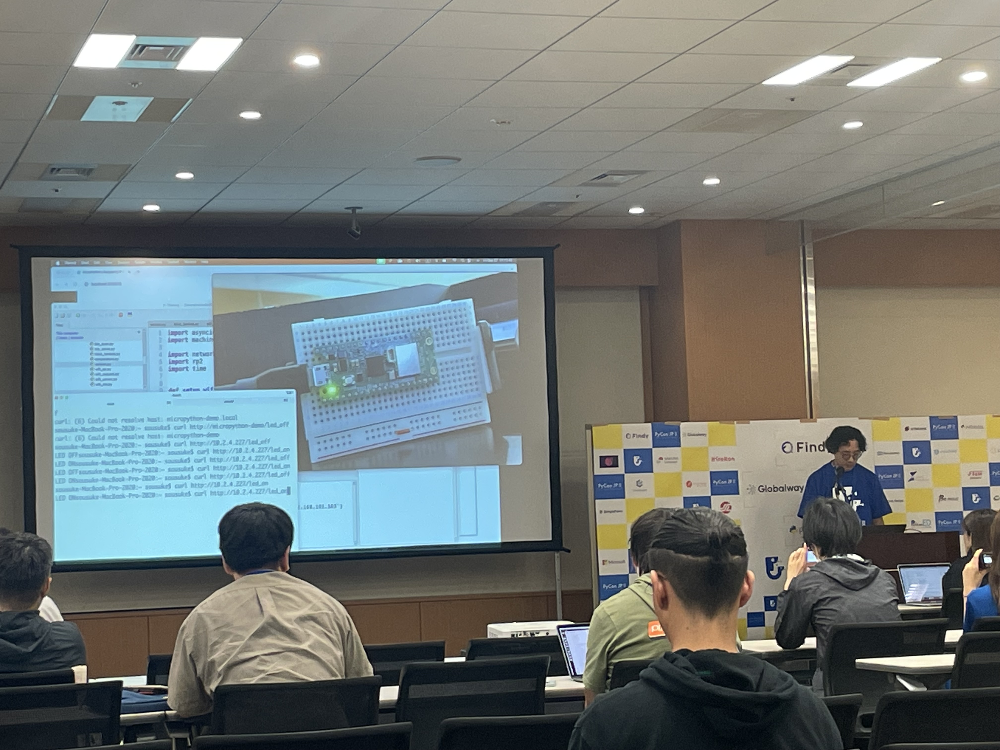
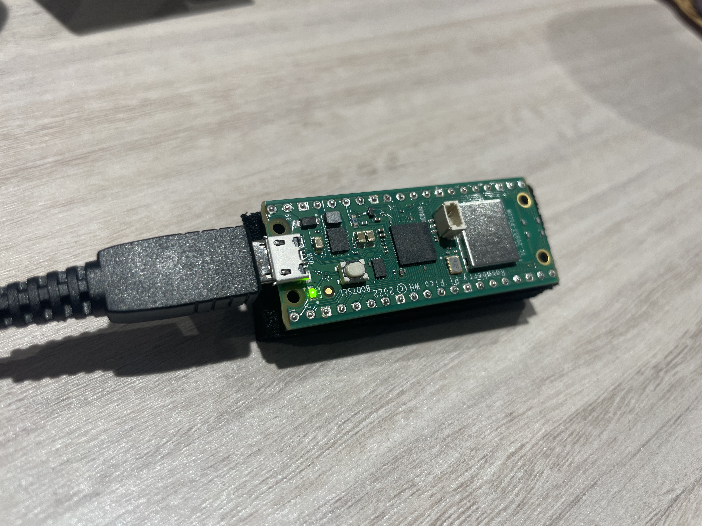
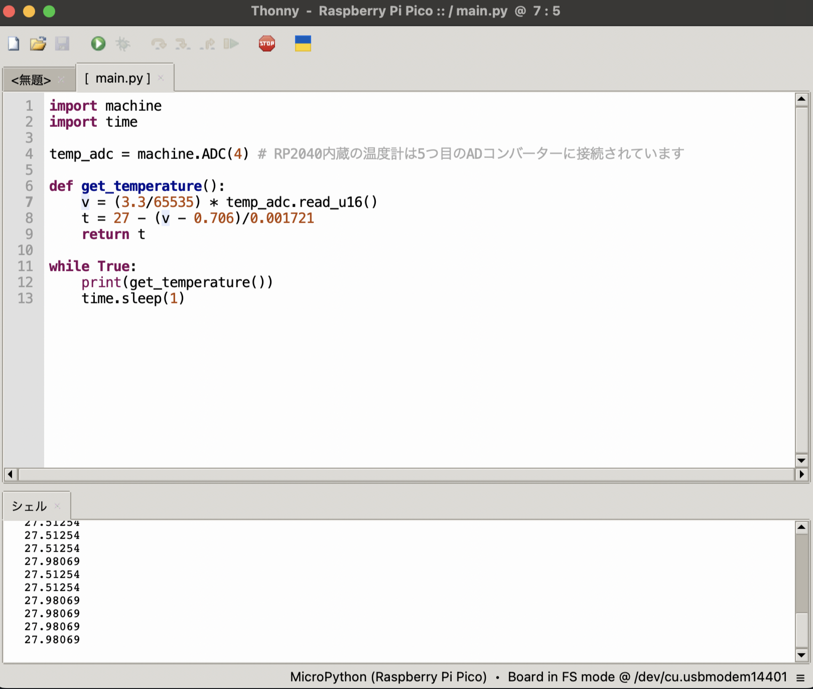
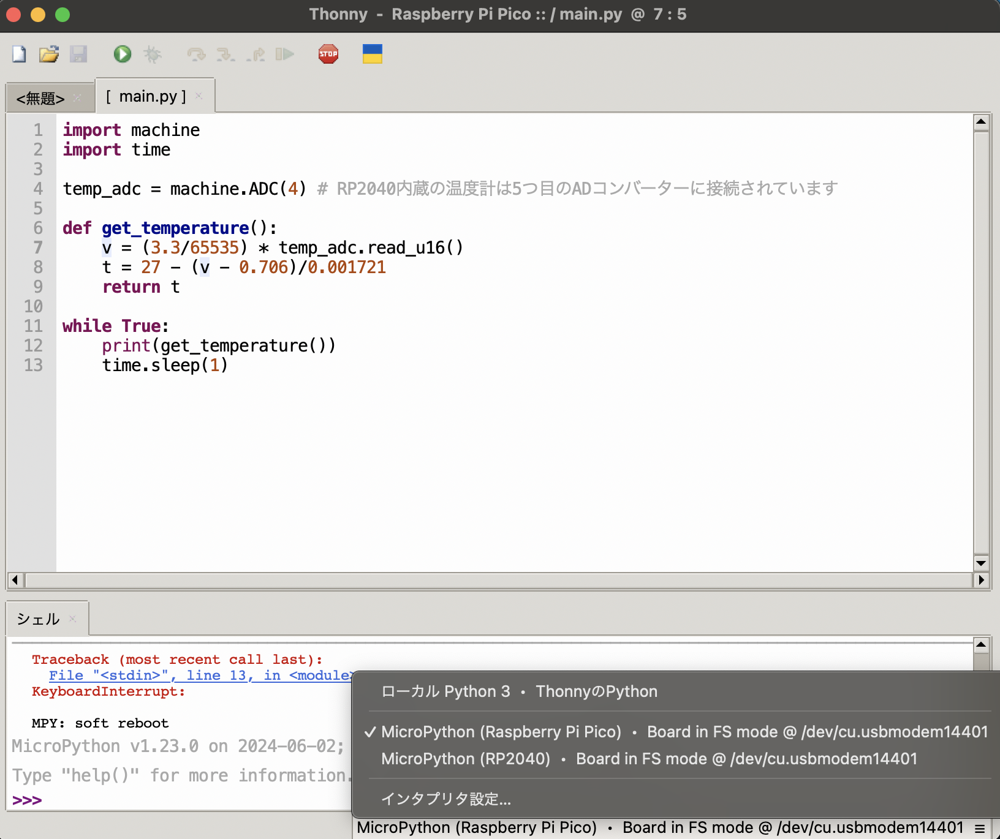

## こんにちは あるいは こんばんは

PyConjp2024に行ってきました！🐾

そこで知ったRaspberry Piの"Hello world"にあたる「Lチカ」を、初心者がスライドを見ながら、ハンズオンをした記録です。

私自身、「Raspberry Piは興味あるけど・・・動かすのは難しいんじゃないかな？」と認識しておりました。
が、セッションにて、スピーカーの皆さんが **「語るにはあまりに時間が足りない！！！」** とおっしゃるほどの熱量で話してくださりました。

**その熱に当てられて、
やってみたくなるのが世の常・・・！**

下記セッションのスライドの始めを参考にさせていただきました！(WiFiはちょっとまだ早かった・・・)
[PyConJP2024公式HP](https://2024.pycon.jp/ja/talk/MJ7GA9)
[該当スライド](https://nkm3.org/raspberry_pi_pico_w_network_slide/1)

実際にやってみて感想と、詰まったところについて書きました。

※なお、PyConjp2024に関する内容が中心ではないため、ご注意ください。

### この記事の対象者

Pythonを少しでも書いたがことある方
Raspberry Piが興味がある方
Raspberry Piを知っているがハードルが高いと感じている方

### Lチカとは

その名の通り、LEDをチカチカさせるという言葉の略称です。
LEDライトを「点灯させるコード」と「消灯させるコード」を交互に書いて実行することを指します。
プログラミング言語を学び始めたとき、画面に「Hello World」を表示させるのと同じ役割を持ちます。

## 環境

**使用機材**

- Raspberry Pi Pico W
- ケーブル（USB Type-A → USB Type-B）情報を渡せるもの

**入れたアプリ**

- [uf2ファイル](https://micropython.org/download/RPI_PICO_W/)
- Thonny

## Lチカ完成!

上記写真のように、付属のLEDライトが点滅することができました。
初めて触るレベルの初心者ですが、次に記載する内容以外は、スライドを参考に進めることができました。
点滅レベルでは、かなり簡単に行うことができます。
また、ケーブルを直接つなげることによって、Raspberry Pi内部のファイルを直接実行することができるため、お手軽に動かせることがわかりました。
今回使ったRaspberry Pi Pico Wは、温度センサーが内蔵されているため、温度を測ることもできました！

時間にすると、半日程度で環境構築や調査をしながら進めることができるという印象です。

## 個人的にハマったところ

### Raspberry PiのファイルをThonnyで開けない！

Thonnyを初めて触った際、使用中のPCからRaspberry Piに変更する方法がわからず、「ファイルがない！」となってしまいました。

写真の右下の部分をクリックすると、接続したいRaspberry Piを選択できます。
選択した後に、「ファイルを開く」ボタンを押すことで、接続が可能になります。

### uf2ファイルをドラッグ&ドロップしたら、「不正なディスクの取り外し」エラー警告が出た！

調べたところ、これは正常な動きのようです。
入れられなかったのかと焦り、何回も試してしまいましたw
正常に入れられてよかったです。
[調べた際の参考URL](https://ameblo.jp/pta55/entry-12657731791.html)

### ケーブルの種類について

ケーブルには、

- 電気を通すだけのもの
- 電気と情報の両方通すもの

があります。ここを間違えると、コードや環境が合っていても光らないということが起こります。
百均のケーブルではなく、ちゃんとデータ送信ができるケーブルを入手してから作業を行ってください。

## まとめ

私個人のRaspberry Piへの第一印象は、機械工学がわからないと何もできない・低レイヤーの物理層について理解しないと話が成立しない印象でした。
今回、「Lチカ」を行い、Pythonで電気をつけることができました。
Pythonが少しわかれば、面白ことが簡単にできると感じました。
しかし、低レイヤーに関してもっと理解があれば
今回は時間の関係上、Wi-Fiなどの接続までは行いませんでしたが、面白そうなので機会があれば試してみたいと思います。
