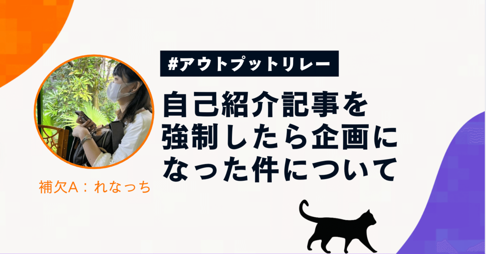

<figure></figure>

このnoteは #アウトプットリレー の2週目の2日目第1グループ補欠です。  
Discordで話聞いてたら、爆速で企画が立ってました。Move Fastですね。

## はじめまして

猫テロのれなっちと、いいます。  
鳥取県民で、妖怪がいっぱいいるところから来ました。  
元栄養士・調理師です。料理スキル カンストしてます。  
得意料理は、牛肉の煮込みとハンバーグです〜  
全て目分量で作れます  
  
コード浮かばない時や疲れた時に喫猫をするのが楽しみです。  
猫が好きです♡最近、Xの有名どころの猫ちゃんが写真だけで判別できるようになった気がします！  
飼い主さんが撮った猫の写真って感情豊かで最高に可愛いですよね！  
怒り顔のイカ耳やびっくりしてる顔も良い！  
最近猫カフェに行けてないので今度行きます！

### なんで、エンジニアになったの？

HTMLやCSSって、変更したらすぐに画面が変わります。  
たのしい・・・  
人の健康はこんなに早く出力しない！  
ちょっとやってみたいと思ったのがきっかけです。  
決して、スタバでPCかっこいい〜って思ったのがきっかけではありません。

### どこで、働いてるの？

仕事は水耕栽培を行っている会社で、Neax.jsを書いています。  
枝豆の成長が早くて照明にぶつかってました。そろそろバジルを収穫させてもらおうと思っています。

### 言語は、TypeScriptです。

TypeScriptは、JavaScriptのスーパーセット言語です。  
はじめは意味がわかりませんでした。

[https://typescriptbook.jp/#typescript%E3%81%AFjavascript%E3%81%AE%E3%82%B9%E3%83%BC%E3%83%91%E3%83%BC%E3%82%BB%E3%83%83%E3%83%88](https://typescriptbook.jp/#typescript%E3%81%AFjavascript%E3%81%AE%E3%82%B9%E3%83%BC%E3%83%91%E3%83%BC%E3%82%BB%E3%83%83%E3%83%88)

> スーパーセットとは、元の言語との互換性を保ちつつ、元の言語を拡張して作った言語のこと。

— サバイバルTypeScript

TypeScriptを書いていると、意味の分かりにくい仕様に出会ったりします。  
理由を辿っていくと「大元の言語は、JavaScriptだからですね」に集約されていきました。  
  
スーパーセットってJavaScriptの良さを引き出すためにあえて緩い仕様にしたり、挙動を合わせている言語という認識になっています（違ったらこっそり教えてください）  
型とは、まだわかりあえていません。急に型迷子になって焦ったりします。

皆さんがよく知ってるRの企業で講師もさせてもらってます。  
お話ししに来てください。  
緊張？？？する相手じゃありませんよ？  
私の時は、「おしゃべりしようかな〜」程度でお越しください

### みんな趣味かいてるなぁ

- ディズニーシーで、ワイワイする(ソアリンやピーターパン等の空飛べる系が好きです。ピーターパンは、妖精の粉で空を飛べます。最高！！！このアトラクションで、幼い時の「ティンカー・ベルの妖精の粉で空が飛びたい！」という、夢が叶って泣きました🧚)
  
- 乗馬🐎　ライセンスとりました〜4級ライセンスほしいな
  
- ハンドメイドや料理をする(和裁洋裁のキャッチアップ済み・料理は一応フルコース的なものを真似事で作れます)
  
- 好きなアニメ
  
  - 小林さんちのメイドラゴン(推しは、小林さんです。かっこいい・・・最高・・・推せる)
  
  - 薬屋のひとりごと(世界観が好き〜薬剤の知識もすき)
  
  - お兄ちゃんはおしまい！(かわいい・癒される)
  
  - ご注文はうさぎですか？(千夜ちゃんがすき)

明日の投稿は おかチーさん([https://note.com/okaka\_c](https://note.com/okaka_c))です！お楽しみに！
