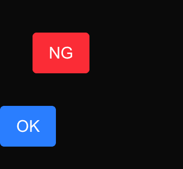
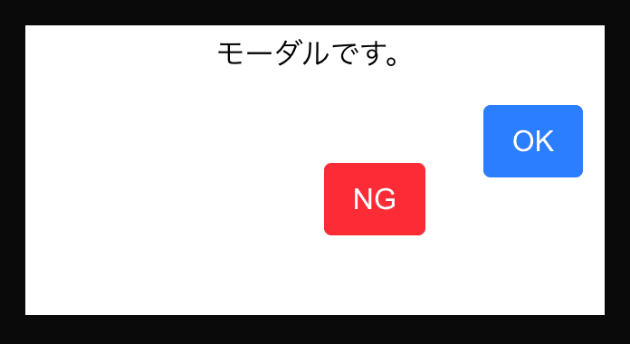
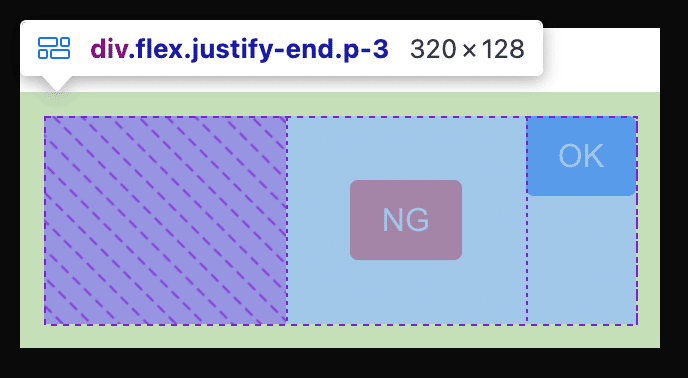
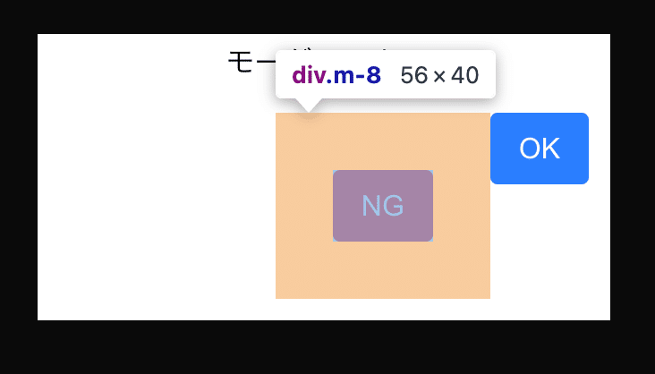

<figure></figure>

DRY原則・YAGNI原則など、〇〇の原則って、いっぱいありますよね  
本や記事に書いてあるのはふわっとした概念の話が多い気がしています  
概念を理解しているつもりに、なっていませんか？  
私はなっていました  
今後同じようなミスを起こさないようにメモっておこうと思います

## 単一責任原則(SRP)とは？

<strong>オブジェクト指向原則</strong>　<strong>SOLID</strong>の一つ  
<strong>単一責任の原則</strong>(SRP: Single Responsibility Principle)

> 「ひとつのクラスにひとつの責務」

— ちょうぜつソフトウェア設計入門

上記のことを指す原則です  
大変シンプルでわかりやすい！  
これは、完全に理解したな・・・ふふふ  
って、思っておりました

## どんなコードで違反してしまったの？

本を読んで「完全に理解した」状態の私はコンポーネント実装の際にこの責務を違反してしまいました  
(実務なので実装内容は、変更してあります🙇)

<strong>開発環境</strong>  
言語：TypeScript  
ライブラリ：React  
フレームワーク：Next.js  
css：TailwindCSS

以下、buttonコンポーネントの実装を例にしていきます  
下のスクリーンショットは、例として作ったコンポーネントをimportして表示してみました  
このスクリーンショットでは、問題点がわかりにくいと思います

<figure><figcaption>単体で表示したもの</figcaption></figure>

NG：赤いボタンのコード

```tsx
const MarginAffectsOuter: React.FC = () => {
  return (
    <div className="m-8">
      <button
        type="button"
        className="bg-red-500 text-white hover:bg-red-600 px-4 py-2 rounded"
      >
        NG
      </button>
    </div>
  );
}

export default MarginAffectsOuter;
```

OK：青いボタンのコード

```tsx
const Button: React.FC = () => {
  return (
    <div>
      <button
        type="button"
        className="bg-blue-500 text-white hover:bg-blue-600 px-4 py-2 rounded"
      >
        OK
      </button>
    </div>
);
};

export default Button;
```

何が問題でしょうか？  
ヒントとして、アトミックデザインではこのコンポーネントはAtomsです  
最も小さいコンポーネントで、<strong>使い回すこと</strong>を想定されています  
このNGの方のコンポーネントは、使い回しやすいでしょうか？

答えはNOです  
実際に、使いまわしてみましょう！

<figure><figcaption>モーダルにボタンを表示してみました</figcaption></figure>

flexによって、buttonを横並びにしてみました  
横並びにしただけなので、横並びになる予定でしたがズレています  
NGの方のボタンは、marginがコンポーネントの一番外のタグに書いてあります  
ここが大変に問題です

<figure><figcaption>buttonをラッピングしているタグのCSS</figcaption></figure>

<figure><figcaption>NGボタンのCSS</figcaption></figure>

コンポーネントのCSSが、importした親コンポーネントのUIに影響を及ぼしています  
Buttonコンポーネントは、<strong>「ボタンとして表示される」ことが責務</strong>です  
表示されている親コンポーネントのデザインは責務に含まれていません  
コンポーネントの外側にmarginが出てしまい、デザインに影響を及ぼしてしまっています  
これは、コンポーネントを使いまわしにくくする原則違反です

<strong>コンポーネントの一番外側のタグに、marginなどの外側に影響を与えるCSSを書くのは避けるべきです</strong>

## 気をつける点は？

React中心でお話しすると、実装しているコンポーネントはなんの機能の責任を持っているかをちゃんと意識することが一番の近道なのですが、  
  
<strong>・・・難しくない？？？  
</strong>  
シンプルでわかりやすいが、実装する際は難しい！  
実装するものの責務がなんなのかをちゃんと見極めて実装できるように努めていきたいと思います

### 参考文献

[https://kyleshevlin.com/no-outer-margin/](https://kyleshevlin.com/no-outer-margin/)

[https://amzn.asia/d/gmOypLE](https://amzn.asia/d/gmOypLE)
