<figure></figure>

[https://pyladies-tokyo.connpass.com/event/362524/](https://pyladies-tokyo.connpass.com/event/362524/)

言語の歴史や各言語への愛に興味津々な れなっちです！  
本日は、非常に興味深いイベントに参加させていただきました！

[https://twitter.com/tomowk1/status/1951507847944286458](https://twitter.com/tomowk1/status/1951507847944286458)

まずは参戦コミュニティと参戦言語についてご紹介いたします！

## 今回集結したコミュニティたち：

Java女子部、GTUG Girls、RustLadies、Women Who Go Tokyo、Snowflake女子会、Joshi.ts、FlutterKaigi girls、PyLadies Tokyo

### そして愛される言語たち：

Java、Rust、C言語、GO、Dart、Python、TypeScript、SQL、CSnakesetc...などなど!

## 登壇内容

### Java Café Break — レガシー豆を最新フレーバーで抽出せよ by.よこな（@ihcomega）

[https://twitter.com/hfslca7439/status/1951505134619709767](https://twitter.com/hfslca7439/status/1951505134619709767)

Javaの印象は？？？

<figure>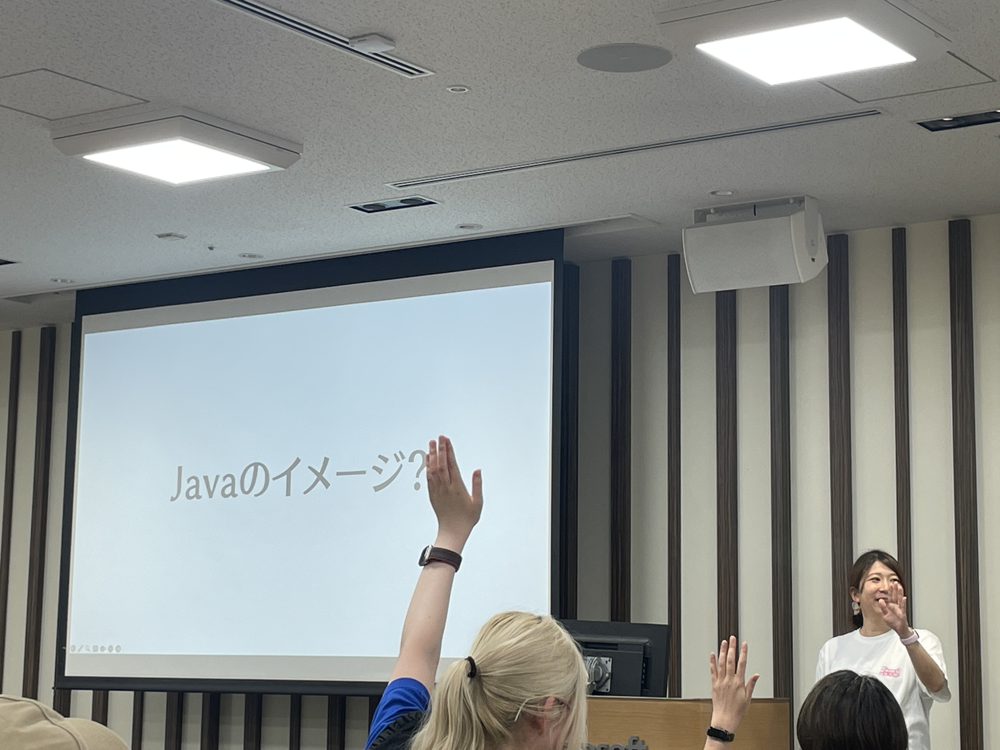<figcaption>ﾌﾙｲｹﾞﾝｺﾞ・・・？？？</figcaption></figure>

Pythonの方が古い↓

[https://twitter.com/\_\_allllllllez\_\_/status/1951501921216532894](https://twitter.com/__allllllllez__/status/1951501921216532894)

後方互換性をかなり大切にしている（スローガン：Write Once, Run Anywhere）

<figure>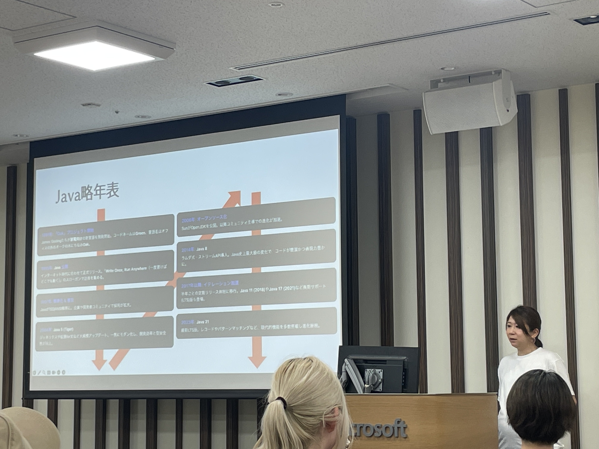</figure>

他の言語と同じで、どんどん書きやすくなっている

[https://twitter.com/yuuun5124/status/1951557506301567470](https://twitter.com/yuuun5124/status/1951557506301567470)

半年に一回バージョンアップ

<figure>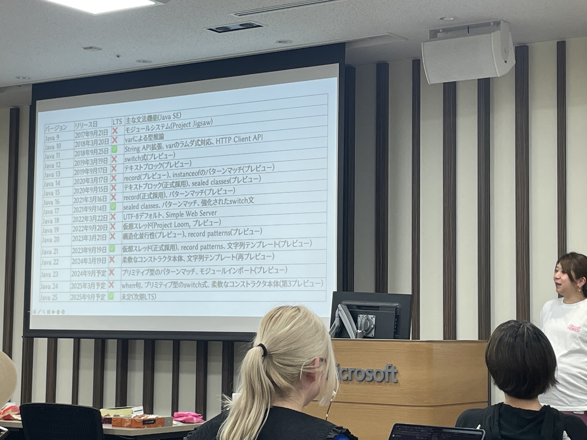</figure>

書き方の歴史 パターンマッチ？かつて見たjavaとは進化しているぞ！  
実際のコードも見せていただきました〜

<figure>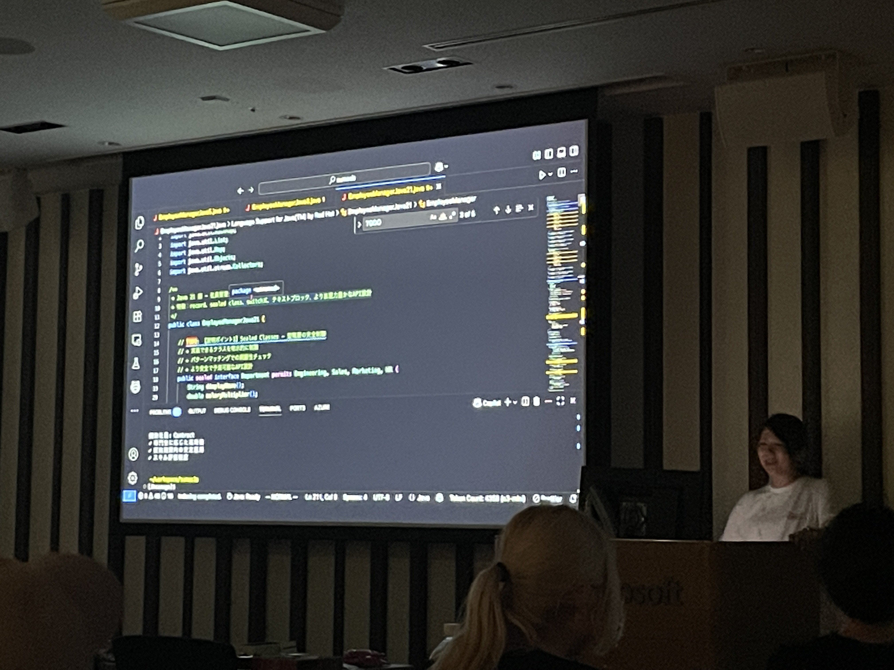</figure>

Javaの関数は、キャメルケース。書き方も言語によって違う！その違いを見つけるのも楽しい〜

[https://twitter.com/topi\_log/status/1951503507149955411](https://twitter.com/topi_log/status/1951503507149955411)

java言語は、作成時にエンジニアがカフェに集まって作っていたらしい。その時に飲んでいたコーヒーの銘柄がjavaだったらしい！

[https://twitter.com/\_\_allllllllez\_\_/status/1951504521613680897](https://twitter.com/__allllllllez__/status/1951504521613680897)

### Rustの歴史完全に理解した by.ふみふみ

[https://twitter.com/hfslca7439/status/1951505300265054504](https://twitter.com/hfslca7439/status/1951505300265054504)

初めて聞く所有権と借用という概念

<figure>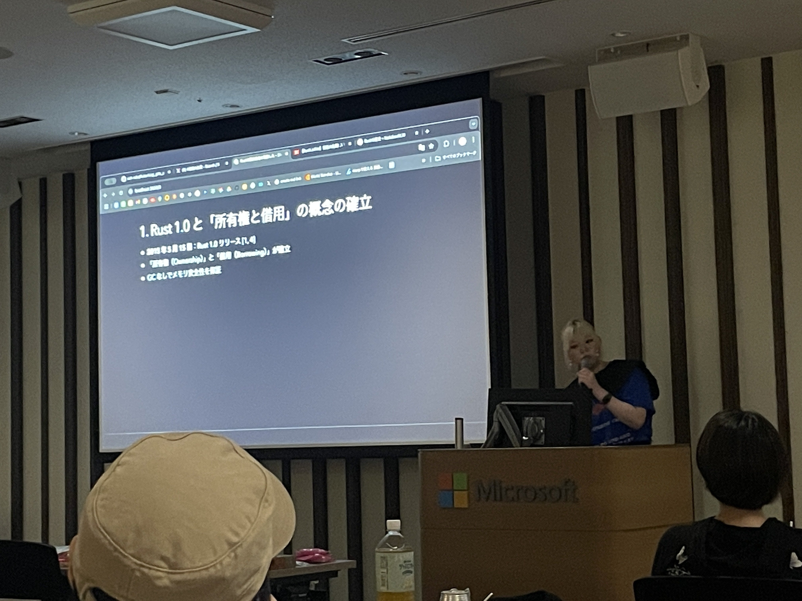</figure>

[https://twitter.com/ihcomega/status/1951505822829379992](https://twitter.com/ihcomega/status/1951505822829379992)

TypeScriptとかより、Rustの方が、型がガチガチ

[https://twitter.com/topi\_log/status/1951505811139862940](https://twitter.com/topi_log/status/1951505811139862940)

2021に非同期処理もできるように  
Rustは、スパダリだ！エラーのヒントが具体性が高い！ヘルプがある！

[https://twitter.com/\_\_allllllllez\_\_/status/1951506694430925193](https://twitter.com/__allllllllez__/status/1951506694430925193)

カニは、非公式キャラ(フェリス)

[https://twitter.com/Kunodayo\_oboete/status/1951507105598627934](https://twitter.com/Kunodayo_oboete/status/1951507105598627934)

Rust気になる方は、ぜひ、次のイベントに！！！

[https://rustladies.connpass.com/event/362014/](https://rustladies.connpass.com/event/362014/)

### さるでもわかるCの歴史（仮） by.@yuzuafro

[https://twitter.com/hfslca7439/status/1951508144687120407](https://twitter.com/hfslca7439/status/1951508144687120407)

登壇してくださった@yuzuafroさんは、純粋なc言語2003~2019年まで17年書いておられたスペシャリスト！

C言語は、1972年にアメリカの「ベル研究所」で誕生  
「C++、Java、C#、Rustなどの多くの言語に影響を与えている」

[https://twitter.com/\_\_allllllllez\_\_/status/1951512623394202044](https://twitter.com/__allllllllez__/status/1951512623394202044)

OSのLinuxカーネル・組み込み機器等に使われている  
安全性を犠牲にして、高レベルの低レベル処理ができる！  
いくらでも危ないプログラミングが書ける！  
安全性を犠牲にして、高速で処理ができる！

[https://twitter.com/micchiebear/status/1951509776963346957](https://twitter.com/micchiebear/status/1951509776963346957)

[https://twitter.com/tomowk1/status/1951510076931580393](https://twitter.com/tomowk1/status/1951510076931580393)

古い言語なので、歴史も長い！  
独占禁止法違反になり、OS化に！これで爆速的に使われるように！  
ISOで標準化されているので、アップデートが少ない

[https://twitter.com/yuuun5124/status/1951510595855147098](https://twitter.com/yuuun5124/status/1951510595855147098)

最近のモダンな言語と比較して、ISO規格に適合・高い後方互換性があるが・・・  
学習がしにくい  
PCのしくみがよくわかる！他の言語が怖く無くなる！

[https://twitter.com/\_\_allllllllez\_\_/status/1951512159093162395](https://twitter.com/__allllllllez__/status/1951512159093162395)

[https://twitter.com/yuzu\_afro/status/1951513931253686769](https://twitter.com/yuzu_afro/status/1951513931253686769)

### これまでのGo by.miki

[https://twitter.com/\_\_allllllllez\_\_/status/1951512882463777044](https://twitter.com/__allllllllez__/status/1951512882463777044)

Gopherには、2つの意味がある！  
・マスコットキャラクターのこと  
・GO言語のエンジニアのこと  
Go PlaygroundでサクッとGOを書ける！実行できる

[https://twitter.com/ihcomega/status/1951513695152156741](https://twitter.com/ihcomega/status/1951513695152156741)

New\_timeを実行すると、GOの公開日時は出る！

<figure>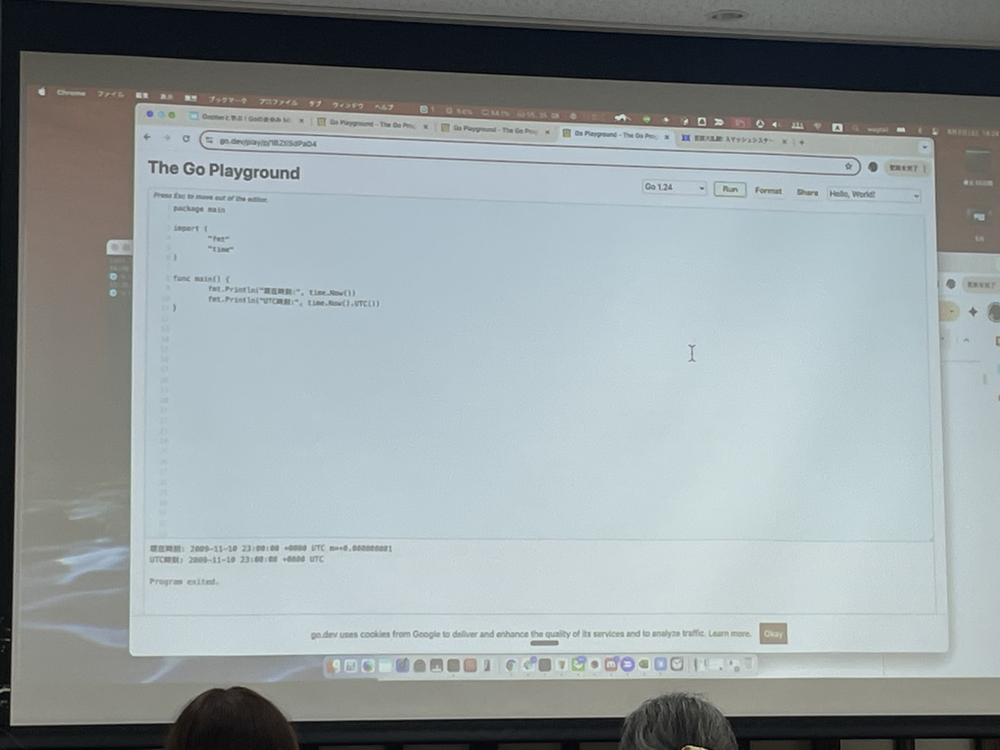</figure>

C言語のコンパイル時間が長い！問題だ！3人の偉人たちの集大成

[https://twitter.com/\_\_allllllllez\_\_/status/1951514873122435474](https://twitter.com/__allllllllez__/status/1951514873122435474)

アップグレードの際に古いコードが動かないことありませんか？GOは、2009のコードが今でも動く

[https://twitter.com/riko111/status/1951515301247590715](https://twitter.com/riko111/status/1951515301247590715)

ジェネリクス2022に登場10年以上検討を重ねて登場

<figure>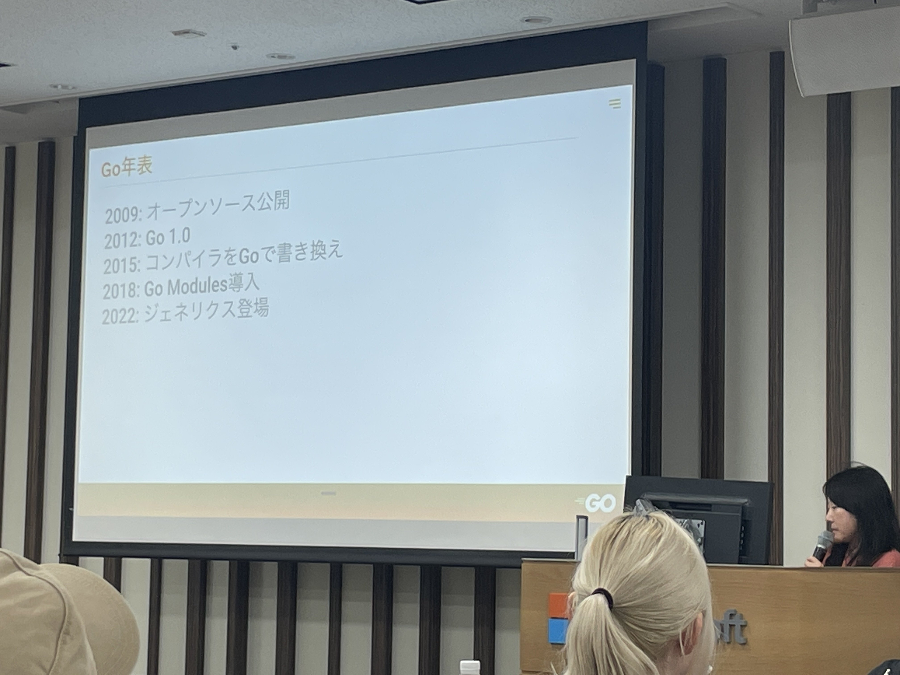</figure>

Dockerは、GOで書かれている

[https://twitter.com/\_\_allllllllez\_\_/status/1951515832120418627](https://twitter.com/__allllllllez__/status/1951515832120418627)

### Dart 参戦！！静的型付き言語界の隠れた実力者 by.kuno

[https://twitter.com/\_\_allllllllez\_\_/status/1951518916825772181](https://twitter.com/__allllllllez__/status/1951518916825772181)

Flutterだけの言語なんでしょう？→そんなことないです！

[https://twitter.com/\_\_allllllllez\_\_/status/1951519218215891023](https://twitter.com/__allllllllez__/status/1951519218215891023)

「Javascriptは、構造的な欠陥がある！」って、宣言して作りました

[https://twitter.com/\_\_allllllllez\_\_/status/1951519427876495722](https://twitter.com/__allllllllez__/status/1951519427876495722)

[https://twitter.com/maaya8585/status/1951519550337589397](https://twitter.com/maaya8585/status/1951519550337589397)

ブラウザ内で動くように開発→失敗・・・AppleやMicrosoftがブラウザに入れてくれないw3cも入れてくれない

<figure>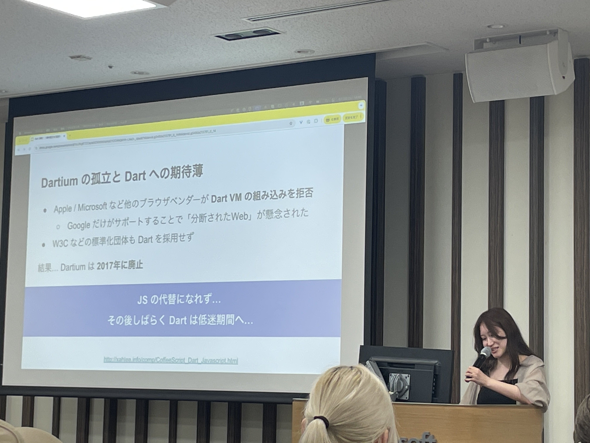</figure>

Dart低迷から、Dart2でFlutter誕生復活

[https://twitter.com/\_\_allllllllez\_\_/status/1951520061413638410](https://twitter.com/__allllllllez__/status/1951520061413638410)

DartでUIをそのままコードとして書いてレンダリングしてブラウザ表示することができるため、ズレない

[https://twitter.com/micchiebear/status/1951520785715306509](https://twitter.com/micchiebear/status/1951520785715306509)

Nullセーフティになりました。Nullダメだよ

[https://twitter.com/\_\_allllllllez\_\_/status/1951521286464913752](https://twitter.com/__allllllllez__/status/1951521286464913752)

[https://twitter.com/Kunodayo\_oboete/status/1951525202468413653](https://twitter.com/Kunodayo_oboete/status/1951525202468413653)

### ここがすごいよPython！超超初心者の私が感動した”やさしさのルーツ” by.Ruka

[https://twitter.com/\_\_allllllllez\_\_/status/1951522085928575452](https://twitter.com/__allllllllez__/status/1951522085928575452)

<figure>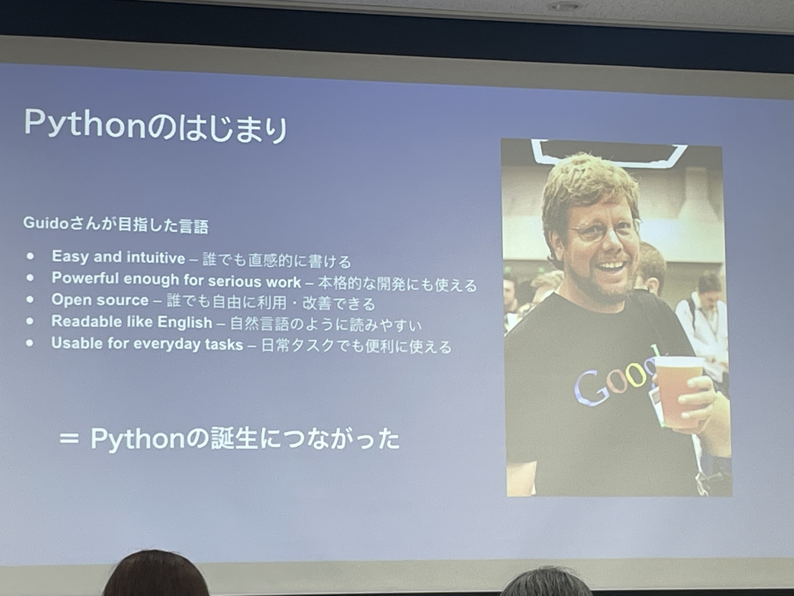</figure>

Pythonは素直に書いたらちゃんと動く  
素人でも読めるし書ける

[https://twitter.com/\_\_allllllllez\_\_/status/1951524465604472953](https://twitter.com/__allllllllez__/status/1951524465604472953)

「プログラミングは、天才の所業でしょ」  
環境構築で躓く・・・みなさん共感されておられました

[https://twitter.com/tomowk1/status/1951522744035844549](https://twitter.com/tomowk1/status/1951522744035844549)

構文が自然言語ぽい  
uvなら環境構築は3行!!!  
pipしか使ってないため、その違いを体験したくなりました！

[https://twitter.com/yuuun5124/status/1951523445541577216](https://twitter.com/yuuun5124/status/1951523445541577216)

Pythonは、優しい言語  
みんなが使いやすくて、みんなが育てる言語

[https://twitter.com/\_\_allllllllez\_\_/status/1951524465604472953](https://twitter.com/__allllllllez__/status/1951524465604472953)

### TypeScript爆誕秘話〜JSに型が生えた旨みとは by.ふみふみ

[https://twitter.com/\_\_allllllllez\_\_/status/1951525670389162031](https://twitter.com/__allllllllez__/status/1951525670389162031)

TypeScriptは、JavaScriptの辛さ解消のため言語  
Microsoftが作成

[https://twitter.com/tomowk1/status/1951526703290859848](https://twitter.com/tomowk1/status/1951526703290859848)

なんで型が必要なの→jsは大規模の開発を想定していなかった  
型チェック＝「事前にバグを検出」  
IDE連携かなり充実

[https://twitter.com/\_\_allllllllez\_\_/status/1951526937312297408](https://twitter.com/__allllllllez__/status/1951526937312297408)

派生が多い。ts＝jsのスーパーセット  
ECMAScriptの進化によりそう  
TC39のFlake８などの設計  
フロント言語では常に上位言語  
anyを使わないといけない時があるが、暗黙の了解でanyをあまり使わないようにする

[https://twitter.com/Kunodayo\_oboete/status/1951528374360588426](https://twitter.com/Kunodayo_oboete/status/1951528374360588426)

### SQLは死なない：クラウド時代の不滅の言語 by.tomo

[https://twitter.com/\_\_allllllllez\_\_/status/1951529468209795161](https://twitter.com/__allllllllez__/status/1951529468209795161)

機械ではなく、人のために生まれた「関係モデル」リレーションモデル

[https://twitter.com/riko111/status/1951529735722508750](https://twitter.com/riko111/status/1951529735722508750)

SQLの論文を発表した人と作った人が違う！

[https://twitter.com/\_\_allllllllez\_\_/status/1951530047954919548](https://twitter.com/__allllllllez__/status/1951530047954919548)

SEQUEL(シーコー:SQL)と、海外では呼ばれてる  
何がしたいかで試せる言語  
選んで・分けて・数えるだけでできる

[https://twitter.com/\_\_allllllllez\_\_/status/1951530639494357033](https://twitter.com/__allllllllez__/status/1951530639494357033)

1999年後半~2000年にインターネットが爆誕→NoSQL等が流行った

[https://twitter.com/\_\_allllllllez\_\_/status/1951530725167210748](https://twitter.com/__allllllllez__/status/1951530725167210748)

クラウドの技術が進化してきて、SQLが再評価  
共通言語でシンプル世界共通！  
SQLだけでAIとも繋がる？

[https://twitter.com/yuuun5124/status/1951531867133583577](https://twitter.com/yuuun5124/status/1951531867133583577)

### CSnakes(Python✖️C# 会場スポンサーLT)

[https://twitter.com/\_\_allllllllez\_\_/status/1951537950581527032](https://twitter.com/__allllllllez__/status/1951537950581527032)

まあやの部屋気になる〜

[https://twitter.com/\_\_allllllllez\_\_/status/1951537161045680293](https://twitter.com/__allllllllez__/status/1951537161045680293)

主流なのが、「いろんな言語を使い分けてシステム構築」  
どうにかして、「一言語で全部やれない」  
今年の5月に生まれた言語！赤ちゃん  
C#のコンパイラーを使用して、Pythonを実行するためのライブラリ

[https://twitter.com/tomowk1/status/1951537952498262473](https://twitter.com/tomowk1/status/1951537952498262473)

IoTで使用できる！

[https://twitter.com/2323\_code/status/1951538337044635787](https://twitter.com/2323_code/status/1951538337044635787)

GitHubにある[CSnakes](https://github.com/tonybaloney/CSnakes)

[https://twitter.com/yuuun5124/status/1951538504015683846](https://twitter.com/yuuun5124/status/1951538504015683846)

GIL問題。3.13から無効化可能に！

[https://twitter.com/Kunodayo\_oboete/status/1951539220486512979](https://twitter.com/Kunodayo_oboete/status/1951539220486512979)

CSnakes (シースネーク)の音が、海蛇ぽいから

[https://twitter.com/2323\_code/status/1951537771761545432](https://twitter.com/2323_code/status/1951537771761545432)

デモの際に、Visual Stadio使用されていました

[https://twitter.com/tomowk1/status/1951539976610652294](https://twitter.com/tomowk1/status/1951539976610652294)

### つくってまなぶgrepコマンド(Flutter ✖️ Rust)

[https://twitter.com/\_\_allllllllez\_\_/status/1951541384084951491](https://twitter.com/__allllllllez__/status/1951541384084951491)

[https://twitter.com/Kunodayo\_oboete/status/1951541497641476138](https://twitter.com/Kunodayo_oboete/status/1951541497641476138)

オプションも作っておられました・・・すごい！

<figure>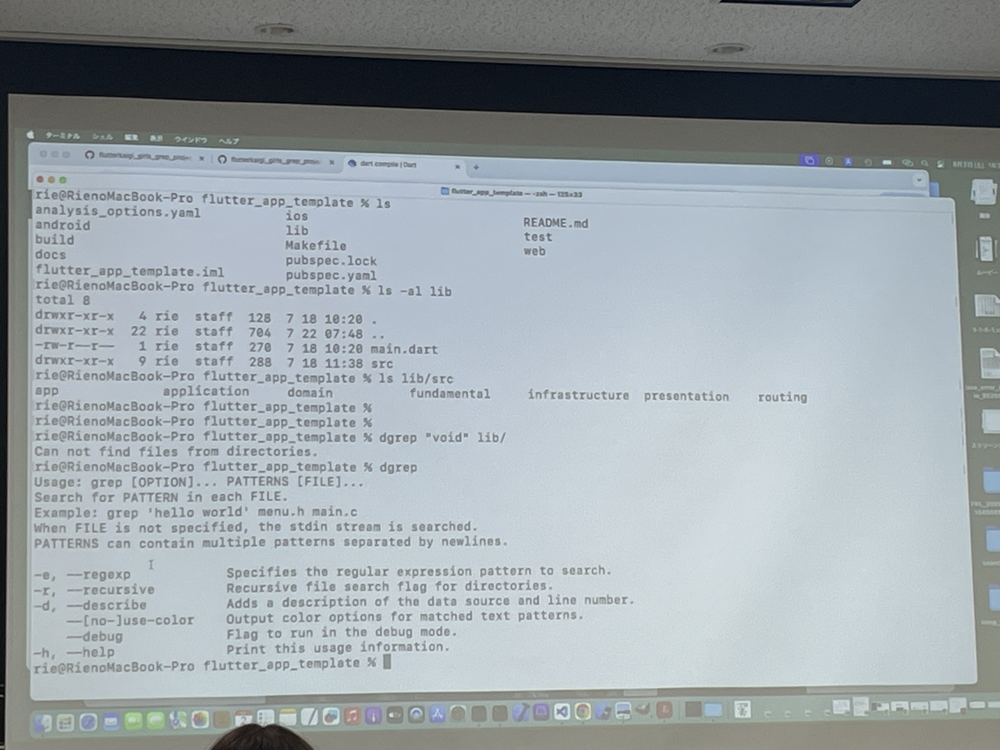<figcaption>オプション一覧</figcaption></figure>

[https://twitter.com/yuka3028/status/1951545425166737914](https://twitter.com/yuka3028/status/1951545425166737914)

Rustの練習帳を参考に作られたそうです

[https://twitter.com/topi\_log/status/1951546814081216724](https://twitter.com/topi_log/status/1951546814081216724)

[https://twitter.com/cch\_robo/status/1951547384095265173](https://twitter.com/cch_robo/status/1951547384095265173)

### Snowflake✖️Go

[https://twitter.com/hfslca7439/status/1951548318720598352](https://twitter.com/hfslca7439/status/1951548318720598352)

[https://twitter.com/hfslca7439/status/1951549197376954681](https://twitter.com/hfslca7439/status/1951549197376954681)

[https://twitter.com/riko111/status/1951549405137608910](https://twitter.com/riko111/status/1951549405137608910)

両者共に相手の印象を伝え合うのにも愛♡を感じました！  
魅力の共有ありがとうございます！

<figure>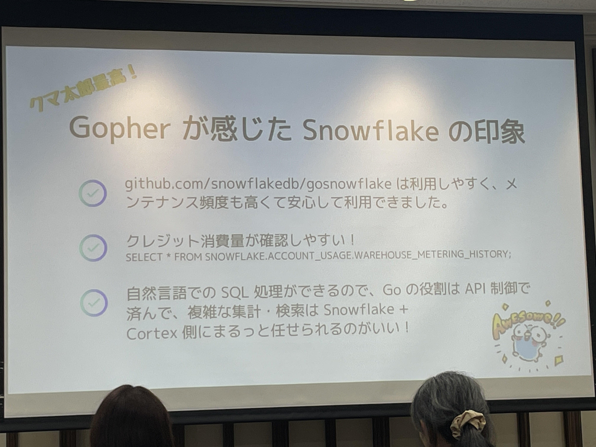</figure>

<figure>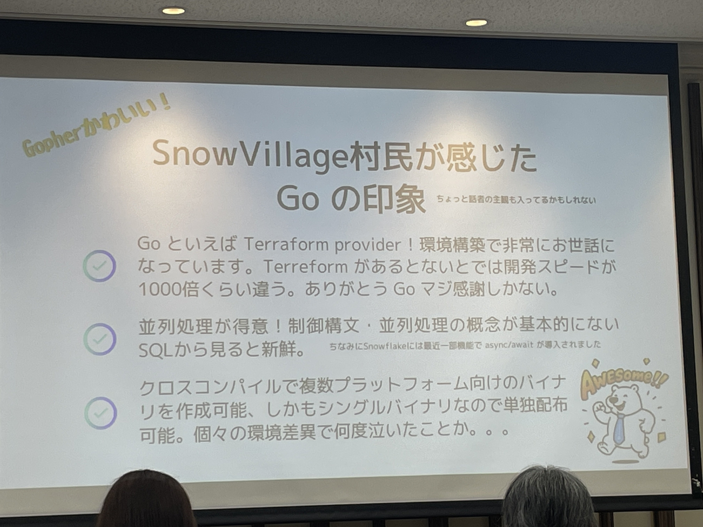</figure>

[https://twitter.com/hfslca7439/status/1951551138832195873](https://twitter.com/hfslca7439/status/1951551138832195873)

可愛いだけじゃない！作り込んだデモも見せていただきました〜

<figure>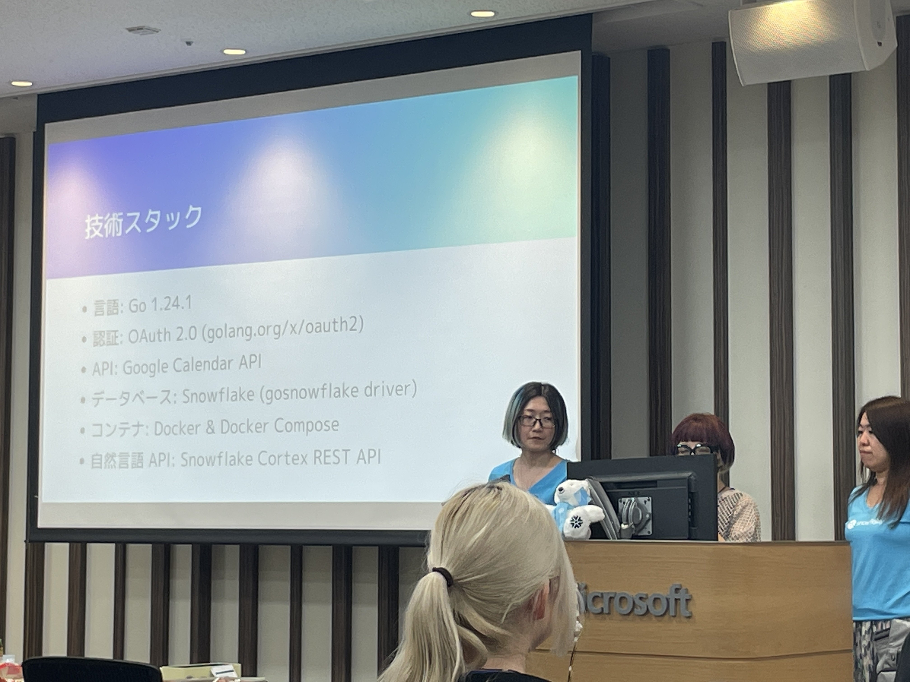</figure>

<figure>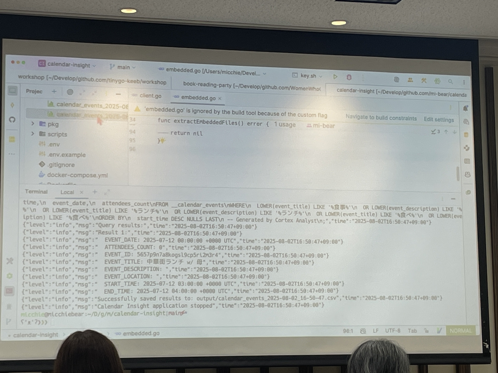<figcaption>コードで実行</figcaption></figure>

<figure>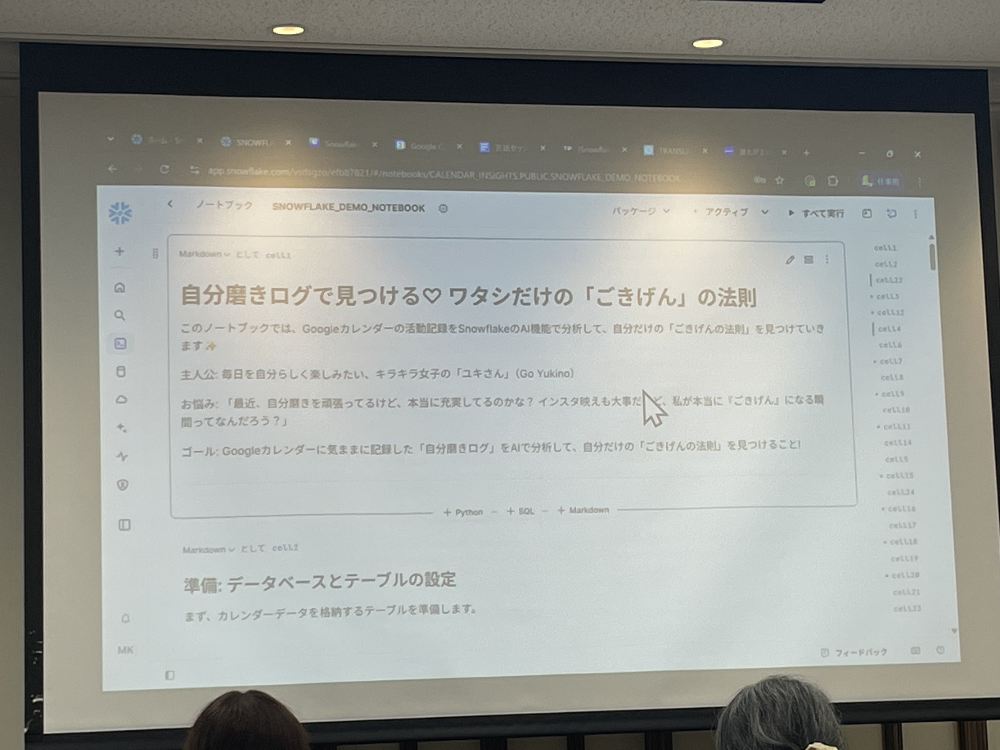<figcaption>ノートブックで実行</figcaption></figure>

### Kotlin✖️Java

[https://twitter.com/\_\_allllllllez\_\_/status/1951553854954414580](https://twitter.com/__allllllllez__/status/1951553854954414580)

私は、Kotlinをフレームワークと勘違いしておりました・・・

[https://twitter.com/hfslca7439/status/1951554057954558274](https://twitter.com/hfslca7439/status/1951554057954558274)

美脚公式キャラクター　kodeeくん

[https://twitter.com/yuuun5124/status/1951554552844656960](https://twitter.com/yuuun5124/status/1951554552844656960)

<figure>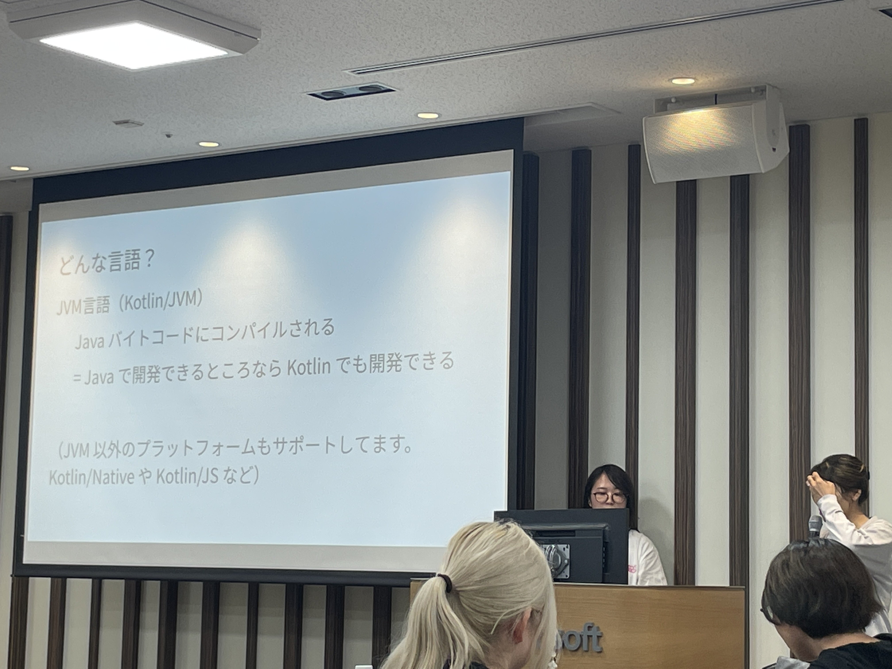</figure>

<figure>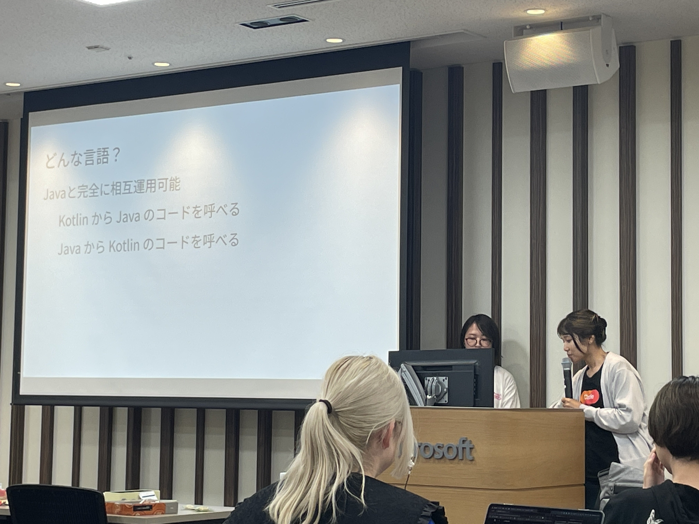</figure>

[https://twitter.com/yuka3028/status/1951555338689474566](https://twitter.com/yuka3028/status/1951555338689474566)

<figure>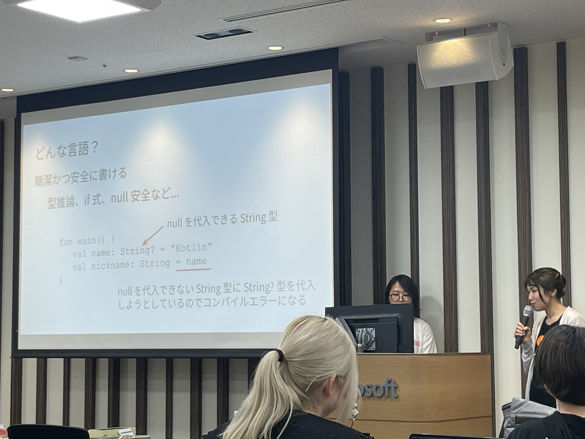<figcaption>nullが代入できると聞いて・・・</figcaption></figure>

[https://twitter.com/topi\_log/status/1951555437872267499](https://twitter.com/topi_log/status/1951555437872267499)

[https://twitter.com/hfslca7439/status/1951556123464704189](https://twitter.com/hfslca7439/status/1951556123464704189)

普段使っている言語と似てる！などの話もちらほら出てきておりました

[https://twitter.com/yuuun5124/status/1951556315165438350](https://twitter.com/yuuun5124/status/1951556315165438350)

[https://twitter.com/yuka3028/status/1951556430320083378](https://twitter.com/yuka3028/status/1951556430320083378)

### イベントの様子と感想

参加者の皆さんから溢れる言語愛を聞いて、心から刺激を受けました！

今日得た学びは、普段使っている言語への見方も変えてくれました。各言語の背景には、開発者の深い思想と情熱が込められている—この事実を知ったことで、言語仕様の変化やアップデートの方向性にも、その哲学が色濃く反映されていることが見えてきました。

この視点を持つことで、これからの学習がより意味のあるものになりそうです！

[https://twitter.com/\_\_allllllllez\_\_/status/1951616765374661010](https://twitter.com/__allllllllez__/status/1951616765374661010)

[https://twitter.com/maaya8585/status/1951607448693027123](https://twitter.com/maaya8585/status/1951607448693027123)

[https://twitter.com/tomowk1/status/1951629724364759174](https://twitter.com/tomowk1/status/1951629724364759174)

[https://twitter.com/minn\_flutter/status/1951583703710478395](https://twitter.com/minn_flutter/status/1951583703710478395)

[https://twitter.com/shinseitaro/status/1951568698365694043](https://twitter.com/shinseitaro/status/1951568698365694043)

[https://twitter.com/\_\_allllllllez\_\_/status/1951561794104733704](https://twitter.com/__allllllllez__/status/1951561794104733704)
