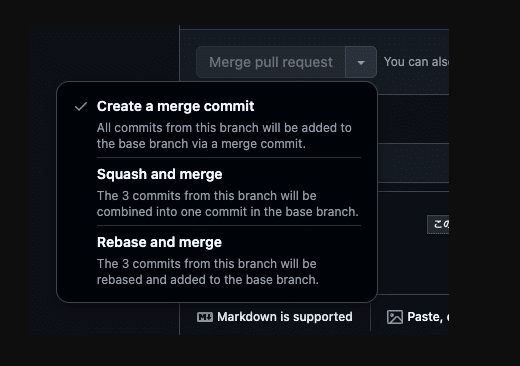

自分用のメモ！

## GitHubのマージ機能って３種類あんねん

<figure><figcaption>GitHub公式のMarge選択トグル</figcaption></figure>

mergeが選択できることは、なんとなく知っていたけど、それ以上のことを知らなかったのでメモ  
いい記事いっぱいあったから詳しくは他の記事参考

[https://qiita.com/ko-he-8/items/94e872f2154829c868df](https://qiita.com/ko-he-8/items/94e872f2154829c868df)

### git fetch --pruneも一緒に使えば、treeが綺麗保てる

「Rebase and merge」を使った場合に、残った元のbranchを

```bash
% git fetch --prune
```

で削除することができます。

> 削除済みのリモートブランチの追跡ブランチを削除できます。

[https://qiita.com/P-man\_Brown/items/8b4d408a99068975857e](https://qiita.com/P-man_Brown/items/8b4d408a99068975857e)

<strong>これで、マージ先のbranchを一本にしてtreeを綺麗に保つことができます。</strong>

[https://docs.github.com/ja/repositories/configuring-branches-and-merges-in-your-repository/configuring-pull-request-merges/about-merge-methods-on-github](https://docs.github.com/ja/repositories/configuring-branches-and-merges-in-your-repository/configuring-pull-request-merges/about-merge-methods-on-github)

## dockerのエラーは、コマンドで確認するとかっこよ

### 覚えておきたいdockerのコマンドメモ

私は、dockerのログをGUIで確認する派なのですが、コマンドで確認するとかっこいいことがわかったので、dockerのコマンドの整理も兼ねてここに記載

<strong>log確認</strong>

```bash
// dockerのlog確認コマンド
% docker compose logs <サービス名>
```

[https://qiita.com/takaikeee12/items/b0bace8b5dcbc8560ab3](https://qiita.com/takaikeee12/items/b0bace8b5dcbc8560ab3)

<strong>イメージの削除</strong>

```bash
// imagesの一覧表示
% docker images

// イメージの削除
% docker rmi -f <イメージ名　or イメージID>

// 未使用のDockerイメージを削除するコマンド
% docker images prune
```

<strong>dockerのコンテナ一覧</strong>

```bash
// dockerのコンテナ一覧
% docker ps

// すべてのdockerのコンテナ一覧(起動中＋停止中)
% docker ps -a
```

[https://qiita.com/RyoSakon001/items/6b7f2b49d517f8dfbb3a](https://qiita.com/RyoSakon001/items/6b7f2b49d517f8dfbb3a)

## MySQLのpasswordは、空も可能(ローカルの話)

私の固定観念で、MySQLをdocker環境で作成する時にpasswordをちゃんと設定しないといけないと思っていました。  
こんな感じに

```text
// compose.yml
   services:
    db:
     environment:
       TZ: Asia/Tokyo
       MYSQL_ROOT_PASSWORD: password
```

まさか空が許されているなんで・・・

```text
// compose.yml
   services:
    db:
     environment:
       TZ: Asia/Tokyo
       MYSQL_ROOT_PASSWORD: ""
```

しかも、rootに入れちゃうなんて！  
自分だけで、開発してデプロイしない場合とか、純粋にSQLを使用したいだけとかで、使えそうかな？

> root アカウントのパスワードが空の場合、MySQL のインストールは保護されません: 誰でも root パスワードなしとして MySQL サーバーに接続でき、すべての権限を付与できます。

[https://dev.mysql.com/doc/refman/8.0/ja/default-privileges.html](https://dev.mysql.com/doc/refman/8.0/ja/default-privileges.html)

<strong>ちなみに</strong>

PostgeSQL 9.3.18から、空パスワードを許していないそうです

[http://opendolphin.motomachi-hifuka.jp/2017/09/postgres-9318-b.html](http://opendolphin.motomachi-hifuka.jp/2017/09/postgres-9318-b.html)

<strong>GitHubで仮パスワードも管理したくない時</strong>

.env　→　ignoreに書いておく。  
.env.exampleにベースを用意して、.env作成。  
作成した時に、適当なパスワードを入力。パスワードは個人で管理する。  
ここまでしてからSQLを作る(上記の場合は、dockerのコンテナを作成すると、個人の.envに記載されたpassで入ることができる)  
([ansible](https://qiita.com/Brutus/items/1894629105d61f4854bc)を呼べる際は、呼ぶのもあり)

## 新しいことをしてる時こそ"YAGNI原則"を忘れない

仕事で、ejsをvueにリファクタリングしています。  
初めてvueをキャッチアップして、コンポーネントを小さくわかりやすくしようと意気揚々と仕事につきました。  
  
でも、Atomic Designは今回の案件には採用されていません。  
また、今後デザインがかなりわかりそうな予感・・・  
会議中に知ったことを整理して、私が思い出したのが、この題の「YAGNI原則」でした。

> 必要なときがくるまで、余計なコードを書くのはやめよう。

[https://zenn.dev/jimon/articles/f250216fa4c831#yagni%E5%8E%9F%E5%89%87](https://zenn.dev/jimon/articles/f250216fa4c831#yagni%E5%8E%9F%E5%89%87)

今は、スピードが最優先です。  
コードを綺麗にわかりやすく、vue公式ようにするよりも<strong>今必要な部品</strong>を<strong>今必要な大きさ</strong>で、組み込んでいくのがいいと判断しておこなっています。
