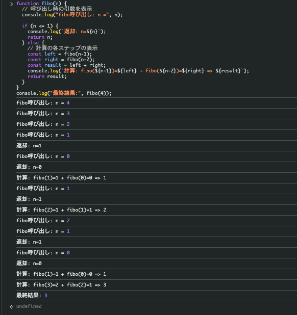

<figure></figure>

このnoteは #アウトプットリレー です。  
昨日の投稿はRUNTEQ60期のたかさんでした！👉️こちら（[https://note.com/taka\_11926/n/ne16f8a240570](https://note.com/taka_11926/n/ne16f8a240570)）

「自分の欲しい情報だけとれるツール作成」や「実行方法の自動化」など自分に必要なものを勉強のために作っておられるのがとても楽しそうで読んでいてわくわくする記事でした！

最近読んでいる本([Effective TypeScript](https://www.oreilly.co.jp/books/9784814401093/))の影響を受けて、再帰関数について話していこうと思います！  
100%の理解まで行っていないことを認識しています。愛あるツッコミをよろしくお願いします🐾

## 今回のゴールは？

- 再帰関数について「完全に理解」できる
  
- コピペで実行できる

## 再帰関数(さいきかんすう)とはなんぞや？

簡単にいうと、

> 「自分自身を呼び出す処理が書かれている関数のこと」

— [https://wa3.i-3-i.info/word14900.html](https://wa3.i-3-i.info/word14900.html)

引用させていただいている「「分かりそう」で「分からない」でも「分かった」気になれるIT用語辞典」さんの説明は、本当にわかりやすいので一度みてください。

## 実際に再帰処理を実行してみよう！

JavaScriptは、検証画面のコンソールで実行することができます。  
以下のコードをコピーして、実行してみましょう！

```js
function fibo(n) {
  if (n <= 1) {
    return n;
  } else {
    return fibo(n-1) + fibo(n-2);
  }
}
console.log(fibo(4));
```

フィボナッチ数の4番目の「3」が出力されたと思います。  
このコードではどんな風に計算されているのでしょうか？  
「console.log()」を追加して実行してみましょう！

```js
function fibo(n) {
  // 呼び出し時の引数を表示
  console.log("fibo呼び出し: n =", n);
  
  if (n <= 1) {
    console.log(`返却: n=${n}`);
    return n;
  } else {
    // 計算の各ステップの表示
    const left = fibo(n-1);
    const right = fibo(n-2);
    const result = left + right;
    console.log(`計算: fibo(${n-1})=${left} + fibo(${n-2})=${right} => ${result}`);
    return result;
  }
}
console.log("最終結果:", fibo(4));
```

下記、スクリーンショットのような出力値になると思います。

<figure><figcaption>実行時の出力値</figcaption></figure>

```text
// 処理のネストは下記の感じ。入力値が4なのにかなりネストもしてるし、処理もしています。

fibo(4)
├─ fibo(3)
│   ├─ fibo(2)
│   │   ├─ fibo(1) → 1
│   │   └─ fibo(0) → 0
│   └─ fibo(1) → 1
└─ fibo(2)
    ├─ fibo(1) → 1
    └─ fibo(0) → 0
```

4番目のフィボナッチ数は確認が取れました！  
100番目とか気になりませんか？実行してみましょう！  
(上記は空間計算量を表しています。)

> 空間計算量：アルゴリズムが必要とする追加のメモリ量  
>
> O(n)=アルゴリズムが必要とする追加のメモリ量が入力のサイズと同じだけの新しい配列を作っているのがわかります

— [https://qiita.com/oharu121/items/5c124e4c9eca284976b4](https://qiita.com/oharu121/items/5c124e4c9eca284976b4)

<strong>注意：一旦記事を読み切ってから、ご自身の責任でおこなってください</strong>

```js
function fibo(n) {
  if (n <= 1) {
    return n;
  } else {
    console.log(fibo(n-1));
    return fibo(n-1) + fibo(n-2);
  }
}
console.log(fibo(100));
```

ブラウザからの応答がなくなりました・・・(本当にやらかしました)

<figure><figcaption>応答してくれなくなったブラウザ</figcaption></figure>

再帰呼び出しは、自身を呼び出します。そのため、指数的に呼び出し回数が多くなります。  
ブラウザが最大コールスタックサイズを超えてしまい、スタックオーバーフローを起こしてしまったようです。  
入力値4の際の処理の流れを見る感じ、入力値100だと途方もないネストになることが想定つきます。

> スタックオーバーフロー：プログラムの実行中にスタックメモリの割り当て量を超えてしまう現象のことです。

— [https://trends.codecamp.jp/blogs/media/terminology348](https://trends.codecamp.jp/blogs/media/terminology348)

> スタック（stack）メモリーとは関数の引数や戻り値、ローカル変数に関数の呼び出し元へ戻るためのアドレスを保存するために用いられます。

— [https://www.kumikomist.com/embedded/stack-memory/](https://www.kumikomist.com/embedded/stack-memory/)

> This is one of the most critical JavaScript errors that can completely crash your application and sometimes freeze the browser tab.  
> “Maximum call stack size exceeded” appears when JavaScript recursive functions consume all available memory in the browser’s call stack, typically indicating infinite recursion or extremely deep function calls.

— [https://trackjs.com/javascript-errors/maximum-call-stack-exceeded/](https://trackjs.com/javascript-errors/maximum-call-stack-exceeded/)

これでは、<strong>フィボナッチ数の100番目を知ることができません！</strong>

## 末尾再帰(まつびさいき)ってなんぞや？

本に出てきた「末尾再帰」を使用すると、うまくいくようです。  
本当かどうか検証してみましょう！

末尾再帰を簡単にいうと、

> 自身の再帰呼び出しが、その計算における最後のステップになっているような再帰のパターンのこと

— [https://ja.wikipedia.org/wiki/%E6%9C%AB%E5%B0%BE%E5%86%8D%E5%B8%B0#:~:text=%E6%9C%AB%E5%B0%BE%E5%86%8D%E5%B8%B0%EF%BC%88%E3%81%BE%E3%81%A4%E3%81%B3%E3%81%95%E3%81%84%E3%81%8D,%E5%91%BC%E3%81%B3%E5%87%BA%E3%81%97%E3%82%92%E6%9C%AB%E5%B0%BE%E5%91%BC%E3%81%B3%E5%87%BA%E3%81%97%E3%81%A8%E3%81%84%E3%81%86%E3%80%82](https://ja.wikipedia.org/wiki/%E6%9C%AB%E5%B0%BE%E5%86%8D%E5%B8%B0#:~:text=%E6%9C%AB%E5%B0%BE%E5%86%8D%E5%B8%B0%EF%BC%88%E3%81%BE%E3%81%A4%E3%81%B3%E3%81%95%E3%81%84%E3%81%8D,%E5%91%BC%E3%81%B3%E5%87%BA%E3%81%97%E3%82%92%E6%9C%AB%E5%B0%BE%E5%91%BC%E3%81%B3%E5%87%BA%E3%81%97%E3%81%A8%E3%81%84%E3%81%86%E3%80%82)

ネストの数が減るらしいと認識しています。  
が、説明では、<strong>再帰のパターン</strong>と書いてあるためネストしているのでは？  
結果そんなに変わるの？  
という疑問がでてきました。

## 実際に末尾再帰を実行してみよう！

以下のコードブロックをコピーして、検証画面のコンソールで実行してみてください。  
PCがMacの場合は、Safariで行うことをおすすめします。  
Chromeでも挙動確認しています。

<strong>実行した瞬間に結果が出力</strong>されたと思います。

```js
function fiboTailRec(n, a = 0, b = 1) {
  if (n === 0) return a;
  if (n === 1) return b;
  return fiboTailRec(n - 1, b, a + b);  // 末尾で再帰
}
console.log(fiboTailRec(100));
```

どうしてこんなに早くなるのでしょうか？  
処理の工程を見ていきましょう。  
入力値を4にして書いていきます。

```text
fiboTailRec(4, 0, 1)
↓
fiboTailRec(3, 1, 1)
↓
fiboTailRec(2, 1, 2)
↓
fiboTailRec(1, 2, 3)
```

上記の計算では、ネストがなくなり計算処理が直線で進みます。  
小さく分割して、計算結果を次に渡しながら、スタックを消費せずに計算できているのが確認取れました。

> 空間計算量：アルゴリズムが必要とする追加のメモリ量  
>
> O(1)=アルゴリズムが必要とする追加のメモリ量が変数1個だけ使う → 定数メモリを作っているのがわかります

— https://qiita.com/oharu121/items/5c124e4c9eca284976b4

## 最後に

これであなたも再帰関数・末尾再帰について多分「完全に理解」できましたね！

明日の投稿は ふぁらおさん([https://note.com/mochimochi\_farao](https://note.com/mochimochi_farao))です！お楽しみに！
