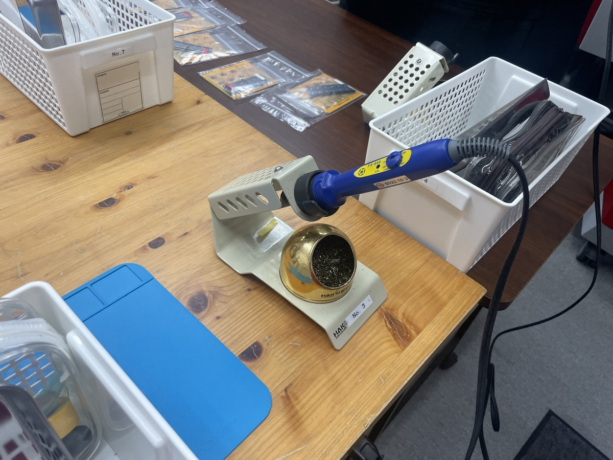
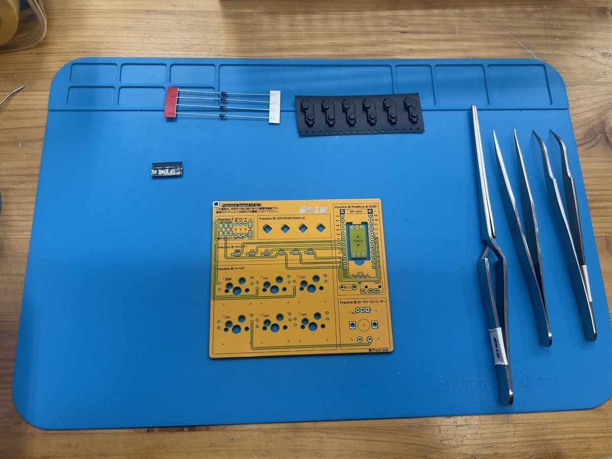
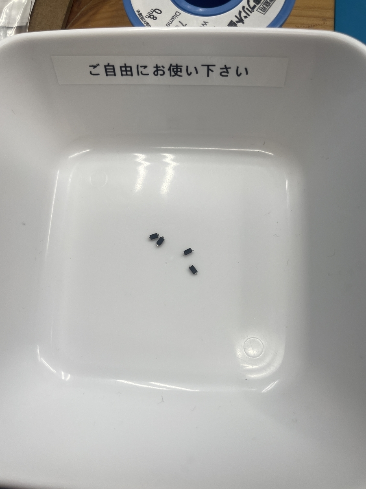
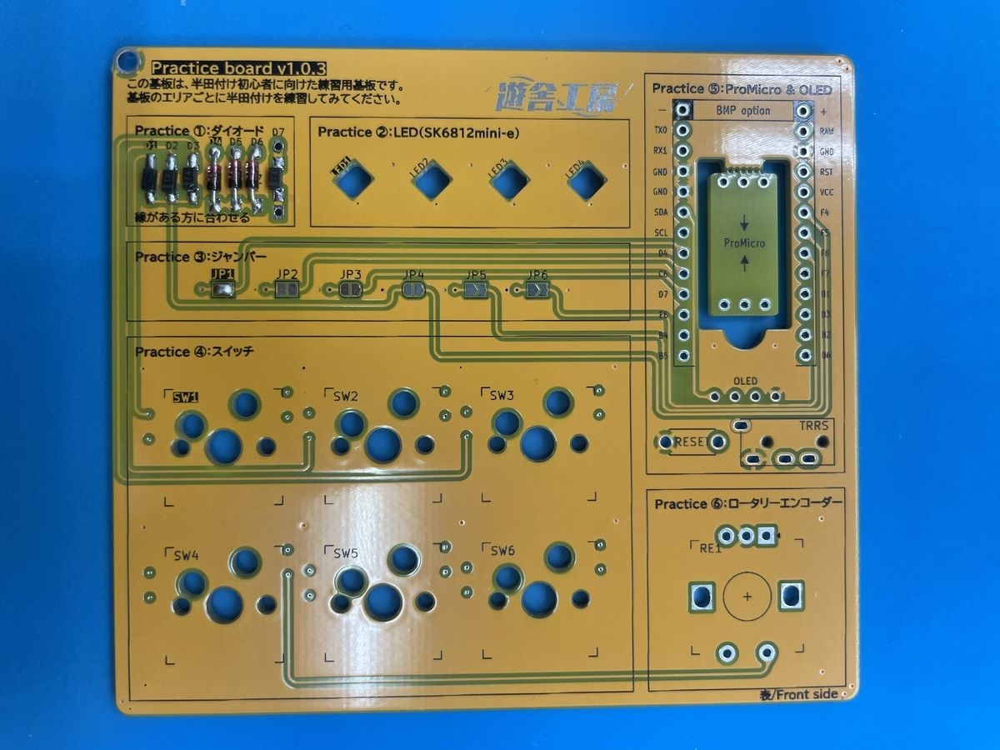
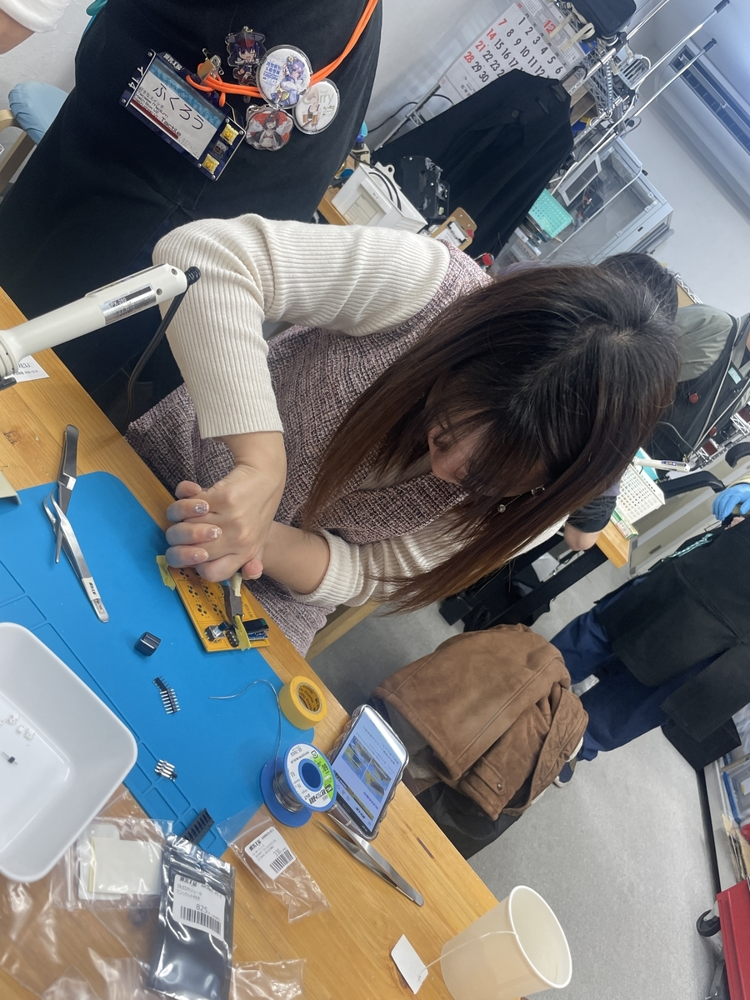
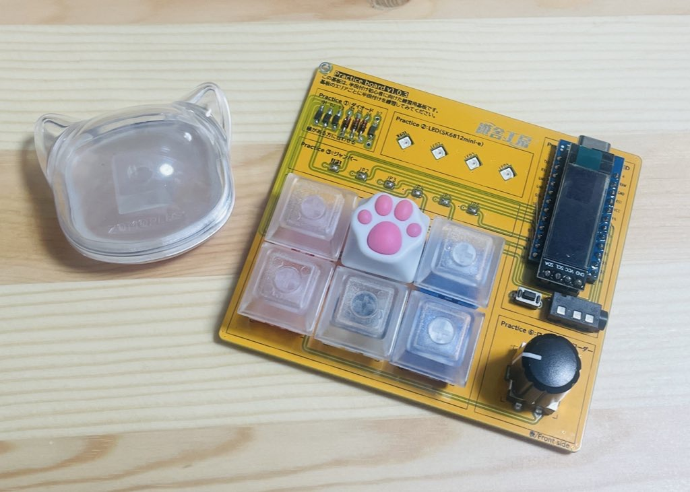
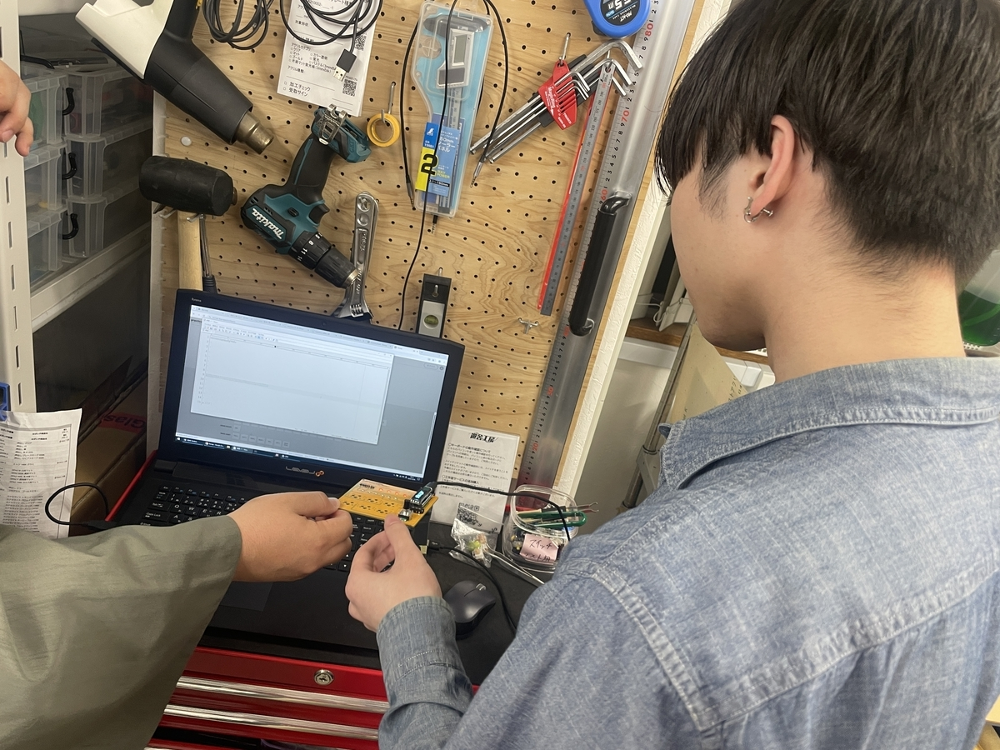

## why

- 弊社の上長が、センサーの半田付けを行っていてどんなものかを知りたかったから
- ハントメイドや調理など作るのか好きなのでやってみたかった
- キーボード作る？？？とは？？？と思っていたため

### 実際にやってみた

友達数人と半田付けを(キーボードを探しに)行ってきました

タイトルにもある通り、初めてのことなので、「はんだ付け講習」をおすすめしていただき行いました！



これがハンダゴテ・・・

<figure></figure>

会社では見たことあるけど触るのは初めて・・・ コンセントを指してすぐにコテ先が320度になるため、周りもちょっと暖かくなることに気がつきました！

今回の基盤

<figure><figcaption>基盤</figcaption></figure>

会社にはあるけど、自分が触ってなにかするのは初めてです。 何もついていない基盤はただの鉄板みたい でも、線が書いてあってここに電気が通りそう！

最初は下の「ダイオード」を取り付けました！ 写真の通りでめっちゃ小さい！ 「『T4』と書いてあるのでそれを確認してください！」と言われて確認するも全然見えなくて困惑

<figure><figcaption>ダイオード</figcaption></figure>

じっくり見て、光の反射を遮って確認してから慎重に取り付けました！

<figure><figcaption>取り付けたダイオード</figcaption></figure>

最初は半田が固まる速度が早く、ダイオードがうまく取り付けられないのを繰り返しながらちゃんと取り付けられました！（教えていただいた方が都度確認してくださるのもありがたかったです！）

不必要な部品を切る作業が結構力が入りました。飛ばないように、マスキングテープで固定して切りました。

<figure><figcaption>真剣</figcaption></figure>

あとは、練習用に切れている回路を繋げたり、LEDライトを取り付けたり、マイコンを差し込んだり・・・して、 完成しました！

<figure><figcaption>完成！</figcaption></figure>

最後に、回路が正しく繋がっているか。キーボードがちゃんと動作するかの確認も一緒に行っていただき無事に終了しました。

<figure><figcaption>回路がちゃんと繋がっているかの確認</figcaption></figure>

### 半田付け楽しい〜〜〜〜〜！！！

半田付けが楽しいことはわかりました。 ただ、座学的に半田を知らなかったため、調べてみました！

<strong>半田付け</strong>とは、「電気電子回路を組み立てるためになくてはならない技術」「加熱された材料の間にはんだを流し込み、材料を溶かして変形させることなく接合すること」



半田を溶かして、回路の切れた部分繋げる作業を行いました。ちょっと、半田を溶かして繋げてやるだけで電気が通るのがかなり不思議でした。 「合金層」を作ることによって、電流が通るんだな〜へぇ〜 上記のURLの説明はわかりやすくてよかったです。 借りた「はんだごて」は少し高級品でしたw

一緒に行った友達の記事



\-----
