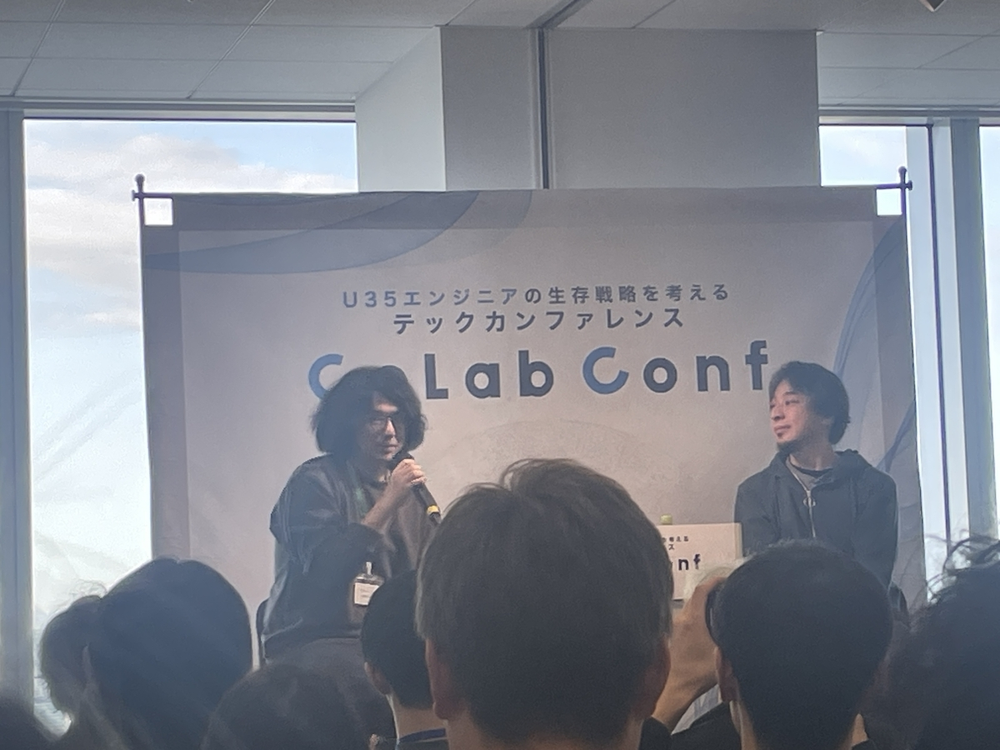

これは私の備忘録です！  
メモ書きベースのところがありますが、お許しください〜

タイムテーブルは下記URL↓  
[【！タイムテーブル公開！】CoLab Conf（コラコン）【U35限定テックカンファレンス】 - connpass](https://supporterz-seminar.connpass.com/event/371963/)

<figure><figcaption>オープニングセッション！</figcaption></figure>

## why

Ruby開発者の「まつもとゆきひろ」さんがおられたから  
ゲストが豪華だったから  
友達が運営だったから

↓わかる！アベンジャーズすぎるw

> IT業界のアベンジャーズって言われてるの笑う[#コラコン](https://twitter.com/hashtag/%E3%82%B3%E3%83%A9%E3%82%B3%E3%83%B3?src=hash&ref_src=twsrc%5Etfw) [pic.twitter.com/jhjohJpm6g](https://t.co/jhjohJpm6g)

— マグロ🍣MOIWDay2 (@sigumataityouda) [2025年12月13日](https://twitter.com/sigumataityouda/status/1999677273562316835)

## オープニングセッション　ひろゆきとmizchiが考える、U35エンジニアの生存戦略

ファンミのようなオープニングセッションから楽しくはじまりました。  
もっとお堅いのかなと思っていたので、最初からリラックスして聞けるようになりありがたかったです！

<figure><figcaption>オープニングセッション！</figcaption></figure>

- AIを使うやコードを書くだけではだめ。他のノウハウがある人は食いっぱぐれない
- ひろゆきさんは、時間を使わないで返答するのが好き
- なくなってしまう言語はある。ユーザー数による。消えない言語をやって方がいい。(低レイヤー知識は必要じゃないかもしれない。ひろゆきさんはした方がいいと思うけど。)
- 誰でもできる仕事はもしかしたら残るかもしれない。人間が慣れたものは全てwebに変更するよりも物理的な電話機のボタンの方がいい(使われる)。人間インターフェースが必要。日本は他の国より既存のものを残したいのもがある。
- 非合理の人たちの気持ちを理解している(多くのお金持っているおっさん・おばさん等をどう騙していくか)
- パフォーマンスが上がる→co2削減の方がわかりやすい(経営層に話が分かりやすい・わかってもらいやすい)
- エンジニアリング以外のお金のことを学ぶ
- ひろゆきさんは、あくまでも手段派。リファクタリングよりも書き換える方がいい。
- プロダクトベースの方がお金を稼ぎやすい→稼ぐところにいいエンジニアは集まる。
- <strong>売り上げは全てを癒す！</strong>
- 手を動かすかどうか(興味があるものにリソースや時間を突っ込むこと)
- ちょこちょこ作ってしまう
- 大企業が行かないサービス。金で買えないものをコワにおく。法律上は大丈夫。モラル的にどうなの？な、ところにお金を稼げる機会がある
- 他人が何をみているかを気にするのが、日本人。ランキングやまとめサイトは日本にしかない
- 勝手に使われることに慣れないといけない。勝手に炎上する時代。規制は無理。
- 無敵な人(ブログでひろゆきさんが作った言葉・ブログは、自分で書いている)
- ベイビーシャーク

## 安野貴博が目指す日本の未来、エンジニアの未来

> 「最近転職しまして」w強すぎる  
> goが書いてあるTシャツきてらっしゃる？  
> [#コラコン](https://twitter.com/hashtag/%E3%82%B3%E3%83%A9%E3%82%B3%E3%83%B3?src=hash&ref_src=twsrc%5Etfw)

— ふみふみ (@2323_code) [2025年12月13日](https://twitter.com/2323_code/status/1999694953300263122)

> .[@takahiroanno](https://twitter.com/takahiroanno?ref_src=twsrc%5Etfw) さんに [#コラコン](https://twitter.com/hashtag/%E3%82%B3%E3%83%A9%E3%82%B3%E3%83%B3?src=hash&ref_src=twsrc%5Etfw) 質問🙋  
>
> Q. 議席拡大まで時間がかかる。どう影響拡大する？  
>
> ・提供OSSツール利用者(他党)の拡大  
> ・党首投票が1票差。少数政党も影響力がある状況  
>
> Q. マイナンバー活用  
>
> 公的給付金のボトルネックが全銀ネットの振込回数上限にある。継続的に提言(一例[#コラコン](https://twitter.com/hashtag/%E3%82%B3%E3%83%A9%E3%82%B3%E3%83%B3?src=hash&ref_src=twsrc%5Etfw)

— ShuzoN / CARTA 技術広報 (@ShuzoN__) [2025年12月13日](https://twitter.com/ShuzoN__/status/1999713518556459291)

> 「AI時代ってゲームの構造変わる瞬間。  
> どういうことかというと、経験（U35）にとって、やろうと思えばチャンスが掴める。チャンスは無限にあるが、今までと同じことをしている人は前より悪いみたいになってしまうかも。今までと違うアクションをとってみて、学びをとってみてください！」  
>
> [#コラコン](https://twitter.com/hashtag/%E3%82%B3%E3%83%A9%E3%82%B3%E3%83%B3?src=hash&ref_src=twsrc%5Etfw)

— ふみふみ (@2323_code) [2025年12月13日](https://twitter.com/2323_code/status/1999706592154124727)

> 投票アルゴリズムの最適化検証のお話面白いな[#コラコン](https://twitter.com/hashtag/%E3%82%B3%E3%83%A9%E3%82%B3%E3%83%B3?src=hash&ref_src=twsrc%5Etfw)

— 0yu (@yud0uhu) [2025年12月13日](https://twitter.com/yud0uhu/status/1999706343654195276)

> 質問  
> 「選挙について、アプリで投票できるようにならないか」  
>
> 回答  
> 「やった方がいいと思うし、技術障壁はあるができると思う。ただ、投票方式を変えると陰謀論が蔓延りやすくなり不正選挙を謳いやすくなる。ただ、ネット投票できるようになると投票アルゴリズムも変えやすい。民主主義。」[#コラコン](https://twitter.com/hashtag/%E3%82%B3%E3%83%A9%E3%82%B3%E3%83%B3?src=hash&ref_src=twsrc%5Etfw)

— 合同会社そうじゃバード🐣 (@soja_bird_llc) [2025年12月13日](https://twitter.com/soja_bird_llc/status/1999706263287161139)

マイナンバーに紐付いた口座にpushしない理由が、「システムが間に合っていない」が意外と知られていない！

> 「システムが間に合ってない」で対象者に対して一日の上限が足りないケースあるんだ [#コラコン](https://twitter.com/hashtag/%E3%82%B3%E3%83%A9%E3%82%B3%E3%83%B3?src=hash&ref_src=twsrc%5Etfw)

— あきら (@connect0459) [2025年12月13日](https://twitter.com/connect0459/status/1999704155951366465)

> 全銀ネット、でたわね[#コラコン](https://twitter.com/hashtag/%E3%82%B3%E3%83%A9%E3%82%B3%E3%83%B3?src=hash&ref_src=twsrc%5Etfw)

— いかねこ@3丁目待機 (@xi_kax) [2025年12月13日](https://twitter.com/xi_kax/status/1999703971599122614)

> 外に出たくない！！！  
> お家で政策を見比べながら投票したい！！！  
> それはそう。[#コラコン](https://twitter.com/hashtag/%E3%82%B3%E3%83%A9%E3%82%B3%E3%83%B3?src=hash&ref_src=twsrc%5Etfw)

— いかねこ@3丁目待機 (@xi_kax) [2025年12月13日](https://twitter.com/xi_kax/status/1999705385368977745)

> 質問  
> 「少子化についてのデジタルな解決策はあるか」  
>
> 回答  
> 「原因は"有配偶率の減少"と"有配偶出生率の減少”の2つ。まず、”有配偶率の向上”には経済困窮の改善、次に”0人→1人”にするには不妊治療への誘導、次に”1人→2人”にするには経済困窮の改善、というのが大事。」[#コラコン](https://twitter.com/hashtag/%E3%82%B3%E3%83%A9%E3%82%B3%E3%83%B3?src=hash&ref_src=twsrc%5Etfw)

— 合同会社そうじゃバード🐣 (@soja_bird_llc) [2025年12月13日](https://twitter.com/soja_bird_llc/status/1999702735017681073)

> [https://t.co/tRZ81ZVVIv](https://t.co/tRZ81ZVVIv)  
>
> [#コラコン](https://twitter.com/hashtag/%E3%82%B3%E3%83%A9%E3%82%B3%E3%83%B3?src=hash&ref_src=twsrc%5Etfw)

— nao (@philosophy_note) [2025年12月13日](https://twitter.com/philosophy_note/status/1999698764316180568)

> [https://t.co/KD2NqIVWed](https://t.co/KD2NqIVWed)  
> [#コラコン](https://twitter.com/hashtag/%E3%82%B3%E3%83%A9%E3%82%B3%E3%83%B3?src=hash&ref_src=twsrc%5Etfw)

— 🍅( '-' 🍅)ｱｶﾎｼｨ (@akahoshi_1421) [2025年12月13日](https://twitter.com/akahoshi_1421/status/1999701703596400788)

> Q. 少子化についてテクノロジーでどう解決しようと思っていますか [#コラコン](https://twitter.com/hashtag/%E3%82%B3%E3%83%A9%E3%82%B3%E3%83%B3?src=hash&ref_src=twsrc%5Etfw) [pic.twitter.com/J7k1AN0GBt](https://t.co/J7k1AN0GBt)

— ふみふみ (@2323_code) [2025年12月13日](https://twitter.com/2323_code/status/1999702426639827394)

> ・一時情報は大事  
> ・変なやつエミュレータを作る  
> ・普段から他者になりきって相手の言うこと想像しながら会話してみる [#コラコン](https://twitter.com/hashtag/%E3%82%B3%E3%83%A9%E3%82%B3%E3%83%B3?src=hash&ref_src=twsrc%5Etfw)

— こやす / こやちゃん (@_koyasoo) [2025年12月13日](https://twitter.com/_koyasoo/status/1999705383376683066)

## Matzだけど何か質問ある？

> [#コラコン](https://twitter.com/hashtag/%E3%82%B3%E3%83%A9%E3%82%B3%E3%83%B3?src=hash&ref_src=twsrc%5Etfw)  
> Matz さんだ！ [pic.twitter.com/VIECLMhpnv](https://t.co/VIECLMhpnv)

— 猫テロのれなっち (@hfslca7439) [2025年12月13日](https://twitter.com/hfslca7439/status/1999718151932772849)

Matzさんは、東京が嫌いw  
絶対に会いにきてくれるだろうなぁ(元鳥取県民)

> Matzさん、島根でオープンソース開発してたら市長や県知事が会いにきたw  
> [#コラコン](https://twitter.com/hashtag/%E3%82%B3%E3%83%A9%E3%82%B3%E3%83%B3?src=hash&ref_src=twsrc%5Etfw)

— Kei Yonekawa (@kei_y0614) [2025年12月13日](https://twitter.com/kei_y0614/status/1999713197197263300)

主体的に地方に住んで、自分の特技で1番になる

> Matz「東京には仕事がありそうだからみたいな曖昧な理由でやってる人はもっと人生を真剣に考えてください（意訳）」  
> 仕事がありそうだなと思って引っ越したワイ「はい…」[#コラコン](https://twitter.com/hashtag/%E3%82%B3%E3%83%A9%E3%82%B3%E3%83%B3?src=hash&ref_src=twsrc%5Etfw)

— Masa (@_masa6272) [2025年12月13日](https://twitter.com/_masa6272/status/1999713788258582651)

> MatzさんはEmacsでパースしやすい言語としてRubyを作ったが、今もし新しく言語をデザインするなら？  
> 面白い質問だ〜[#コラコン](https://twitter.com/hashtag/%E3%82%B3%E3%83%A9%E3%82%B3%E3%83%B3?src=hash&ref_src=twsrc%5Etfw)

— 0yu (@yud0uhu) [2025年12月13日](https://twitter.com/yud0uhu/status/1999713923097108685)

今新しい言語を作るなら、特定のもののための言語を作る

> Matzさん「今言語を作るなら汎用的な言語でなく、特定の目的のための言語がいいんじゃないか」  
> [#コラコン](https://twitter.com/hashtag/%E3%82%B3%E3%83%A9%E3%82%B3%E3%83%B3?src=hash&ref_src=twsrc%5Etfw)

— Kei Yonekawa (@kei_y0614) [2025年12月13日](https://twitter.com/kei_y0614/status/1999714459703705635)

- RubyがC言語と違うため、言語処理系の授業をとっていたのに、あんまり覚えていなくてRuby用のコンパイラーを作るのが大変だった
- 新しい言語を作ってみようと思うのなら、プログラミング言語を作る系の記事のサンプルコードから始めて、ちゃんと使える言語にするにはどうしたらいいかを考えたらいいんじゃないかな？
- AIには体がないから、要求がない。人間は「どんな問題を解決するべきか」「何が嬉しいか」を考える
- AIは、ばぐを見つけるのが下手くそ
- RSSリーダーを最近AIのみで作った！

> 組み込み向けRuby[https://t.co/MvgONzsC3G](https://t.co/MvgONzsC3G)  
> [#コラコン](https://twitter.com/hashtag/%E3%82%B3%E3%83%A9%E3%82%B3%E3%83%B3?src=hash&ref_src=twsrc%5Etfw)

— 🍅( '-' 🍅)ｱｶﾎｼｨ (@akahoshi_1421) [2025年12月13日](https://twitter.com/akahoshi_1421/status/1999711548403749002)

言語のコミュニティは今後みんなを言語沼・技術沼に誘い込まないといけないらしい👀

> 技術沼に引き摺り込む  
>
> コード書く方が楽しいぞぉ〜〜  
> [#コラコン](https://twitter.com/hashtag/%E3%82%B3%E3%83%A9%E3%82%B3%E3%83%B3?src=hash&ref_src=twsrc%5Etfw)

— 猫テロのれなっち (@hfslca7439) [2025年12月13日](https://twitter.com/hfslca7439/status/1999718759381238267)

お茶目な方だぁ！

> [#コラコン](https://twitter.com/hashtag/%E3%82%B3%E3%83%A9%E3%82%B3%E3%83%B3?src=hash&ref_src=twsrc%5Etfw)  
>
> 「〇〇の言語には、あの機能があるから〜」  
>
> Matz さん『それはあなたの感想ですよね？」

— 猫テロのれなっち (@hfslca7439) [2025年12月13日](https://twitter.com/hfslca7439/status/1999719433175203894)

コミュニティの邪魔にならないようにする。モチベーションが全て！

> モチベーションを阻害してはいけない  
> 刺さる[#コラコン](https://twitter.com/hashtag/%E3%82%B3%E3%83%A9%E3%82%B3%E3%83%B3?src=hash&ref_src=twsrc%5Etfw)

— たぁさん (@taasan_r32) [2025年12月13日](https://twitter.com/taasan_r32/status/1999718536445649400)

> コミニュティはモチベーションがすべて  
> →その気持ちを阻害するようなことはしないようにしている[#コラコン](https://twitter.com/hashtag/%E3%82%B3%E3%83%A9%E3%82%B3%E3%83%B3?src=hash&ref_src=twsrc%5Etfw)

— 0yu (@yud0uhu) [2025年12月13日](https://twitter.com/yud0uhu/status/1999718574638924260)

> Rubyのような安定期の言語は、変更するの大変  
> [#コラコン](https://twitter.com/hashtag/%E3%82%B3%E3%83%A9%E3%82%B3%E3%83%B3?src=hash&ref_src=twsrc%5Etfw)  
>
> 「冒険するなら最初のうちに〜〜」

— 猫テロのれなっち (@hfslca7439) [2025年12月13日](https://twitter.com/hfslca7439/status/1999720341233631652)

> 質問したのやっぱりmizchiさんだった[https://t.co/dqWtD2Hp7U](https://t.co/dqWtD2Hp7U)  
>
> [#コラコン](https://twitter.com/hashtag/%E3%82%B3%E3%83%A9%E3%82%B3%E3%83%B3?src=hash&ref_src=twsrc%5Etfw)

— nao (@philosophy_note) [2025年12月13日](https://twitter.com/philosophy_note/status/1999720400079692280)

> Matzさんのお話初めて聞いたけど、すごくアサーティブな方なんだな、という印象だった  
>
> 純粋に何かが好きで熱中できる人は、人それぞれの「好き」があることをわかっているから、他者の「好き」も尊重できるのかな  
> [#コラコン](https://twitter.com/hashtag/%E3%82%B3%E3%83%A9%E3%82%B3%E3%83%B3?src=hash&ref_src=twsrc%5Etfw)

— さこ (@sako__n) [2025年12月13日](https://twitter.com/sako__n/status/1999722997264109646)

言語にissue作る際は、なんでそのissueを作成したのか。背景や原因をちゃんと伝えるといい。どんな技術的課題があって、その課題を解決するためにissueを作成したのかを伝えるといいらしい

> streem？  
> 探してみよう  
> [#コラコン](https://twitter.com/hashtag/%E3%82%B3%E3%83%A9%E3%82%B3%E3%83%B3?src=hash&ref_src=twsrc%5Etfw)

— yasunori🫖@loglass🐳 (@YKirin0418) [2025年12月13日](https://twitter.com/YKirin0418/status/1999714406415114656)

## AI時代のエンジニアリング-大規模案件で見えたAI活用実践知-

大規模案件でAIを使用すると溢れる  
情報の洪水がおきる👀

自動化プログラムをAIにやらせる。プログラムコードは、何回実行してもプロンプロを消耗しない。少しの手直しで使用することができる！

> AIにしようすると溢れる  
>
> 発想の転換！  
>
> 変換するプログラムの作成をAIにやらせる  
> [#コラコン](https://twitter.com/hashtag/%E3%82%B3%E3%83%A9%E3%82%B3%E3%83%B3?src=hash&ref_src=twsrc%5Etfw) [pic.twitter.com/ssR5HruNQi](https://t.co/ssR5HruNQi)

— 猫テロのれなっち (@hfslca7439) [2025年12月13日](https://twitter.com/hfslca7439/status/1999750831562981848)

> [#コラコン](https://twitter.com/hashtag/%E3%82%B3%E3%83%A9%E3%82%B3%E3%83%B3?src=hash&ref_src=twsrc%5Etfw)  
>
> 言語の壁  
> 高そう…  
> AI翻訳強い… [pic.twitter.com/bKBqwJfifM](https://t.co/bKBqwJfifM)

— 猫テロのれなっち (@hfslca7439) [2025年12月13日](https://twitter.com/hfslca7439/status/1999752250206597201)

> 人でもAIでも扱い切れる大きさにしてあげる [#コラコン](https://twitter.com/hashtag/%E3%82%B3%E3%83%A9%E3%82%B3%E3%83%B3?src=hash&ref_src=twsrc%5Etfw) [pic.twitter.com/7974CgxJuN](https://t.co/7974CgxJuN)

— 猫テロのれなっち (@hfslca7439) [2025年12月13日](https://twitter.com/hfslca7439/status/1999753423949050254)

## AI時代のソフトウェア開発を考える

> [#コラコン](https://twitter.com/hashtag/%E3%82%B3%E3%83%A9%E3%82%B3%E3%83%B3?src=hash&ref_src=twsrc%5Etfw)  
> twadaさんの講演聴いて試したいこと  
>
> ・AIに疑問を質問する形式はよくやってたけど、要望を伝えた上でAIから自分に質問させる形式は今まで意識してやってなかったからやってみたい。  
>
> ・AIに批判的レビュアーの人格を与えてレビューさせる  
> →その手があったか！って感じです

— Reono (@reono_game) [2025年12月13日](https://twitter.com/reono_game/status/1999808083913232489)

AIによって、サイクルが加速していって、必要なものが変わる

> t\_wadaさんの公演で、今読むと良い本として「Googleのソフトウェアエンジニアリング」が上がっていてびっくり。  
> 1年程前に輪読会で読んだ時、これ実現するにはGoogleレベルの組織とエンジニアの個のレベルがないと難しいのではとなったけど、AIによって実現しやすくなったのか。読み直すぞ[#コラコン](https://twitter.com/hashtag/%E3%82%B3%E3%83%A9%E3%82%B3%E3%83%B3?src=hash&ref_src=twsrc%5Etfw) [pic.twitter.com/HdRTIDC4tu](https://t.co/HdRTIDC4tu)

— たての (@tateno2321201) [2025年12月13日](https://twitter.com/tateno2321201/status/1999807519062163631)

> 和田さんが読んだ方がいいという「Googleのソフトウェアエンジニアリング」は英語版であれば無料で読めますよ  
>
> Software Engineering at Google[https://t.co/mM37Olmr8f](https://t.co/mM37Olmr8f)  
> [#コラコン](https://twitter.com/hashtag/%E3%82%B3%E3%83%A9%E3%82%B3%E3%83%B3?src=hash&ref_src=twsrc%5Etfw)

— もつ@C107 1日目 南2地区 j40b/2日目 東6ス-47b (@ad_motsu) [2025年12月13日](https://twitter.com/ad_motsu/status/1999761421845094687)

> [https://t.co/MI5AGQuDug](https://t.co/MI5AGQuDug)  
> t\_wadaさんおすすめ  
> [#コラコン](https://twitter.com/hashtag/%E3%82%B3%E3%83%A9%E3%82%B3%E3%83%B3?src=hash&ref_src=twsrc%5Etfw)

— ふみふみ (@2323_code) [2025年12月13日](https://twitter.com/2323_code/status/1999760323830775814)

> Q. AIが訂正したコードに自習を持てないが、そこで自分がどうより良い行動だと判断するための力を身につけるか  
>
> A. 自分が変だと思うことを恐れない。セカンドオピニオン的に別のエージェントを使って、批判的な姿勢をジュニアエンジニアのコードとしてレビューしてもらう。 [#コラコン](https://twitter.com/hashtag/%E3%82%B3%E3%83%A9%E3%82%B3%E3%83%B3?src=hash&ref_src=twsrc%5Etfw)

— ふみふみ (@2323_code) [2025年12月13日](https://twitter.com/2323_code/status/1999775221499453919)

> みんな t\_wada メソッドを TDD で進めるのに使ってるけど自分は PR やコード、テストの品質レビュー、リファクタリングのためのテスト網羅性のレビューなどに t\_wada メソッドを使う事を推したい。  
>
> テストケースの洗い出しの精度が異常に上がって一生レビューして貰ってる。是非ためして欲しい。

— Ryo HIGASHIGAWA (@biwakonbu) [2025年7月2日](https://twitter.com/biwakonbu/status/1940454489464713406)

2択にした瞬間負けている  
もっと視野を広げて！

> [https://t.co/5D1LLeawiF](https://t.co/5D1LLeawiF)  
>
> 「AIに賭けるか否かの2択ではなく、視野を広げて。  
> もっとたくさんの可能性がいっぱいあります。」  
>
> もっと可能性を並べて、味見  
> [#コラコン](https://twitter.com/hashtag/%E3%82%B3%E3%83%A9%E3%82%B3%E3%83%B3?src=hash&ref_src=twsrc%5Etfw)

— ふみふみ (@2323_code) [2025年12月13日](https://twitter.com/2323_code/status/1999770151437365439)

> [https://t.co/W80SFoDl63](https://t.co/W80SFoDl63)[#コラコン](https://twitter.com/hashtag/%E3%82%B3%E3%83%A9%E3%82%B3%E3%83%B3?src=hash&ref_src=twsrc%5Etfw)

— nao (@philosophy_note) [2025年12月13日](https://twitter.com/philosophy_note/status/1999769783664021884)

やっちゃっていると認識  
複雑化しないコードを書けるようになる！

> [#コラコン](https://twitter.com/hashtag/%E3%82%B3%E3%83%A9%E3%82%B3%E3%83%B3?src=hash&ref_src=twsrc%5Etfw)  
>
> diffが小さい方がいいけど、  
> 複雑性が上がるコードを書いてしまう  
>
> 良かれと思って、小さい変更で複雑化させてしまうことがある [pic.twitter.com/n8E2IgjZTa](https://t.co/n8E2IgjZTa)

— 猫テロのれなっち (@hfslca7439) [2025年12月13日](https://twitter.com/hfslca7439/status/1999767232256295170)

kiroちゃん使っているので、気になるところ👀

> Kiroがproperty based testをやっててすごい[#コラコン](https://twitter.com/hashtag/%E3%82%B3%E3%83%A9%E3%82%B3%E3%83%B3?src=hash&ref_src=twsrc%5Etfw)

— カルロスわらふじ (@RyoMa_0923) [2025年12月13日](https://twitter.com/RyoMa_0923/status/1999766596764713206)

> kiro の property based testing[https://t.co/uD4cV5YvkP](https://t.co/uD4cV5YvkP) [#コラコン](https://twitter.com/hashtag/%E3%82%B3%E3%83%A9%E3%82%B3%E3%83%B3?src=hash&ref_src=twsrc%5Etfw)

— ふみふみ (@2323_code) [2025年12月13日](https://twitter.com/2323_code/status/1999766578565702091)

コードの質は落ちていくのか・・・確かに、AIに書かせて認識していないコードがないと思えない

> [#コラコン](https://twitter.com/hashtag/%E3%82%B3%E3%83%A9%E3%82%B3%E3%83%B3?src=hash&ref_src=twsrc%5Etfw)  
> 品質は、ちょっと落ちる [pic.twitter.com/OkpSZjJBdK](https://t.co/OkpSZjJBdK)

— 猫テロのれなっち (@hfslca7439) [2025年12月13日](https://twitter.com/hfslca7439/status/1999766272133976404)

> ドキュメントはコードの近くにあればあるほど同期される（更新される）  
>
> 遠くにあればあるほど乖離が進む  
> [#コラコン](https://twitter.com/hashtag/%E3%82%B3%E3%83%A9%E3%82%B3%E3%83%B3?src=hash&ref_src=twsrc%5Etfw)

— ふみふみ (@2323_code) [2025年12月13日](https://twitter.com/2323_code/status/1999765377845461035)

「コアドメイン(中核)は、AIとペアプロ。ロジックが複雑ではないところはAIに任せるようになる」すでにそうなっている気がする！

> [https://t.co/FU3Id6eTpY](https://t.co/FU3Id6eTpY) [#コラコン](https://twitter.com/hashtag/%E3%82%B3%E3%83%A9%E3%82%B3%E3%83%B3?src=hash&ref_src=twsrc%5Etfw)  
> コアドメイン（中核）はAIと伴奏。  
> 業務ロジックが複雑じゃないところはAIに任せる形になるでしょう。

— ふみふみ (@2323_code) [2025年12月13日](https://twitter.com/2323_code/status/1999762752991297833)

## わいわい

> 🟦 [#コラコン](https://twitter.com/hashtag/%E3%82%B3%E3%83%A9%E3%82%B3%E3%83%B3?src=hash&ref_src=twsrc%5Etfw) 実況レポート🟦  
> U35エンジニアの生存戦略を考える テックカンファレンス「CoLab Conf」  
>
> 全てのコンテンツが終了し、無事閉会。  
> 全15セッション、17ブースを実施し、500人以上の方にご参加いただきました。  
>
> 参加者、ゲスト、スポンサー、スタッフの皆さんありがとうございました！！ [pic.twitter.com/jAS9y9ETYi](https://t.co/jAS9y9ETYi)

— サポーターズCoLab (@spz_colab) [2025年12月13日](https://twitter.com/spz_colab/status/1999795287167279169)

> [#コラコン](https://twitter.com/hashtag/%E3%82%B3%E3%83%A9%E3%82%B3%E3%83%B3?src=hash&ref_src=twsrc%5Etfw)  
> ！！！仲良し！！！ [pic.twitter.com/rNiD2EhMzE](https://t.co/rNiD2EhMzE)

— 猫テロのれなっち (@hfslca7439) [2025年12月13日](https://twitter.com/hfslca7439/status/1999746143446794714)

楽しかった！  
AIに言わせられなかった〜

> これ楽しかった[#コラコン](https://twitter.com/hashtag/%E3%82%B3%E3%83%A9%E3%82%B3%E3%83%B3?src=hash&ref_src=twsrc%5Etfw) [pic.twitter.com/wG6u0S55tc](https://t.co/wG6u0S55tc)

— ふくい (@_yukruru) [2025年12月13日](https://twitter.com/_yukruru/status/1999757020686352841)

参加していないセッションだけど気になる内容だぁ

> [#コラコン](https://twitter.com/hashtag/%E3%82%B3%E3%83%A9%E3%82%B3%E3%83%B3?src=hash&ref_src=twsrc%5Etfw) [pic.twitter.com/LYkNuYPaou](https://t.co/LYkNuYPaou)

— ふみふみ (@2323_code) [2025年12月13日](https://twitter.com/2323_code/status/1999744594901410258)

美味しかった〜  
セッションいっぱい聞いてお腹すくので定期的な糖質感謝〜  
最後までちゃんと集中できました！

> 🟦 [#コラコン](https://twitter.com/hashtag/%E3%82%B3%E3%83%A9%E3%82%B3%E3%83%B3?src=hash&ref_src=twsrc%5Etfw) 実況レポート🟦  
> U35エンジニアの生存戦略を考える テックカンファレンス「CoLab Conf」  
>
> ただいま休憩所にておにぎりを提供中です🍙  
> 梅、わかめ、鮭、海老天、鶏五目...などなど、  
> さまざまな味が楽しめます！  
>
> ぜひ小休憩のお供にご賞味ください♪ [pic.twitter.com/gUyxfWp4zW](https://t.co/gUyxfWp4zW)

— サポーターズCoLab (@spz_colab) [2025年12月13日](https://twitter.com/spz_colab/status/1999705454423982519)

> 🟦 [#コラコン](https://twitter.com/hashtag/%E3%82%B3%E3%83%A9%E3%82%B3%E3%83%B3?src=hash&ref_src=twsrc%5Etfw) 実況レポート🟦  
> U35エンジニアの生存戦略を考える テックカンファレンス「CoLab Conf」  
>
> おやつタイム第二弾！  
> ここからは少し長めの小休憩となります🍵  
> サンドイッチ、スイーツなどを提供しておりますのでわいわい休憩しましょう！ [pic.twitter.com/wHLHDCOeGi](https://t.co/wHLHDCOeGi)

— サポーターズCoLab (@spz_colab) [2025年12月13日](https://twitter.com/spz_colab/status/1999731443900252541)

## 今後どう生かすか

- xにもっと感想あげておこう。その時の感想は貴重！
- 技術沼に浸かろう
- 私にはまだ難しい内容だったけど、定期的に聞いて視野を広げるのは良き！
- 結構な方が手を素早くあげておられてとてもすごいなと思った。自分もあげられるような理解度になりたい〜

\-----
