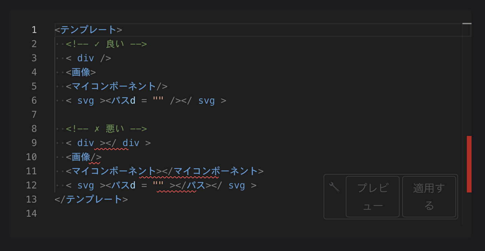

## 1. はじめに

この記事は、[TechBull Advent Calendar 2025](https://adventar.org/calendars/11900) の19日目の記事です。

- **本記事で扱う内容**
  - Vue3/Nuxt4のアプリケーションにESLintとPrettierを設定した際の備忘録です

- **対象読者**
  - はじめてESLint・Prettierを導入する人
  - ESLintとPrettierのコンフリクトに悩んでいる人
  - ESLint 9系の新しい設定形式を知りたい人

- **使用環境**
  - Vue: 3.5
  - Nuxt: 4.0
  - ESLint: 9系（検証時: 9.25.1）
  - Prettier: 3系（検証時: 3.6.2）

### 2. ESLintとPrettierの役割の違い

#### ESLintとは

> 設定可能なJavaScriptリンター  
> JavaScriptコード内の問題を発見し、修正するのに役立ちます。
>
> 出典: [ESLint公式](https://eslint.org/)

コードの一貫性を維持するための静的解析ツールで、単純な構文エラーやコーディング規約から外れたコードを指摘してくれます。

**参考リンク：**

- [ESLint公式](https://eslint.org/)
- [ESLint Module](https://eslint.nuxt.com/packages/module)
- [Nuxt Code Style](https://nuxt.com/docs/4.x/guide/concepts/code-style)

<details><summary>補足：Linterとは</summary>

> ソースコードに対して一連のルールを実行した結果を報告できる静的解析ツール。各ルールは、ソースコード内の任意の数の違反を報告できます。
>
> 出典: [ESLint公式　Linter](https://eslint.org/docs/latest/use/core-concepts/glossary#linter)

</details>

---

#### Prettierとは

> An opinionated code formatter
>
> 出典: [Prettier公式](https://prettier.io/)

コードフォーマッターです。コードを自動的に整形してくれるツールです。
コードを書いている際に整形する手間と時間を節約して、一貫したスタイルでコードを整えてくれます。

<details><summary>補足：フォーマッターとは</summary>

> 開発者がプログラミング言語で記述したソースコードを、一定のルールに従って整形してくれるもの
>
> 出典: [フォーマッター](https://e-words.jp/w/%E3%83%95%E3%82%A9%E3%83%BC%E3%83%9E%E3%83%83%E3%82%BF%E3%83%BC.html)

</details>

---

#### なぜ両方必要なのか

両者とも「コードの綺麗さ・一貫性」を保ってくれるツールです。
上記の説明にもあるように、確認観点の違いがあります。

**役割の違い：**

| ツール | 主な役割 |
| --- | --- |
| **ESLint** | コード品質・バグ検出（構文エラー、コーディング規約違反など） |
| **Prettier** | コードスタイルの統一（インデント、改行、スペースなど） |

この役割の違いから、２つを併用することで、より高品質で統一されたコードベースを維持できます。

---

### 3. ESLint 9系の設定ファイル変更について

#### 従来の`.eslintrc.js`から`eslint.config.js`への移行

ESLint 9系から、設定ファイルが移行されたようです。書き方も変更があったため、設定の際は要注意です。

**主な変更点：**

- 設定ファイル名：`.eslintrc.js` → `eslint.config.js`
- 設定形式：従来の階層的な設定 → Flat Config形式
- デフォルトの挙動：`.eslintrc.*`は非推奨となり、`eslint.config.js`が標準に

---

#### Flat Config形式の特徴

ESLint 9で導入された新しい設定形式です。詳しくは以下の記事が参考になります。

[ESLint を eslintrc から Flat Config に移行する、ハマりポイントを添えて。](https://qiita.com/Shilaca/items/c494e4dc6b536a5231de)

**簡単な比較例：**

```javascript
// 従来の .eslintrc.js
module.exports = {
  extends: ['eslint:recommended'],
  rules: {
    'no-console': 'warn'
  }
}

// 新しい eslint.config.js (Flat Config)
export default [
  {
    rules: {
      'no-console': 'warn'
    }
  }
]
```

---

### 4. 導入手順

#### ESLintの導入

Nuxtが標準サポートのリンターです。導入・設定方法もNuxt公式に書いてあります。
プロジェクト対応のNuxt固有の設定もあります。
以下公式を参考に導入してください。

```bash
# @nuxt/eslintモジュールをプロジェクトに追加します。
npx nuxi module add eslint

# TypeScriptの型定義をインストールします.
npm install -D typescript
```

コマンド実行後、プロジェクトルート直下に`eslint.config.mjs`ファイルが自動生成されます。

**参考リンク：**

- [ESLint Module](https://eslint.nuxt.com/packages/module)
- [Nuxt Code Style](https://nuxt.com/docs/4.x/guide/concepts/code-style)

#### Prettierの導入

インストール方法は、以下の公式を参照してください。

**参考リンク：**
[Prettier Install](https://prettier.io/docs/install)

```bash
# Prettierのインストール
npm install --save-dev --save-exact prettier

# 空の設定ファイルを作成
node --eval "fs.writeFileSync('.prettierrc','{}\n')"

# フォーマットしないファイルを指定するための.prettierignoreファイルを作成
node --eval "fs.writeFileSync('.prettierignore','# Ignore artifacts:\nbuild\ncoverage\n')"

# プロジェクト全体をフォーマット
npx prettier . --write

# フォーマットされているかの確認
npx prettier . --check
```

**コマンドの説明：**

- `--write`: ファイルを実際にフォーマットする
- `--check`: フォーマットが必要なファイルをチェックするのみ

#### エディタ（VS Code）の設定

VS Codeを使用している場合、以下の拡張機能をインストールすると開発がより便利になります。

**推奨する拡張機能：**

- [ESLint](https://marketplace.visualstudio.com/items?itemName=dbaeumer.vscode-eslint)
- [Prettier](https://marketplace.visualstudio.com/items?itemName=esbenp.prettier-vscode)

保存時の自動フォーマット設定などは、各自の環境に合わせて設定してください。

**参考リンク：**

- [Prettier - Editor Integration](https://prettier.io/docs/editors)

### 5. コンフリクト問題

#### 自己終了タグ（Self-Closing Tags）のコンフリクト

実際にリンター・フォーマッターを動かした際にコンフリクトが起こりました。
コンフリクト内容は、**「HTML void要素の自己終了タグ」の扱いです**。

---

**Vue公式の推奨：**

Vueの公式スタイルガイドでは、以下のように推奨されています：

- **単一ファイルコンポーネント（.vue）内**：自己終了タグを使用すべき
- **DOM内テンプレート内**：自己終了タグを使用してはいけない

```vue
<!-- ✅ 単一ファイルコンポーネント内（推奨） -->
<MyComponent/>

<!-- ❌ DOM内テンプレート内 -->
<my-component/>  <!-- これはNG -->
<my-component></my-component>  <!-- これが正しい -->
```

**参考リンク：**

- [Vue公式スタイルガイド - 自己終了形式のコンポーネント](https://ja.vuejs.org/style-guide/rules-strongly-recommended#self-closing-components)

---

**ESLintのデフォルト（vue/html-self-closing）：**

ESLintの[vue/html-self-closing](https://eslint.vuejs.org/rules/html-self-closing)ルールは、デフォルトで以下の設定になっています：

```javascript
{
  'vue/html-self-closing': ['error', {
    html: {
      void: 'never',        // HTML void要素は自己終了タグを使わない
      normal: 'always',     // 通常のHTML要素は自己終了タグを使う
      component: 'always'   // Vueコンポーネントは自己終了タグを使う
    }
  }]
}
```

**注意すべき点：**

- `html.void: 'never'`の設定により、``, `<br />`などのHTML void要素の自己終了タグは警告されます
- しかし、Vueコンポーネント自体の自己終了タグ（`<MyComponent />`）は推奨されています

```vue
<!-- ❌ ESLintがデフォルトで警告 -->

<br />

<!-- ✅ ESLintがデフォルトで推奨 -->

<br>

<!-- ✅ Vueコンポーネントは自己終了タグOK -->
<MyComponent />
```



**参考リンク：**

- [vue/html-self-closing](https://eslint.vuejs.org/rules/html-self-closing)

---

**Prettierのデフォルト：**

Prettierは、**すべてのvoid要素**（HTML要素とVueコンポーネント両方）に自己終了タグを追加します。

```vue
<!-- 入力 -->

<br>
<MyComponent></MyComponent>

<!-- Prettierでフォーマット後 -->

<br />
<MyComponent />
```

これにより、ESLintの`html.void: 'never'`設定とコンフリクトが発生します。

---

#### 実際のエラー例とログ

実際のエラーは以下のように出力されました。

```bash
warning  Disallow self-closing on HTML void elements ()    vue/html-self-closing
```

**コンフリクトの流れ：**

1. Prettierで保存 → `` が `` に変換される
2. ESLintが実行される → `html.void: 'never'` により警告が出る

---

#### なぜこのコンフリクトが発生するのか

**ESLintとPrettierの設計思想の違い**によるコンフリクトです。

| ツール | HTML void要素の扱い | Vueコンポーネントの扱い |
| --- | --- | --- |
| **ESLint (デフォルト)** | 自己終了タグ非推奨 | 自己終了タグ推奨 |
| **Prettier** | 自己終了タグ追加 | 自己終了タグ追加 |

**重要な区別：**

- **HTML void要素**：``, `<br>`, `<input>`など
- **Vueコンポーネント**：`<MyComponent>`, `<BaseButton>`など

Vueコンポーネントについては両者とも自己終了タグを推奨していますが、HTML void要素については意見が分かれています。

#### 解決方針の決定

今回は、コードスタイルの統一を優先し、**自己終了タグを使用する方を選びました**。

**理由：**

1. **可読性の観点**：タグの終了が明示的で分かりやすい
2. **一貫性の維持**：Prettierの自動フォーマットに従うことで、チーム全体のコードスタイルが統一される

### 6. コンフリクトの解決方法

#### `eslint-config-prettier`の導入

このコンフリクトを解決するために、**`eslint-config-prettier`** を使用しました。

#### eslint-config-prettierとは

`eslint-config-prettier`は、PrettierとESLintのルールの競合を解決するための公式設定パッケージです。**Prettierと競合する可能性のあるESLintルールをすべてオフにする**ことで、両ツールが協調して動作できるようにします。

設定方法は、公式GitHubを参考にしてください。

**参考リンク：**

- [eslint-config-prettier (GitHub)](https://github.com/prettier/eslint-config-prettier)

#### 具体的な設定例

ESLint設定で以下をカスタマイズしました：

- **変数名はキャメルケース**で書くことを推奨
- **すべての要素で自己終了タグを使用**することを推奨

これにより、Prettierとのコンフリクトが解消され、コードスタイルが統一されました。

### 7. まとめ

#### 導入によって得られたメリット

**開発効率の向上：**

- コマンド一つで自動的にコードが整形され、スタイルを気にせず開発に集中できる
- ESLintによる静的解析で、潜在的なバグを早期に発見

**チーム開発での効果：**

- 誰が書いたコードでも一定の書き方になり、読みやすく保守しやすい
- スタイルに関する議論が不要になり、ロジックやアーキテクチャに集中できる

#### 今回の学び

1. **ESLint 9系のFlat Config形式**への理解
2. **コンフリクトの解決**には、ツールの設計思想を理解し、プロジェクトに適した方を選択すること
3. **デフォルト設定から始める**ことで、メンテナンスコストを抑える

#### 今後のメンテナンス方針

今回は、ほとんどがデフォルトのまま使用しています。
今後、不便を感じたり、より良い設定が見つかった場合は、チームと相談しつつ対応していきます。
