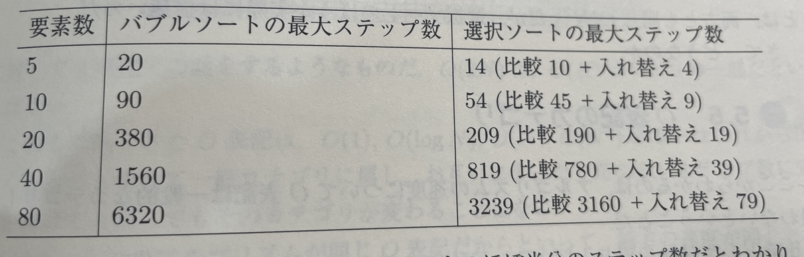

\[[Amazon.co.jp: データ構造とアルゴリズム: 上達のための基本・常識 : Jay Wengrow, 黒川 利明: 本](https://amzn.asia/d/4REIJNZ)

## これは、メモです！

これは、私のための私のメモです。

<strong>決まり</strong>

- コードは、JS・TSのみ
- 実際に書いて覚える
- 記事の長さは、気にしない！

<strong>なんで、この本を読むの？</strong>

- おすすめしてもらったから！
- 自分の思想を持ちたい。
- データ構造・アルゴリズムについてちゃんと話せるようになりたい！

## O表記でのコード最適化とO表記なしでのコード最適化

> 同じ性能に見える2つのアルゴリズムをどのように見分けて、どのように速い方を選ぶかを学ぶ。

実用的な話になった！  
こういう話を求めていた！  
どうして速いの？その証明はどのようにするの？が気になるところ！

一つ前で実装を確認したバブルソートと今回確認した選択ソートの比較↓

<figure><figcaption>バブルソートと選択ソート</figcaption></figure>

> 比較表から、選択ソートはがバブルソートのほぼ半分のステップ数だとわかり、二倍速いことが示される。

選択ソートでは、全ての数字と比較して、一度入れ替えを行う。  
バブルソートはすべての比較で入れ替えが必要・この分だけステップ数が嵩む  
入れ替えの数が一度なためバブルソートより速い

> <strong>定数を無視</strong> しかし、O表にはおかしなところがある。選択ソートとバブルソートがまったく同じように表されるのだ。

急に意味がわからなくなったぞ？  
ステップ数が全然違うのに一緒ってどゆこと？

> O表記は「N個のデータ要素があれば、アルゴリズムはどれだけのステップかかるか」という本質的な問題に答える。選択ソートはN2のほぼ半分のステップがかかるので、選択ソートの性能をO(N2/N)と表すのは納得できる。
>
> 選択ソートとバブルソートと同じO表記ではO(N2)で表される

ほ〜ん？なぜ？  
1/2の速さなのに、ステップ数なのに？

> <strong>O表記では定数を無視する</strong> O表記では指数以外に定数を含まないという数字の言い回しだ。式から定数は取り除く。  
> 今回の場合、アルゴリズムはN2/2ステップかかるのだが、「/2」を定数だから落として、性能はO(N2)と表す。

なぜ、落とした！  
重要なところを！！！

> アルゴリズムの速度についてO表記は一般的なカテゴリーしか扱わないということだ。

一般的なカテゴリー？  
本文を読んでみると、「データが増えたときのアルゴリズムのステップ数の長期的な推移を問題にする」とある  
これは、O表記で違うものは明白に増え方に差があるので、O表記を比べれば性能の甲乙がわかる  
ここで問題なのが、O表記が同じ場合である  
同じ場合はより詳しくステップ数が増えているかを確認する必要がある  
選択ソートとバブルソートを比べるように定数などを確認する必要が出てくる

より詳しく調べるとはどんなことだろう？  
下に続く

## コードを確認してみた

1章で出てきたコードで確認してみる  
このコードは、両方NステップかかるためO(N)になる  
両方同じO(N)になるが、最初に確認した通り`print_numbers_version_two`の方が二倍速い

> より詳しく調べたらどちらが速いかわかるもうひとつの例だ

このように、詳しく調べる必要があることがわかった

```text
const print_numbers_version_one = () => {
    let number = 2
    while (number <= 100) {
        if (number % 2 === 0) {
            console.log(number);
        }
        number += 1
    }
}

const print_numbers_version_two = () => {
    let number = 2
    while (number <= 100) {
        // 偶数なら出力
        if (number % 2 === 0) {
            console.log(number);
        }
        number += 2
    }
}
```

> O表記では、定数を取り除くので、式が単純になる。 全ステップを数えると、比較がN、増加がN、出力がN/2、足すと2.5Nステップになる。定数2.5を落として、O(N)と表す。 どのステップが重要か、すべてだと言ったが、定数を落としたので、ループの中で何が起こっているかよりは、ループの回数に焦点を当てたといえる。

何がどれだけどのぐらい、ステップ数がかかるかを確認して、定数を落としたときにどこに焦点を当てているかを確認するのがいいのか

> 重要な分析ツールが手に入った。O表記を使ってアルゴリズムの性能を幅広く決定し、O表記で同じ分類になる複数のアルゴリズムを比較できる。

れなっちは、新たな武器を手に入れた！

\-----
