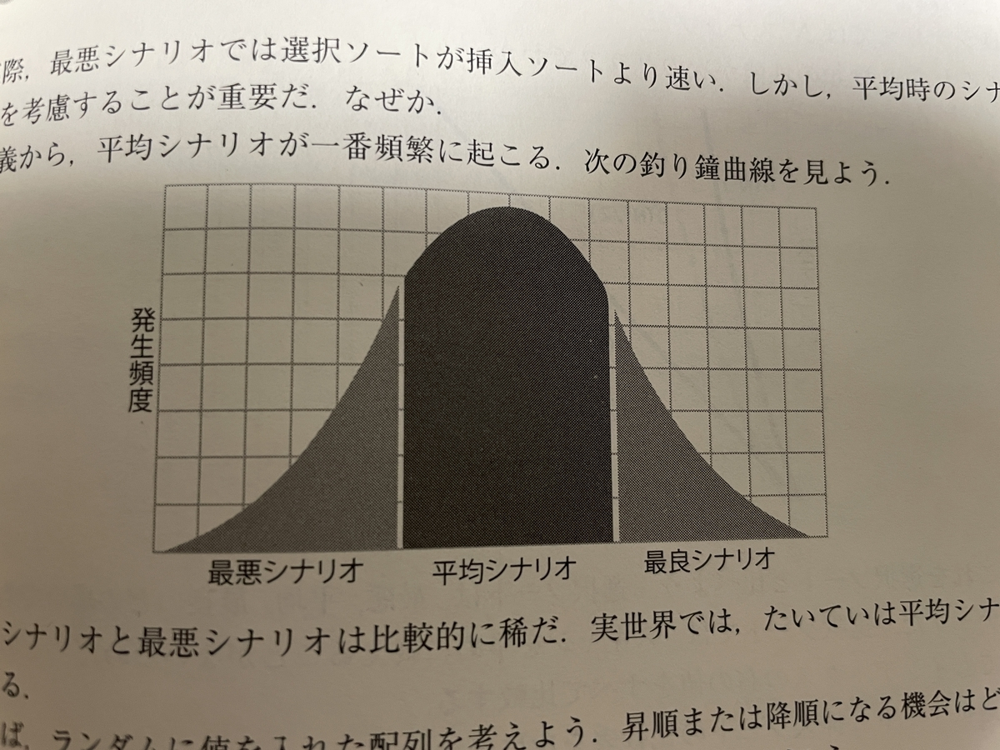
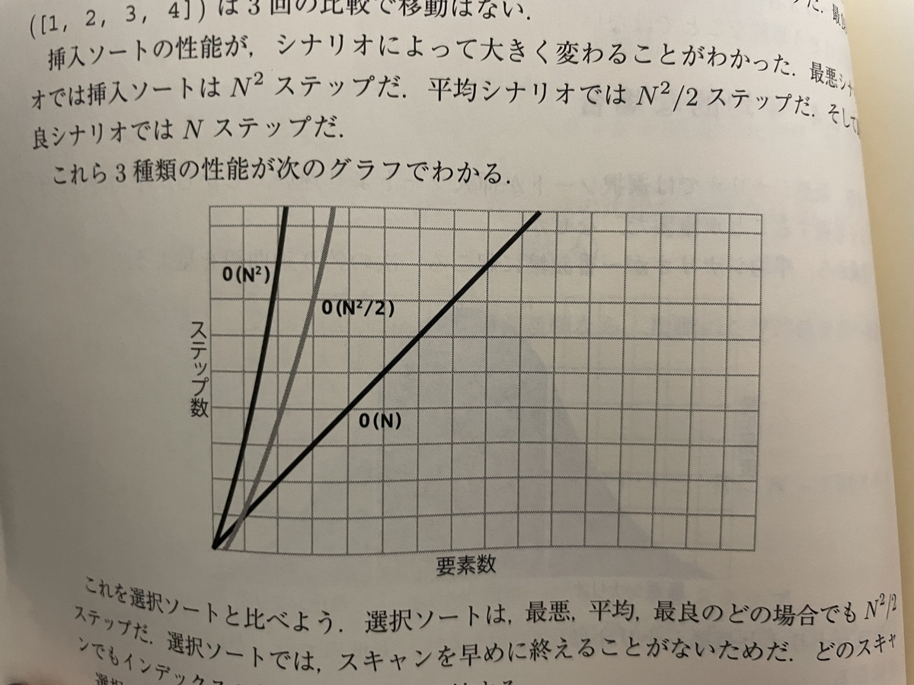
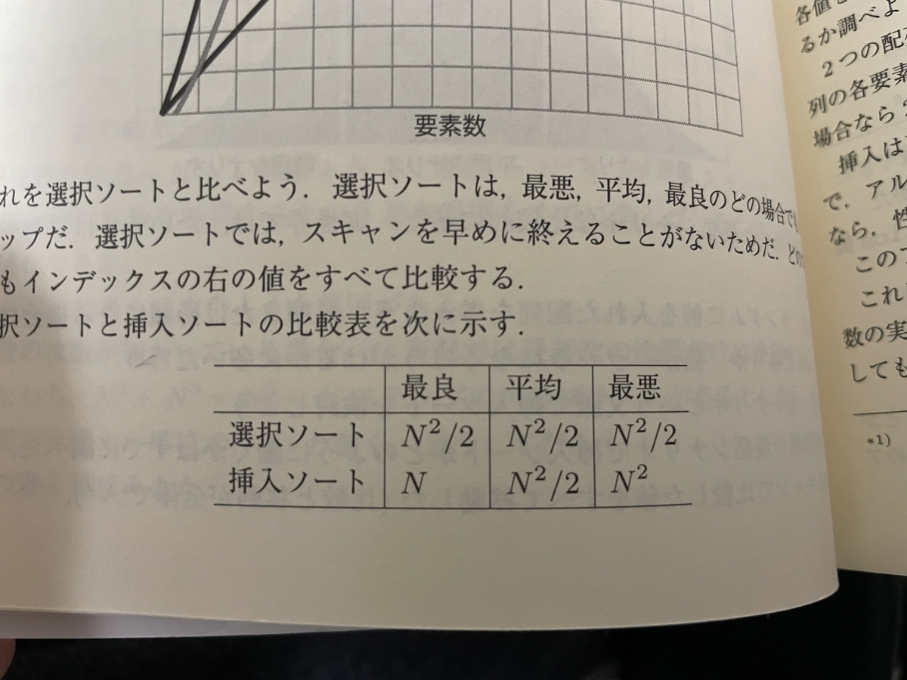

[Amazon.co.jp: データ構造とアルゴリズム: 上達のための基本・常識 : Jay Wengrow, 黒川 利明: 本](https://amzn.asia/d/4REIJNZ)

## これは、メモです！

これは、私のための私のメモです。

<strong>決まり</strong>

- コードは、JS・TSのみ
- 実際に書いて覚える
- 記事の長さは、気にしない！

<strong>なんで、この本を読むの？</strong>

- おすすめしてもらったから！
- 自分の思想を持ちたい。
- データ構造・アルゴリズムについてちゃんと話せるようになりたい！

## 楽観的なシナリオで最適化

ずっと悲観的だったじゃん！

> ここまでは、主として最悪なシナリオでアルゴリズがどれだけのステップかかるかを調べてきた。その背景にあるのは、最悪時に備えておけば大丈夫だという単純な理由だ。  
> しかし、本章では、最悪シナリオだけが考慮すべき状況ではないことを学ぶ。

<strong>最悪時に備えておけば大丈夫だ</strong>  
データ構造や条件が未確定の場合は大体この考えな気がする(重要なことが未確定の場合、その情報を確定する方がいいと思います)

> O表記にはさらに次のような規則がある <strong>複数の次数が加わっている場合、O表記では最高次の次数だけに注目する</strong>

O表記の規則多いので、暗記すること  
だたし、暗記だけだと具体例がなくて覚えにくいのでちゃんとアルゴリズムを解くこと

> 最悪シナリオでは選択ソートが挿入ソートより速い。しかし、平均時のシナリオが一番頻繁に起こる。最良シナリオと最悪シナリオは比較的に稀だ。

<figure><figcaption>釣り鐘曲線</figcaption></figure>

<figure><figcaption>グラフ</figcaption></figure>

<figure><figcaption>表</figcaption></figure>

最悪シナリオを基準に考えるのは、最悪シナリオ以上に遅くなることがないからでしかない  
現実世界で起きるのが多いのは、平均シナリオなのは当たり前で、数が多いのは配慮すべきである。  
「状況によっては、早くも遅くもなる」アルゴリズムの選択の答えは、状況による  
最近読んでる本全部に「状況による」「正解はない」って書いてある・・・経験値ほしい〜

> 挿入ソート：ほとんど整列しているデータを扱うとわかっている場合に速い
>
> 選択ソート：データがほとんど逆順に整列しているとわかっているなら、速い
>
> <strong>覚えておくべきこと</strong>：最悪時に備えることも重要だが、ほとんどの場合は平均時の振る舞いになる

<strong>挿入ソート</strong>：最悪シナリオ以外での分析の威力が示される  
以下、記事に挿入ソートの説明とJSのコードあり



本に載っていた挿入ソート↓  
よく使うと思うので、流れと考え方を暗記

```text
const insertion_sort = (array: number[]) => {
    for (let index = 1; index < array.length; index++) {
        const temp_value = array[index]
        let position = index - 1;

        while ( position >= 0) {
            if ( array[position] > temp_value ) {
                array[position + 1] = array[position]
                position = position - 1
            } else {
                break
            }
        }
        array[position + 1] = temp_value
    }
    return array
}
```

\-----
