[半田についての過去記事](https://a-nnmgmg8989.hatenablog.com/entry/2025/12/12/195727?_gl=1*4mhqg5*_gcl_au*MjIwNDQ3MjMyLjE3NjQ4NjA1MDk.)  
1月16・17日に[フタゴ.dev](https://futako-dev.connpass.com/)の自作キーボード会に参加させていただきました！

主催のKaitouさんの記事↓



## 16日は、買い出しに行きました！

遊舎工房さんに4人で向い、悩みながらみんなのお好みのものを購入！ キースイッチのお試しができるブースがあったり、半田関連の商品も並んでいるため、遊舎工房さんで必要なものを全て購入することができました！

<figure>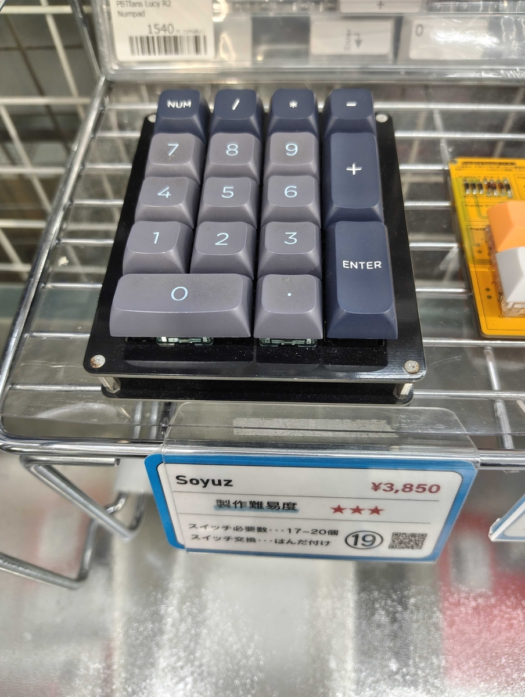<figcaption>このテンキーを購入</figcaption></figure>

購入品は以下です！(自分用にメモ)  
\- Soyuzのテンキーセット  
\- キーキャップ  
\- スタビライザー  
\- フレックス  
\- 半田

Kaitouさんやなかyarnさんは、my半田ごてをお持ちでした(すごい！プロだ！)

> 週末に使うマイハンダゴテの動作確認終了〜✨  
>
> 中学の時に購入したのですが、今も動いてくれてイイ子だ（笑） [pic.twitter.com/nQPMMogClY](https://t.co/nQPMMogClY)

— なかyarn@エンジニア修行中 (@nakayarn) [2026年1月14日](https://twitter.com/nakayarn/status/2011362823432266111)

私の半田ごては、貸してくださる方がおり、借りました。ありがたい・・・

各々買い終わった後に、みんなで立ち飲みのお店に行きました！

<figure>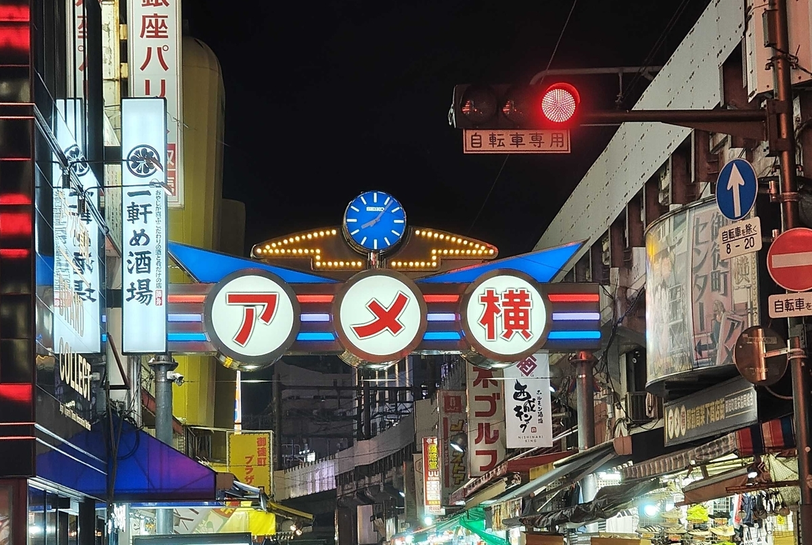<figcaption>お初のアメ横</figcaption></figure>

<figure>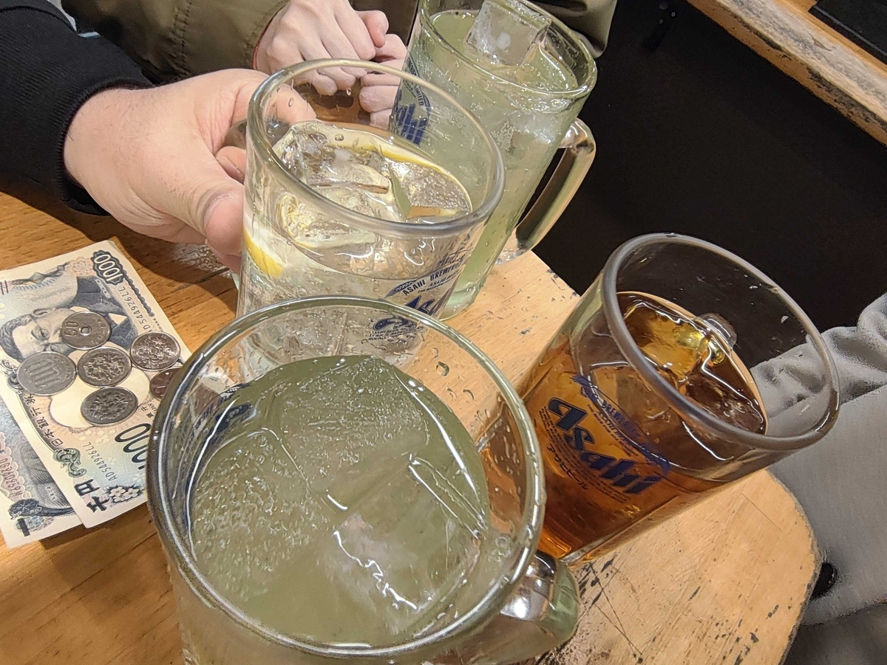<figcaption>乾杯！</figcaption></figure>

人生初の立ち飲みのお店は雰囲気もよく(女性客も多くて入りやすかった)、天ぷらが絶品でした！  
料理もお酒も美味しく、エネルギーチャージ100%！

> これが立ち飲み！！美味しかった〜 [pic.twitter.com/G8aQHjakhZ](https://t.co/G8aQHjakhZ)

— 猫テロのれなっち (@hfslca7439) [2026年1月16日](https://twitter.com/hfslca7439/status/2012158329943118110)

## 17日は、いよいよ組み立てです！

> だいぶできてきた。 [#フタコdev](https://twitter.com/hashtag/%E3%83%95%E3%82%BF%E3%82%B3dev?src=hash&ref_src=twsrc%5Etfw) [pic.twitter.com/RNZlkgGNHc](https://t.co/RNZlkgGNHc)

— Kaitou (@Kaitou1192) [2026年1月17日](https://twitter.com/Kaitou1192/status/2012377698103152651)

<figure>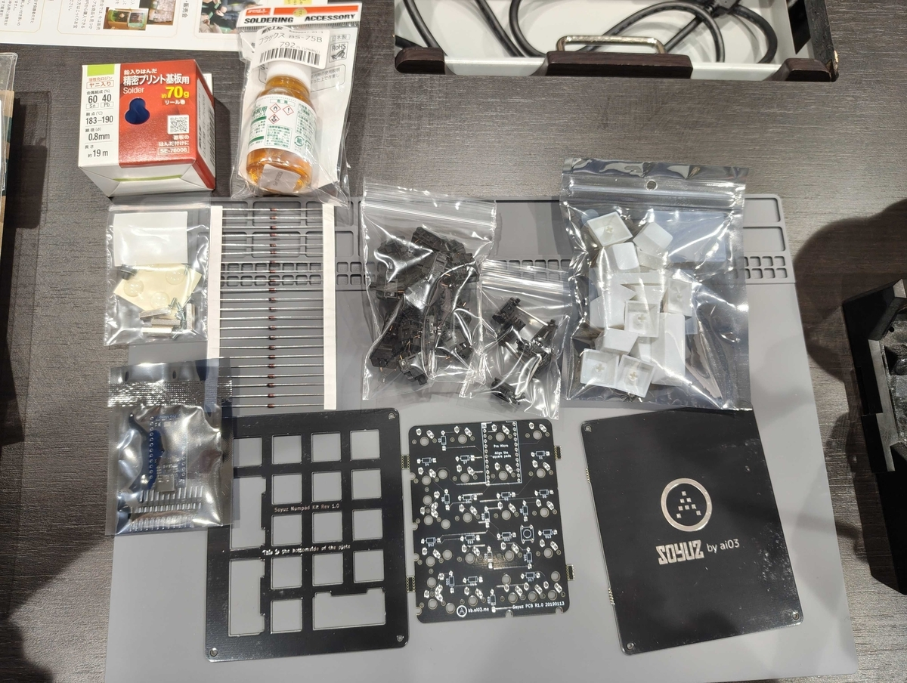<figcaption>テンキーセット</figcaption></figure>

GitHubにて、作り方が載っていました。 まずは、ダイオードを取り付けて・・・

<figure>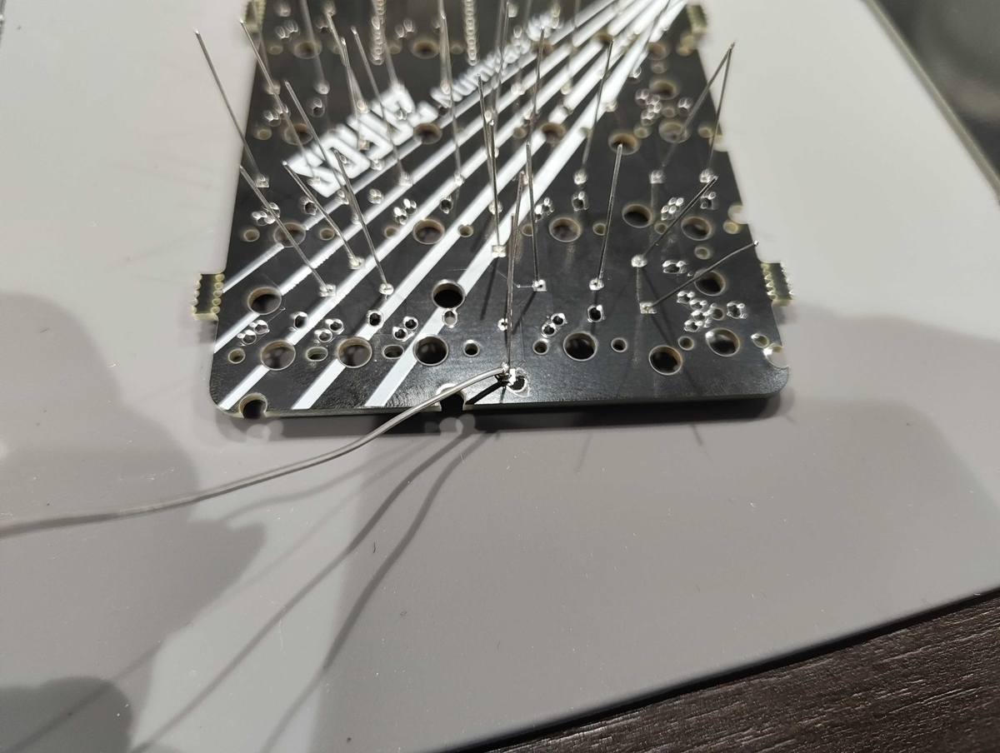<figcaption>ダイオードを差し込み</figcaption></figure>

<figure>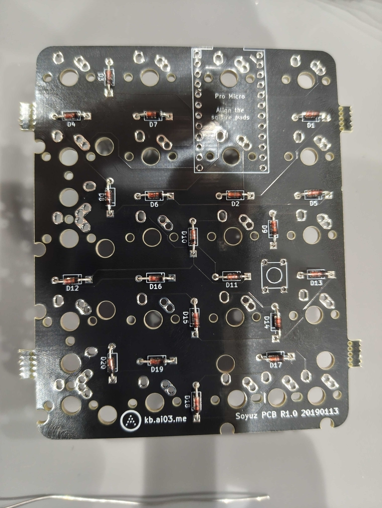<figcaption>半田付け</figcaption></figure>

ここで、ダイオードの向きや付け方を確認・取り付けでかなり時間をかけました！ 確認大切！

いい時間になったので、 みんなでお昼ご飯もいただきました！

<figure>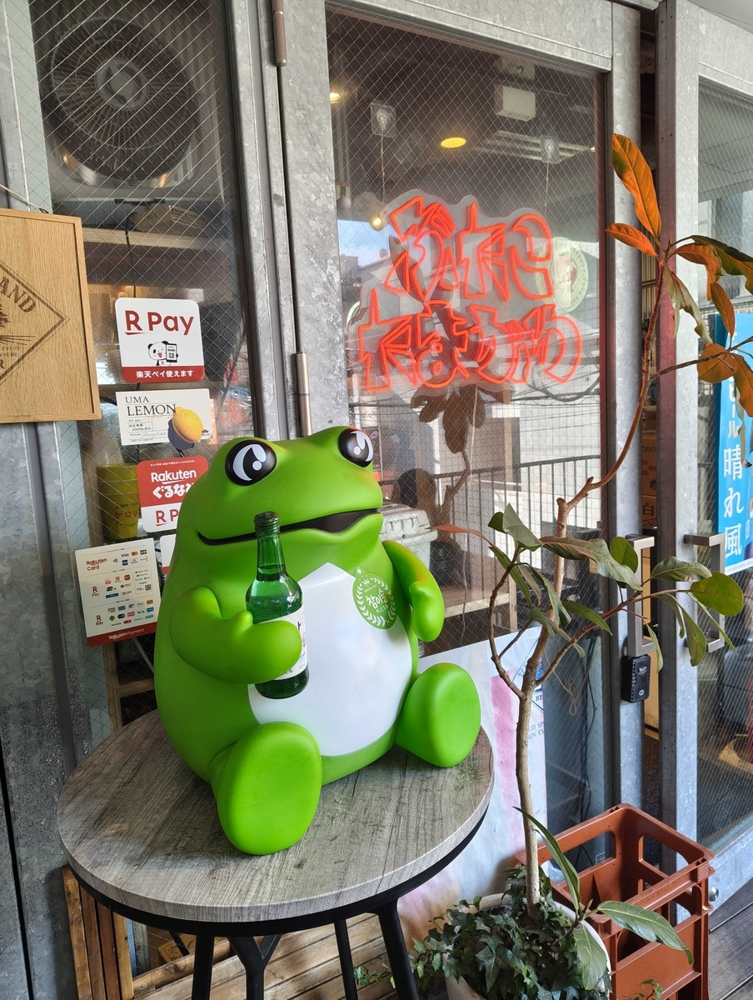<figcaption>カエルがシンボル！</figcaption></figure>

> お昼！ [#フタコdev](https://twitter.com/hashtag/%E3%83%95%E3%82%BF%E3%82%B3dev?src=hash&ref_src=twsrc%5Etfw) [pic.twitter.com/DK7dptV9B0](https://t.co/DK7dptV9B0)

— Kaitou (@Kaitou1192) [2026年1月17日](https://twitter.com/Kaitou1192/status/2012385441190949311)

<figure>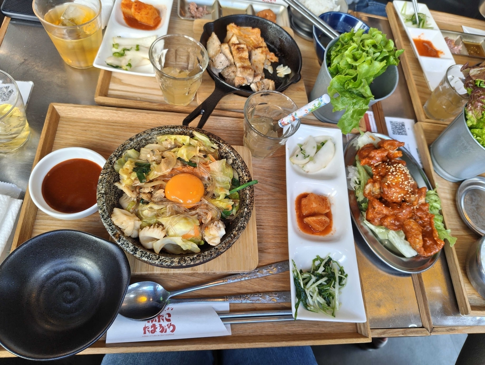<figcaption>お野菜もいっぱいで、おいしかった〜</figcaption></figure>

お昼終わりからは、

Pro Microの取り付け・キースイッチの取り付けを行いました。 ネイルをしているため、爪が長いのですが、スタビライザーの取り付け時にめちゃくちゃ苦戦しましたw

<figure>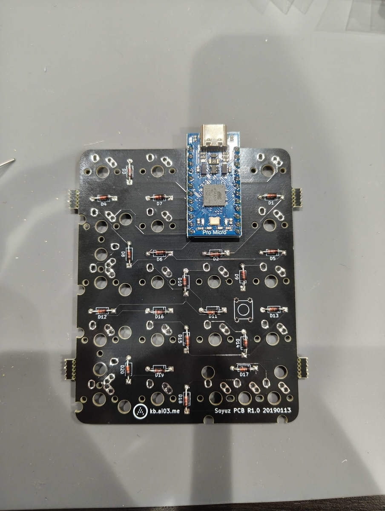<figcaption>Pro Microの取り付け</figcaption></figure>

ここまではかなり順調だったのですが、キーマップの設定が「[REMAP](https://remap-keys.app/)」が対応しておらず、「[QMK Configurator](https://config.qmk.fm/#/keychron/q9/iso/LAYOUT_iso_53)」を使用しました。

<figure>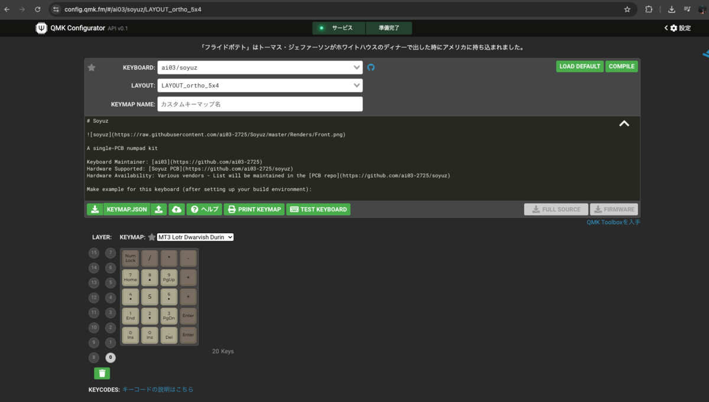<figcaption>実際の画面</figcaption></figure>

これが、難易度が⭐️3の所以だった様子・・・ キーマップ初めてで挑んだため、かなり時間を要しました・・・

<figure>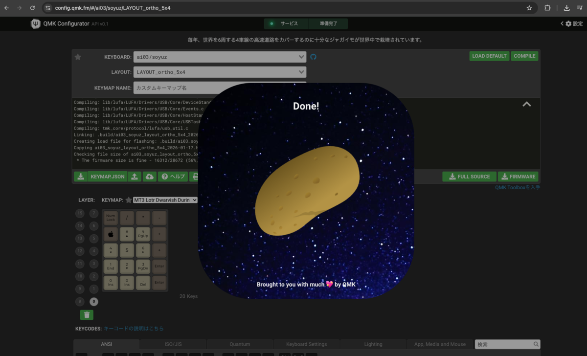<figcaption>ダウンロード中のジャガイモ可愛い</figcaption></figure>

キーマップに時間を要したため、ここでもくもく会の時間が終わってしまいました〜 動かせるまでいかず、無念！！！

<figure>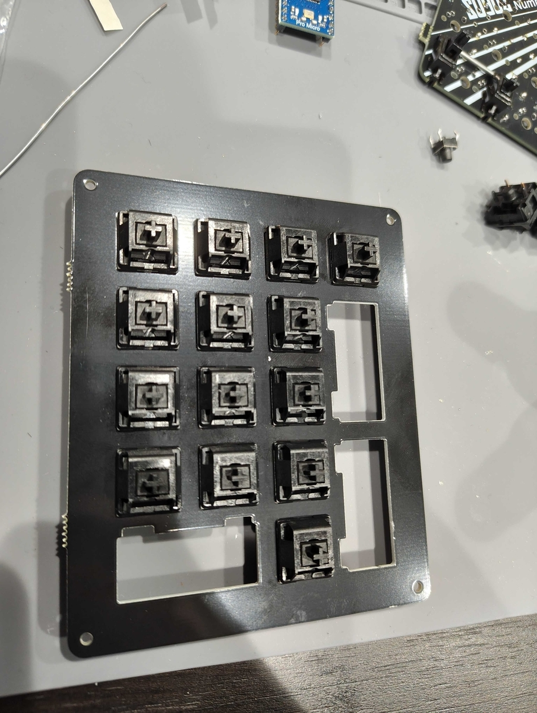<figcaption>キースイッチの取り付けまでは終えました</figcaption></figure>

## その後！

それぞれいいところまで組み立てて、解散となりました。 帰宅後もキーボードとの向き合い設定したり、キーマップのコードを書いたりしておりました。

キーマップは、結局QMK Configuratorでコードをダウンロード・ダウンロードしたキーマップをPro Microにインストールして動かすことに成功しました！ が、5/17しか動きません・・・ どこで何を失敗しているかわからないため、近いうちに遊舎工房さんにお邪魔させていただこうと思います。

<figure>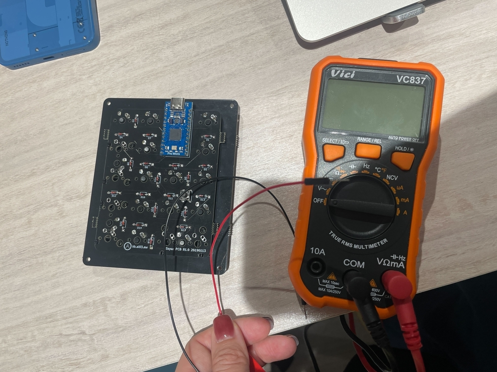<figcaption>デバック</figcaption></figure>

xでみんな発信してくださりました！嬉しすぎる〜↓

なかyarnさんのちょっとポケ⚪︎ンみがあるキーボード

> できた✨  
>
> 怪しく光る物体が出来上がった（笑） [https://t.co/6mJMVQ3y0x](https://t.co/6mJMVQ3y0x) [pic.twitter.com/VPIqidYHiY](https://t.co/VPIqidYHiY)

— なかyarn@エンジニア修行中 (@nakayarn) [2026年1月17日](https://twitter.com/nakayarn/status/2012484202898346042)

いささんが自作キーボード2つもってきてくださりました！ありがとうございます！

> 動作確認用のPCに諸々の道具色々詰めたらめちゃ重たいw

— いささん (@isasan36) [2026年1月17日](https://twitter.com/isasan36/status/2012357091004981556)

Kaitouさんのキーボードワンポイントのオレンジがおしゃれ！

> ついに動いた🙌🏻🙌🏻🙌🏻 [#フタコdev](https://twitter.com/hashtag/%E3%83%95%E3%82%BF%E3%82%B3dev?src=hash&ref_src=twsrc%5Etfw) [pic.twitter.com/3TM4lWx9dk](https://t.co/3TM4lWx9dk)

— Kaitou (@Kaitou1192) [2026年1月17日](https://twitter.com/Kaitou1192/status/2012413804295135601)

## まとめ

俺たちの戦いはまだこれからだっ！！！ キーボードがうごきませんわ！

\-----
