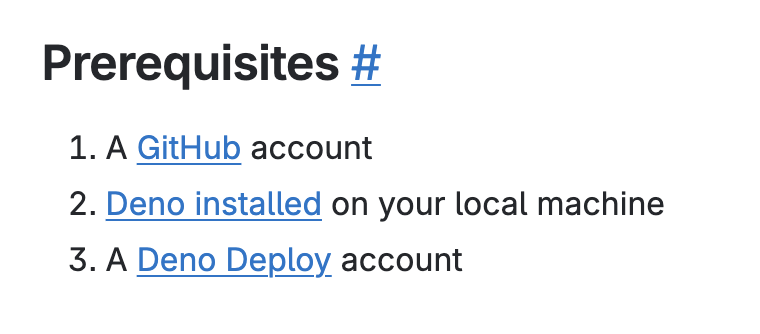
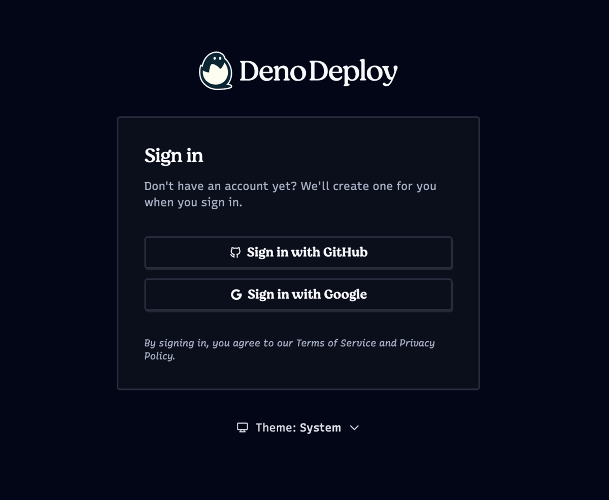
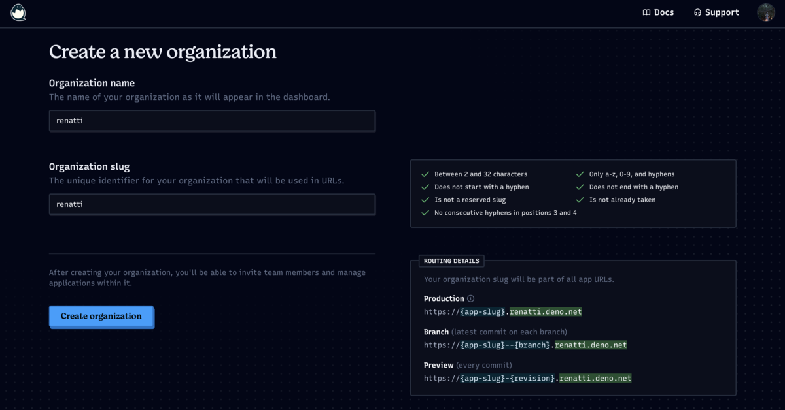
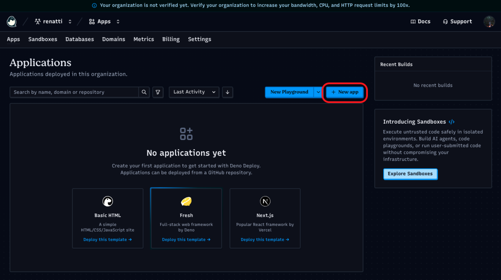
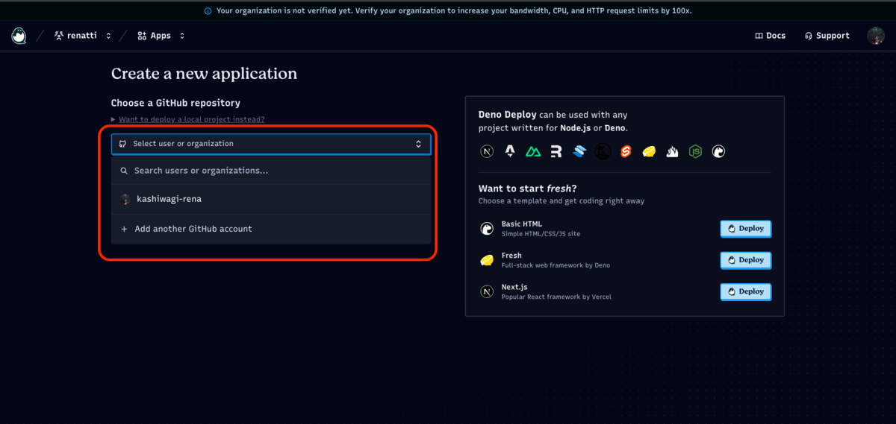
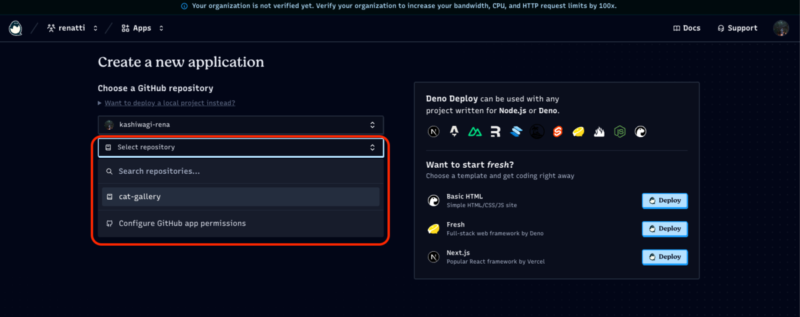
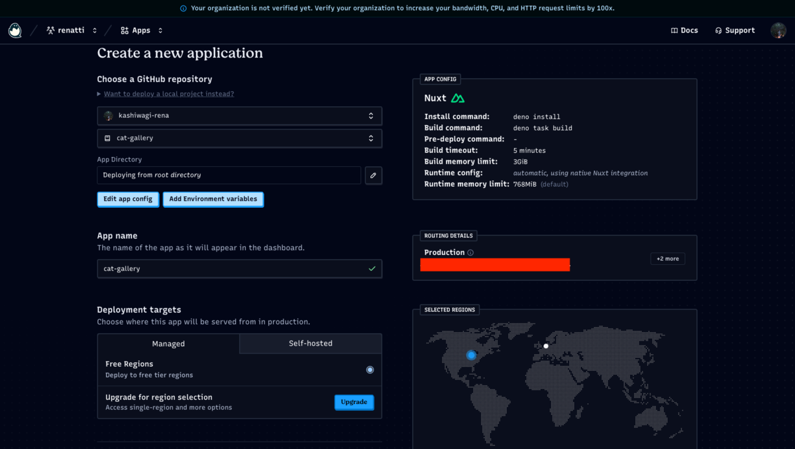
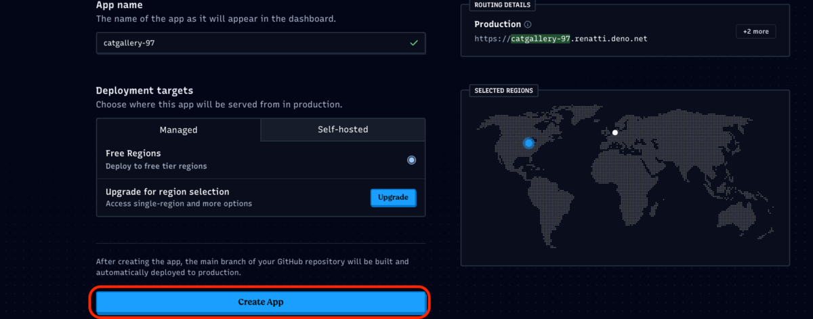

自分用のメモです。  
この記事を一番読むのは自分なのでしょう。  
未来の自分よ！幸あれ〜

## Deno DeployというものをAIに教えてもらった

<s>vercelにNuxtのアプリ上げようと思ったら、NodeじゃなくてDenoを使用したためめちゃくちゃ沼った・・・</s>  
<s>解決策が、Nodeの共存ぐらいしか出てこなくて、萎えたのでDeno Deploy使用してみようと思います</s>。

## まずは公式を一読せよ

公式↓





簡単そう？

'experimental'らしいので、もしかしたら引越ししないとかもしれないな

## あしあと🐾

<figure><figcaption>前提条件</figcaption></figure>

2番までの前提条件はみんなクリアしているで、3番に行く

{% linkcard "https://console.deno.com/login?redirect=%2Faccount" %}

<figure><figcaption>Sign in画面：たまごから見えるお顔が可愛い！</figcaption></figure>

<strong>私は、GitHubでsign inしたよ！</strong>

<figure><figcaption>new organization</figcaption></figure>

<figure><figcaption>Applications</figcaption></figure>

Applications画面の右上の「New app」を押下

<figure><figcaption>自分のGitHubを選択</figcaption></figure>

<figure><figcaption>デプロイするrepositoryを選択</figcaption></figure>

UIが変わらなかったら下記のようになるはず！  
Free Regionsがあるの最高！

<figure><figcaption>こんな感じ</figcaption></figure>

あとは、下にスクロールして、「Create App」を押下してください

<figure><figcaption>Create Appを押下</figcaption></figure>

## 感想

Denoを使用して無料で、デプロイしたい場合の選択肢にはなると思う。  
DBもある様子？  
もうちょい使ってみないと,深くはわからないかな？  
今の所、vercelとほぼ同じ感じ

\-----
