TsKaigi 2026に参加させていただきました！  
※メモ・日記ベースです。自分の聞いたセッションまとめ

<figure>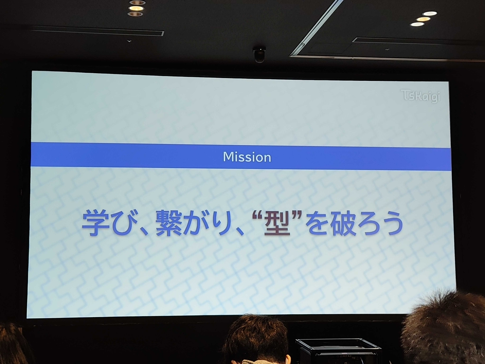<figcaption>Mission</figcaption></figure>

ノベルティかわいい〜〜〜！ NFCカードやPASSPORTが入ってた！かわいい〜  
NFCカード内にXのURLを入れてもらいました

> [#TSKaigi2026](https://twitter.com/hashtag/TSKaigi2026?src=hash&ref_src=twsrc%5Etfw)  
> ノベルティかわいい〜（写真に乗せきれないぐらいある！）  
>
> Passport 中も手が込んでてほんとに良き✨️ [pic.twitter.com/U5RcY0cD1U](https://t.co/U5RcY0cD1U)

— 猫テロのれなっち (@hfslca7439) [2026年5月22日](https://twitter.com/hfslca7439/status/2057636350472663127)

## オープニング

オープニングにて、

- TsKaigiが、世界一(TSのカンファレンスとして)
  
- TypeScriptが、世界一
  
- Claude CodeはTSで書かれている

> [#TSKaigi2026](https://twitter.com/hashtag/TSKaigi2026?src=hash&ref_src=twsrc%5Etfw)  
>
> 👏👏👏 [pic.twitter.com/OYWDPph1dR](https://t.co/OYWDPph1dR)

— 猫テロのれなっち (@hfslca7439) [2026年5月22日](https://twitter.com/hfslca7439/status/2057638126085136401)

昨年も参加させていただきました！スタッフの皆さんありがとうございます！  
マッサージやネイル・ハンズオンなどの企画があるらしい👀  
ここからワクワクが止まりません

## 「関数型プログラミング」を分解する.ts

> [https://t.co/dChuvIfPxA](https://t.co/dChuvIfPxA)  
> 遅ればせながらですが  
> 資料です [#tskaigi\_upsider](https://twitter.com/hashtag/tskaigi_upsider?src=hash&ref_src=twsrc%5Etfw)

— おーみー (@aumy_f) [2026年5月22日](https://twitter.com/aumy_f/status/2057656667563807194)

スライドトップの写真って、台湾の写真では？

「インターネットから来ました」と自己紹介してくださりました。個人的に刺さりました。

> [#TSKaigi](https://twitter.com/hashtag/TSKaigi?src=hash&ref_src=twsrc%5Etfw)  
>
> www [pic.twitter.com/dgZnF3Q4o2](https://t.co/dgZnF3Q4o2)

— 猫テロのれなっち (@hfslca7439) [2026年5月22日](https://twitter.com/hfslca7439/status/2057646520615440683)

<strong>ここでの「関数型プログラミング」の定義が明白ではないので回答に困る</strong>

ここからの話を聞いてから、「確かに最初ではわからなかったし、定義されていなかったな」と認識しました。

> [#TSKaigi](https://twitter.com/hashtag/TSKaigi?src=hash&ref_src=twsrc%5Etfw)  
>
> ワ…ワ…多い [pic.twitter.com/moqoZrf0MW](https://t.co/moqoZrf0MW)

— 猫テロのれなっち (@hfslca7439) [2026年5月22日](https://twitter.com/hfslca7439/status/2057646711292772429)

知っている概念多い！  
今よく使われているもの、大体「関数型プログラミング」卒業生では？？？

広義の意味だと、 const使っていたら、「関数型プログラミング」になるのか？？？

<figure>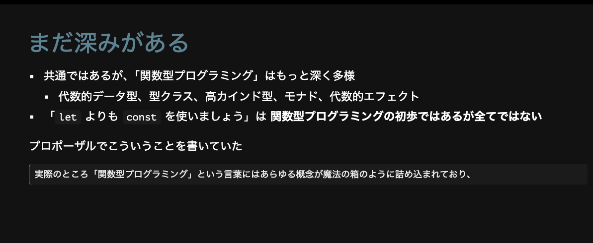<figcaption>constは、初歩ではあった！</figcaption></figure>

> [#TSKaigi](https://twitter.com/hashtag/TSKaigi?src=hash&ref_src=twsrc%5Etfw)  
>
> ご機嫌になる [pic.twitter.com/jaxZXyTCPy](https://t.co/jaxZXyTCPy)

— 猫テロのれなっち (@hfslca7439) [2026年5月22日](https://twitter.com/hfslca7439/status/2057647080261505150)

私たちは、「ご機嫌になる」ためにシステムを作っている  
「いい感じ」共通している！人が欲しいものやご機嫌になることは共通している。  
<strong>みんながご機嫌になること=お金になること</strong>では？と思っているのでかなり重要と認識している

<figure>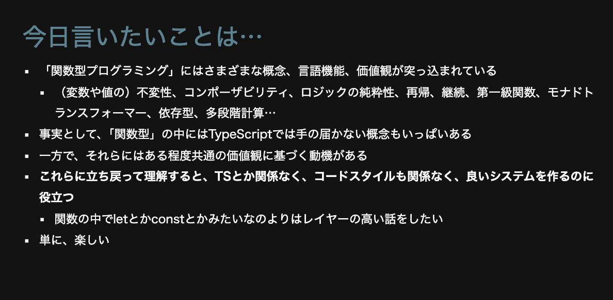<figcaption>単に、楽しい　良き</figcaption></figure>

制約を設けることは、「不自由になる」が「私たちはその方が書きやすい・読みやすい」ことでもある。  
片方が不自由なとき、片方が行いやすいことがある。

<strong>純粋関数</strong> 明示的な入出力は人間もAIも認識しやすくていい

<figure>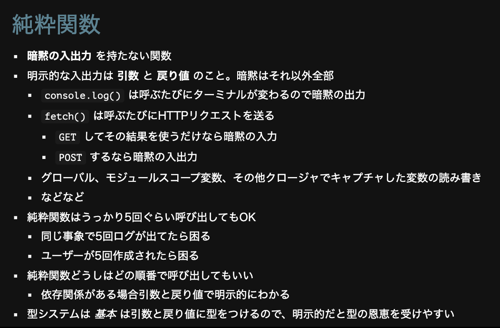<figcaption>純粋関数</figcaption></figure>

プログラミング的には、純粋関数でも副作用のあるものがある

<figure>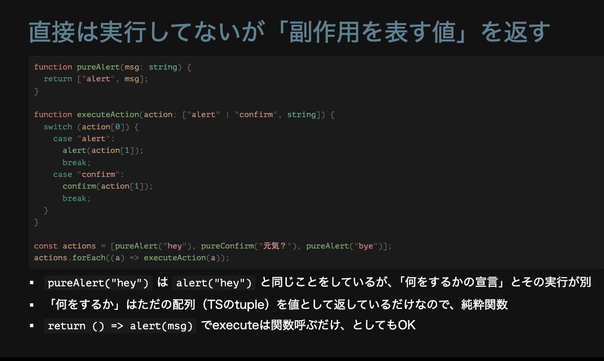<figcaption>副作用を表す値</figcaption></figure>

継続 計算の残りの部分

<figure>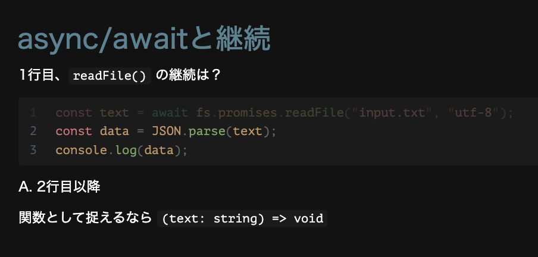<figcaption>継続</figcaption></figure>

結果を受け取って関数に渡す=コールバック関数？

<strong>継続渡しスタイル</strong>

関数として渡すと「コールバック関数」

<figure>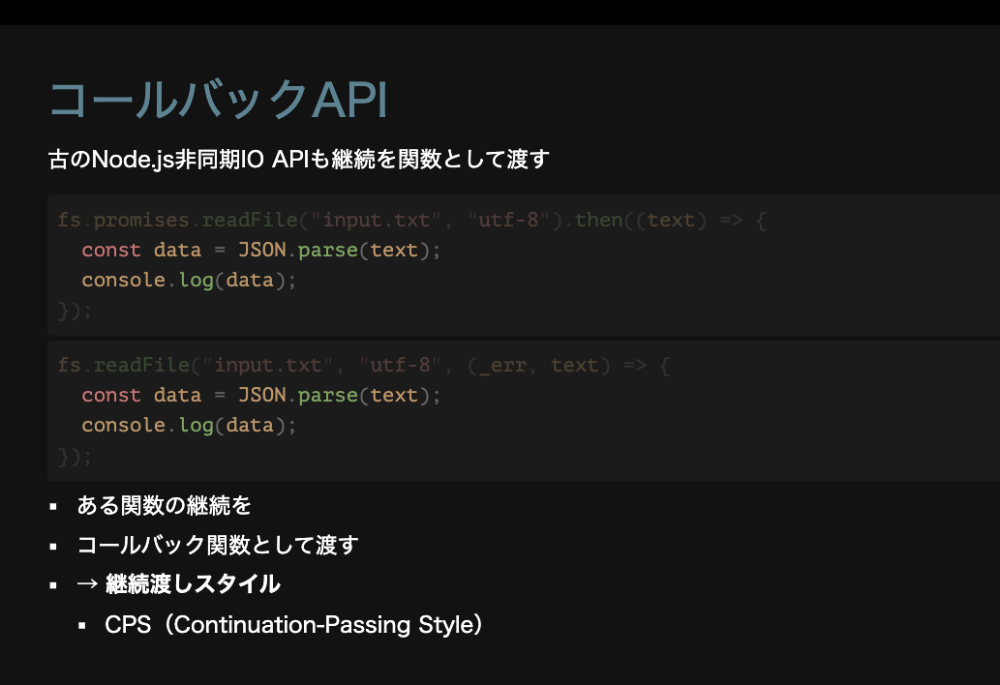<figcaption>継続渡しスタイル</figcaption></figure>

direct style

{% linkcard "https://ja.wikipedia.org/wiki/%E7%B6%99%E7%B6%9A%E6%B8%A1%E3%81%97%E3%82%B9%E3%82%BF%E3%82%A4%E3%83%AB#:~:text=%E7%B6%99%E7%B6%9A%E6%B8%A1%E3%81%97%E3%82%B9%E3%82%BF%E3%82%A4%E3%83%AB%20(CPS%3A%20Continuation,%E8%AB%96%E6%96%87%E3%81%AB%E3%81%8A%E3%81%84%E3%81%A6%E5%B0%8E%E5%85%A5%E3%81%95%E3%82%8C%E3%81%9F%E3%80%82" %}

コールバック地獄→逐次実行のためにネストが必要

<figure>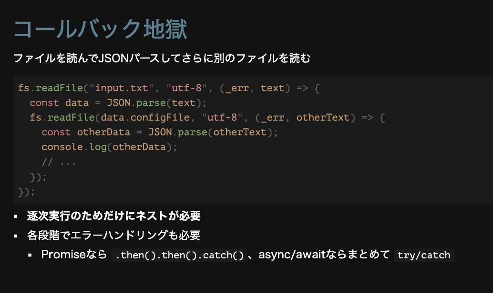<figcaption>コールバック地獄</figcaption></figure>

thenと似た動きをする→Option Rustには組み込まれているらしい

抽象化！！！

右から真ん中に持っていく関数　真ん中から左に持っていく関数をつなげて1つにまとめること モナド？？？

<figure>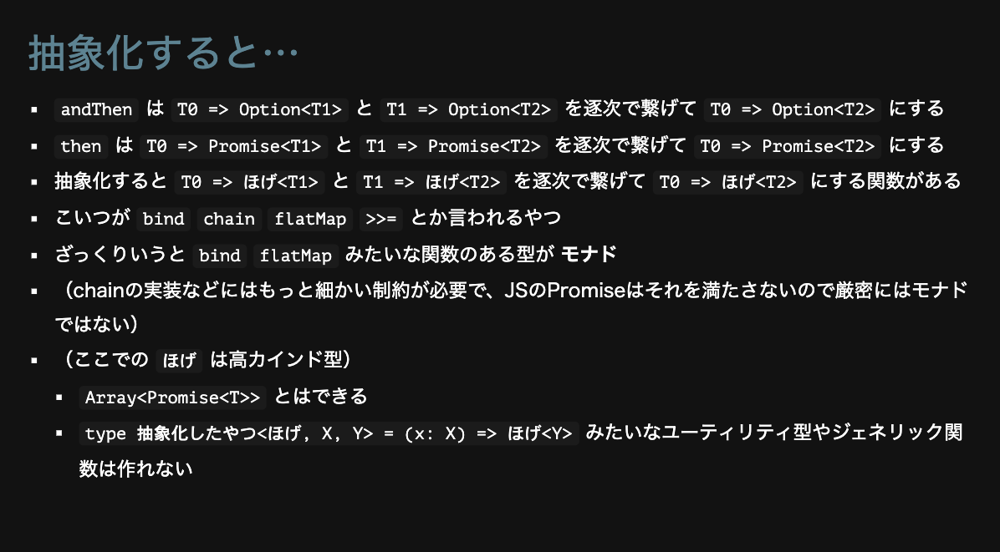<figcaption>抽象化すると・・・</figcaption></figure>

型を見ればどんな動きをする関数なのか、型を見ればわかるのは嬉しい  
静的検査でわかるようにもなる

<figure>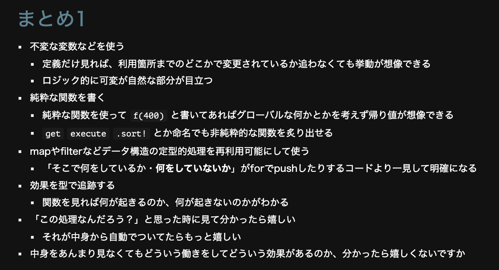<figcaption>まとめ</figcaption></figure>

## 業務に残された「よくない型」で考える「TypeScriptの難しさ」

> 改めて、今回TSkaigi2026で発表したスライドです！  
>
> タイトル : 『業務に残された「よくない型」で考える「TypeScriptの難しさ」』[https://t.co/N1xm6V70SA](https://t.co/N1xm6V70SA)[#TSKaigi2026](https://twitter.com/hashtag/TSKaigi2026?src=hash&ref_src=twsrc%5Etfw) [#tskaigi\_leverages](https://twitter.com/hashtag/tskaigi_leverages?src=hash&ref_src=twsrc%5Etfw)

— Saji (@sajikix) [2026年5月22日](https://twitter.com/sajikix/status/2057666191951532127)

<strong>「成功にはパターンがないが、失敗にはパターンがある」</strong>

TSを書いている際によくない型と認識しつつ、時間や制限によって書いてある型が存在すると思います  
確かにそこはTSの難しいところなので、そうなってしまった

> [#TSKaigi](https://twitter.com/hashtag/TSKaigi?src=hash&ref_src=twsrc%5Etfw)  
>
> よくない型を書いちゃったのはそこがTSの難しさなのでは？  
>
> めちゃくちゃわかりやすい  
> たしかにみんなハマるところ同じな気がするし、そこが難しいところ [pic.twitter.com/VlukQRMve8](https://t.co/VlukQRMve8)

— 猫テロのれなっち (@hfslca7439) [2026年5月22日](https://twitter.com/hfslca7439/status/2057656198921703550)

そこを深掘りした場合は、何が難しいかわかる！

> [#TSKaigi](https://twitter.com/hashtag/TSKaigi?src=hash&ref_src=twsrc%5Etfw)  
>
> 真似ができる👀 [pic.twitter.com/PQYvaPmjwm](https://t.co/PQYvaPmjwm)

— 猫テロのれなっち (@hfslca7439) [2026年5月22日](https://twitter.com/hfslca7439/status/2057656859335790775)

自分のコードでも探してみよう！

> [#TSKaigi](https://twitter.com/hashtag/TSKaigi?src=hash&ref_src=twsrc%5Etfw)  
>
> あ〜…  
> 書いてた気がする…調べよう [pic.twitter.com/XAhDisnHJY](https://t.co/XAhDisnHJY)

— 猫テロのれなっち (@hfslca7439) [2026年5月22日](https://twitter.com/hfslca7439/status/2057657806464098688)

早めに、探してみよう(泣)

> [#TSKaigi](https://twitter.com/hashtag/TSKaigi?src=hash&ref_src=twsrc%5Etfw)  
>
> パターン1は  
> 頑張れば安全にできる！ [pic.twitter.com/YHkndCt07c](https://t.co/YHkndCt07c)

— 猫テロのれなっち (@hfslca7439) [2026年5月22日](https://twitter.com/hfslca7439/status/2057658063663087775)

探して見つけたら、対応できるぞっ！！！

> [#TSKaigi](https://twitter.com/hashtag/TSKaigi?src=hash&ref_src=twsrc%5Etfw)  
>
> Array系いつも型で止まる  
>
> 少しずつ推論してくれるように改善されてるんだ！  
>
> 自作ヘルパーや型ガードで安全性を保証 [pic.twitter.com/S3baabJOE1](https://t.co/S3baabJOE1)

— 猫テロのれなっち (@hfslca7439) [2026年5月22日](https://twitter.com/hfslca7439/status/2057659164932161553)

ここら辺からTSの今後の改善待機勢になる

> [#TSKaigi](https://twitter.com/hashtag/TSKaigi?src=hash&ref_src=twsrc%5Etfw)  
>
> 構築仕切ることで避けること可能 [pic.twitter.com/hpsO51e9xe](https://t.co/hpsO51e9xe)

— 猫テロのれなっち (@hfslca7439) [2026年5月22日](https://twitter.com/hfslca7439/status/2057659747781029895)

> [#TSKaigi](https://twitter.com/hashtag/TSKaigi?src=hash&ref_src=twsrc%5Etfw)  
>
> 今後に期待 [pic.twitter.com/XLyDOpJuX8](https://t.co/XLyDOpJuX8)

— 猫テロのれなっち (@hfslca7439) [2026年5月22日](https://twitter.com/hfslca7439/status/2057661187421286795)

> [#TSKaigi](https://twitter.com/hashtag/TSKaigi?src=hash&ref_src=twsrc%5Etfw)  
>
> いつも進化してくれてありがとう！  
>
> 外部由来の押し戻せないものはないのか！  
> 見ると頑張れば安全性を保証できるコードにできる！ [pic.twitter.com/WSWaPvKU8V](https://t.co/WSWaPvKU8V)

— 猫テロのれなっち (@hfslca7439) [2026年5月22日](https://twitter.com/hfslca7439/status/2057661878118297734)

> 使っていきたいですね✨️ [pic.twitter.com/lBPGkZtrF6](https://t.co/lBPGkZtrF6)

— 猫テロのれなっち (@hfslca7439) [2026年5月22日](https://twitter.com/hfslca7439/status/2057662864580882494)

すぐに自分も対処できることを教わりました！  
ご「型」安全なシステムを作りたいぜぃ

## ハンズオン

> ハンズオン教材がなんとか整いました（半分くらい [#TSKaigi](https://twitter.com/hashtag/TSKaigi?src=hash&ref_src=twsrc%5Etfw) [#TSKaigi2026](https://twitter.com/hashtag/TSKaigi2026?src=hash&ref_src=twsrc%5Etfw)  
> ご参加の方、楽しく一緒に手触りを確認していきましょう  
> connpassの参加は締め切っていますが、後ろの方にしれっと座って聞くこともできると思います  
> 13時40分〜 RightTouchトラックでお待ちしてます [pic.twitter.com/CLjX6IS3aJ](https://t.co/CLjX6IS3aJ)

— berlysia💭❤️‍🔥 (@berlysia) [2026年5月22日](https://twitter.com/berlysia/status/2057654978177822723)

とてもわかりやすい資料ありがとうございます！  
お話を聞きながら、資料の問題をハンズオンする形式でした  
参加者の8割は型エラーが怖いひとだった様子・・・型エラー怖い勢にも優しいTsKaigi・・・🙏

> [#TSKaigi2026](https://twitter.com/hashtag/TSKaigi2026?src=hash&ref_src=twsrc%5Etfw)  
>
> 型エラー怖い人です…  
> よろしくお願いします🙏 [pic.twitter.com/5nm1RLWQn7](https://t.co/5nm1RLWQn7)

— 猫テロのれなっち (@hfslca7439) [2026年5月22日](https://twitter.com/hfslca7439/status/2057684618535735748)

<strong>「エラーが出ることうれしい！」</strong>  
この概念知っているな？  
アプリ作成時にエラーでない不具合めっちゃ探すのも治すのも大変  
型エラーが意図しない形に出ない場合、どこで落ちたり、意図しない挙動になるかわからない・・・  
確かに出てくれる方が嬉しいは共通している

> [#TSKaigi2026](https://twitter.com/hashtag/TSKaigi2026?src=hash&ref_src=twsrc%5Etfw)  
>
> うまく型を表現する…  
>
> エラーが出ることは嬉しい（この概念知ってるなぁ…） [pic.twitter.com/N8kYUZv8Vx](https://t.co/N8kYUZv8Vx)

— 猫テロのれなっち (@hfslca7439) [2026年5月22日](https://twitter.com/hfslca7439/status/2057685227980661017)

> [#TSKaigi2026](https://twitter.com/hashtag/TSKaigi2026?src=hash&ref_src=twsrc%5Etfw)  
>
> ありがたい〜 [pic.twitter.com/y1GsLfDkb5](https://t.co/y1GsLfDkb5)

— 猫テロのれなっち (@hfslca7439) [2026年5月22日](https://twitter.com/hfslca7439/status/2057686009614331947)

最初は、union型の説明。  
Stringは、型的に広い→狭めるためにunion型を使うことがある程度の知識だった。

<strong>値の集合</strong>

最初に理解する概念だし、わかった気になっていた(実務で使用もしている)

例のコードを埋める形でstringではなく、取りうる値が決まった集合としてTSに認識させる(私も再認識する)

再認識やコードのエラー文・挙動を確認しながらTSの型を理解しました

基礎となところから丁寧に講義していただきました！

> TSKaigi 2026 TypeScript型推論ハンズオン：手を動かしてつかむ型の効きどころ [https://t.co/q5HaeaYcVw](https://t.co/q5HaeaYcVw) [#TSKaigi](https://twitter.com/hashtag/TSKaigi?src=hash&ref_src=twsrc%5Etfw)  
>
> 参戦！！！！！

— 猫テロのれなっち (@hfslca7439) [2026年5月22日](https://twitter.com/hfslca7439/status/2057683980015808583)

> 型を拡大することをWidening  
> 型を絞り込むことをNarrowing

— とぴ (@topi_log) [2026年5月22日](https://twitter.com/topi_log/status/2057708033325830598)

完全に理解した！！！

## TypeScriptだけでAIエージェントを作る ― フロント・エージェント・インフラのフルスタック実践



> [#TSKaigi](https://twitter.com/hashtag/TSKaigi?src=hash&ref_src=twsrc%5Etfw) [pic.twitter.com/3WYSTGXxte](https://t.co/3WYSTGXxte)

— 猫テロのれなっち (@hfslca7439) [2026年5月22日](https://twitter.com/hfslca7439/status/2057716309417472013)

> [#TSKaigi](https://twitter.com/hashtag/TSKaigi?src=hash&ref_src=twsrc%5Etfw)  
>
> お世話になっております。  
> CDK [pic.twitter.com/WQDV0FR0n1](https://t.co/WQDV0FR0n1)

— 猫テロのれなっち (@hfslca7439) [2026年5月22日](https://twitter.com/hfslca7439/status/2057718295508455530)

本当にCDK様様です

> [#TSKaigi](https://twitter.com/hashtag/TSKaigi?src=hash&ref_src=twsrc%5Etfw)  
>
> フロントはフロント  
> バックはバック  
> インフラはインフラ  
>
> たしかに、別々に書いてるし認識しながら書いてる…  
> この構成だからなのか！ [pic.twitter.com/9dEKrWa1TS](https://t.co/9dEKrWa1TS)

— 猫テロのれなっち (@hfslca7439) [2026年5月22日](https://twitter.com/hfslca7439/status/2057719368767995914)

仕事で使用中の構成  
これがデフォルトかと思ってた(自分的にはそうなので)  
最近は慣れたけど、ちゃんと分けるのが最初難しかった〜

> [#TSKaigi](https://twitter.com/hashtag/TSKaigi?src=hash&ref_src=twsrc%5Etfw)  
>
> こっち気になる  
>
> 楽なのか  
> 好きなのか [pic.twitter.com/C4Q68sPBSR](https://t.co/C4Q68sPBSR)

— 猫テロのれなっち (@hfslca7439) [2026年5月22日](https://twitter.com/hfslca7439/status/2057719704668815622)

TypeScriptとAWSを使った時の構築方法を知ることができた！  
仕事以外の構築方法にまだ手が伸びていなかったのでにっこり

> [#TSKaigi](https://twitter.com/hashtag/TSKaigi?src=hash&ref_src=twsrc%5Etfw)  
>
> 構築方法いっぱい知れてニッコリ [pic.twitter.com/dfyXIOQkQN](https://t.co/dfyXIOQkQN)

— 猫テロのれなっち (@hfslca7439) [2026年5月22日](https://twitter.com/hfslca7439/status/2057720203010797934)

> [#TSKaigi](https://twitter.com/hashtag/TSKaigi?src=hash&ref_src=twsrc%5Etfw)  
>
> ストリーミングできるんだ！  
> タイムアウトが短い認識してた！  
>
> あの時間で足りるんだ！ [pic.twitter.com/n00y2s2jMf](https://t.co/n00y2s2jMf)

— 猫テロのれなっち (@hfslca7439) [2026年5月22日](https://twitter.com/hfslca7439/status/2057720602287653153)

これ知らなかった・・・  
Lambdaのタイムアウトで引っかかると思い込んでて調べたことなかったな・・・

> [#tskaigi](https://twitter.com/hashtag/tskaigi?src=hash&ref_src=twsrc%5Etfw)  
>
> 人間側が読めるかどうかも重要  
>
> 抽象化してくれてるから読みやすい [pic.twitter.com/3DLVhZ9jn7](https://t.co/3DLVhZ9jn7)

— 猫テロのれなっち (@hfslca7439) [2026年5月22日](https://twitter.com/hfslca7439/status/2057722948287696978)

長く出力されるだけで読みたくなくなるもんなぁ

エージェントも4つ紹介があった・・・

<strong>このまま、遊びでAIエージェント作成できそう？</strong>ってぐらい網羅的なセッションでした！

## TS 7: How We Got There



型には仕様がないので、それが主な懸念事項でした。

RustとGo・・・等々の言語で迷っておられた。

最終的にGoを選んだのは、TSと構造的に似ていたから

> TypeScript というわりかし変な言語をポートするのに適した十分に高速かつ似てる言語って考えると Go っておもろい[#TSKaigi](https://twitter.com/hashtag/TSKaigi?src=hash&ref_src=twsrc%5Etfw) [#tskaigi\_leverages](https://twitter.com/hashtag/tskaigi_leverages?src=hash&ref_src=twsrc%5Etfw)

— 1984 (@asa_high_ost) [2026年5月22日](https://twitter.com/asa_high_ost/status/2057753596918395381)

ガベージコレクションもあるため、移植がスムーズ

<もう一度見たい>

> マジで大変だったんだからな！ [#TSKaigi](https://twitter.com/hashtag/TSKaigi?src=hash&ref_src=twsrc%5Etfw)

— berlysia💭❤️‍🔥 (@berlysia) [2026年5月22日](https://twitter.com/berlysia/status/2057756316857487652)

こちらは昨年のことですねwww

> Key Note[#TSKaigi](https://twitter.com/hashtag/TSKaigi?src=hash&ref_src=twsrc%5Etfw) [pic.twitter.com/9xnUnJVndE](https://t.co/9xnUnJVndE)

— ora (@sorafujitani) [2026年5月22日](https://twitter.com/sorafujitani/status/2057752316703650061)

### マイタイムテーブル機能が最高

聞きたいセッションをちゃんと調べていくけど、当日にどこに行けばいいかわからなくなっていたので、最高ありがたいです！  
しかも、タイムテーブルにチェックすると、リアルタイムで反映されます。

<figure>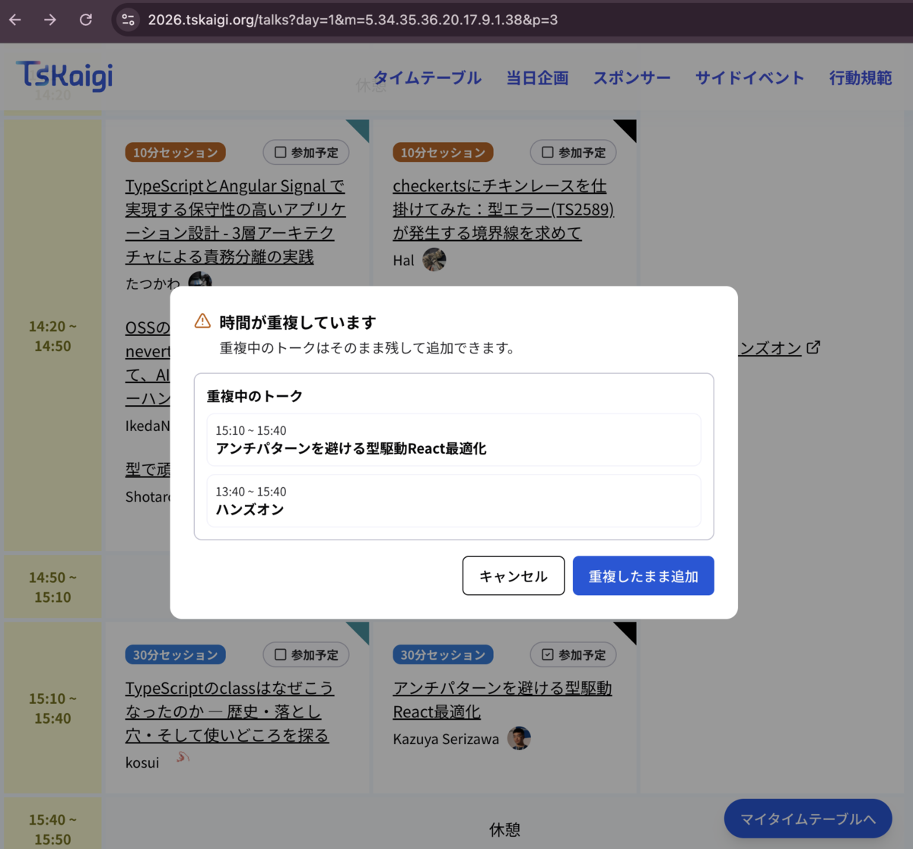<figcaption>これは、ハンズオンと重複した時の悲しみのスクショ</figcaption></figure>

また、セッションが被っていた場合にモーダルを出してくれて何と重複しているか教えてくれる。  
URLも作成してくれるので、友達とタイムテーブルの共有も可能！  
本当にスタッフさんありがとうございます！

> Webサイトに、マイタイムテーブル機能をリリースしました 📅  
>
> 気になるセッションをピックアップして、自分だけのタイムテーブルが作れるようになりました！  
> 👇 さっそく当日の予定を組んでみよう[https://t.co/R767xA9pLf](https://t.co/R767xA9pLf)[#TSKaigi](https://twitter.com/hashtag/TSKaigi?src=hash&ref_src=twsrc%5Etfw) [#TSKaigi2026](https://twitter.com/hashtag/TSKaigi2026?src=hash&ref_src=twsrc%5Etfw)

— TSKaigi (@tskaigi) [2026年5月21日](https://twitter.com/tskaigi/status/2057289110604366016)

### あとで見たいセッション



先輩にoxlintのことを聞いて、興味出た。早いのか・・・早いは正義だからな・・・





\-----
