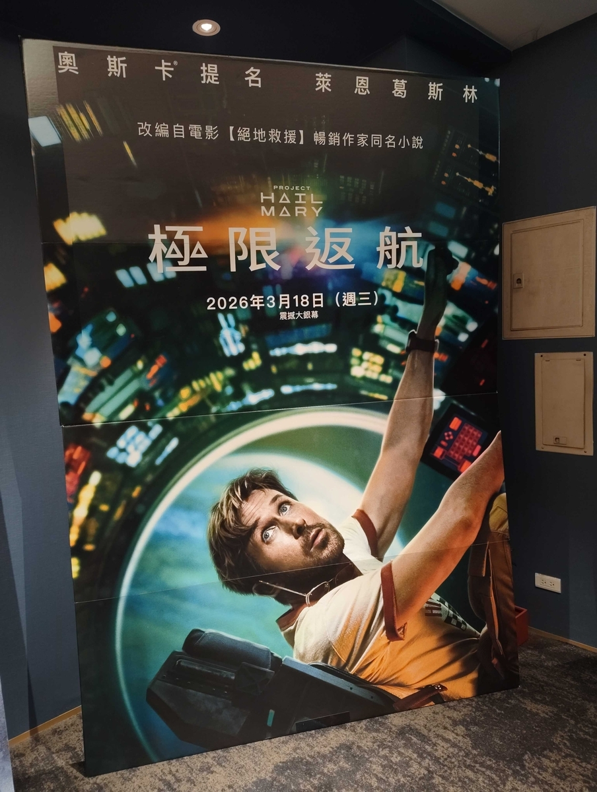

※プロジェクト　ヘイル　メアリーのネタしかありません。見たり読んだりする前にこれを読んでしまうと<strong>終わりです</strong>  
楽しみを全て奪うことになる

<figure><figcaption>台湾に旅行に行った際もオタ活してました</figcaption></figure>



読んでからこのYouTubeも見て欲しい  
あと、買うなら紙の本でお願いしたい・・・テンション上がるから  
紙の本を読め！！！

改ページに場面切り替えがある！  
しかも、ハードカバーと文庫でやっている・・・  
そういうとこ好き  
文庫版下巻のp284が好き

## あらすじを

> 謎の空間で目を覚ました男は、徐々に記憶を取り戻していく。試験管が落ちていくところを見て、重力の違和感を覚え、、、

と、一章がこんな感じです。  
一章でも引き込まれるしかも、冒頭で記憶も戻すし、科学的知識を持っている主人公であることを指し示している。始まりとして良い。最高。好き。  
この本の大部分の説明をしてくれる。

## 2ヶ月前の私へ

映画で気になっていたことを返信していく！

> 日本の参戦ありました？(メアリー宇宙船に日本国旗があった)

あった。  
上巻p47  
日本の太陽観測衛星「アマテラス」(本当にありそうな衛星ですが、フィクションです・調べました)が、ペトロヴェ・ラインを最初に発見します  
映画版ではその話がでませんが日本出てきます！

> アメリカ(？)で爆発した時に巻き込まれている人だれ？

科学者の2人と施設に居た全て  
デュアボとアニー・シャピロの科学者が実験を行っていた。その際の間違った量のアストロファージを使用し、事故になった。

> 地球とグレースの時間ってもしかして差がある？

相対性理論で、13年を4年として体感している  
計算してみたいね！4年ぐらいの速度でないと人間の体にダメージがあるらしい

> なんで、グレースだけ宇宙船で生き残ったの？

ここは深掘りされていない  
知りたい・・・グレースが寝ている時の二人のことも知りたい・・・

> ロッキーの宇宙船に向かった理由がいまいちピンときてないかも？

アストロファージを餌にするタウメーバがキセノナイト製の試験管から抜け出してしまったため  
タウメーバの実験をキセノナイトで行った結果、タウメーバが進化してキセノナイトから抜け出せるようになってしまった。

キセノナイト製の宇宙船に乗っているロッキーの命が危ないことを理解したから

> ロッキーが最初に宇宙船の動き真似したり、ストーキングしていた理由ってなんだろう？

ロッキーも一人ぼっち  
生命体を見つけて、ルンルンだったのでは？と認識  
かわいいね

> グレースは、自分を宇宙船に乗せたメンバーのことを恨んでるの？どんな気持ちだったんだろう？

「地獄に堕ちろ」と作中で言っているし、地球に戻って何か言ってやろうとしている  
が、いい人なので口で言うだけだろうなぁ  
ストラットは、とてもグレースのことを理解している

> グレースは、メアリー宇宙船の死んだメンバーを宇宙になんで放ったんだろう？

こんな形でいいわけがない。埋葬しなければ

という気持ちで、ユニフォームを着せて埋葬した。上巻p122

映画と違い、ちゃんと二人のことを思い出している。

> セタ・パセに釣りに行った際にメアリー宇宙船で行った理由は？

これなんでだ？  
ロッキーが、地球の宇宙船に乗りたくてきちゃったから？

> エリダニアンなにもの？

エリダニ40星系からきたエリダニアン  
良き友になる  
上巻p279

> ロッキーは、六進数の世界の生態 六進数・・・上巻p341  
> 二進数・十進数・十六進数の他に、六進数も覚えたくなる

### これは、なんの物語なのか

科学とは夢とロマンと積み重ねである。  
Magicではなく積み重ねである。  
そして、楽しいものである。

私にとってこの本は、

<strong>科学を勉強する理由を指し示してくれた物語である</strong>

私は、生物学の単位を持っているので、「クエン酸回路」「ミトコンドリア」「グルコース」等々が出た際にテンションも上がるし、他の箇所よりちょっと深く理解できた。  
科学を知っている人が読むとより楽しいだろうなと今思っている。

\-----
