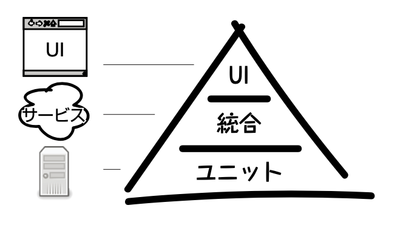

## テスト・・・

テストが大切なことはわかる  
何をテストすればいいかは、なんとなくわかる  
方法も知っている気がする  
でも、なんとなくわかんない

単体テストは、わかりやすい。コンポーネント・関数・１処理単位で入力と出力を書く  
結合テストが、具体的に何を示しているのかわからない。どこからが、結合だ？って、一番最初につまずいた。  
E2Eテストは、めんどくさいので、できればあまりしたくない。最低限はする。でも、それすら信用なくなることがある。

<figure><figcaption>テストピラミッド</figcaption></figure>

よく見るテストピラミッドでも裏付けられている？

### 知識ゼロから学ぶソフトウェアテスト

テストに対して、この本だけだと物足りないですが、一番最初に概念理解するのにおすすめ

「テストってそもそもなに？」  
「なんのために必要なの？」  
って方におすすめです。  
テストについての考え方や種類を教えてくれます。

書き方もフランクで読みやすい！



### 初めての自動テスト

絵本だと思って読み始めるのがおすすめ  
絵が多くてどこのことを言っているのか・なんのテストを書いているのかがわかりやすい。

例で出てくるコードは、Railsのコードのためとっつきやすい

重複が無いか確認し続ける。 一つ確認して対応しても保守しているコードはまた重複が生まれるかもしれないので、重複したらメソッドにまとめる。(DRY原則)

一つのテストにつき、テストする内容は一つ

第2部からが本題だった！  
11章p199からの結合度・テストはどのぐらい書いたらいいのかが書いてある

12章のTDDも話がわかりやすいので初めて読む本にはいい感じかも

## 結合テストは具体的にどんなテストを指しているの？

私的な回答を残しておきます。

<strong>「pageファイル用のテスト！コンポーネントを使う統合ファイル用のテスト」</strong>

何か部品を用意して、それを統合する場所に書くテストを「結合テスト」と言っているイメージを掴んだ。---

\-----
