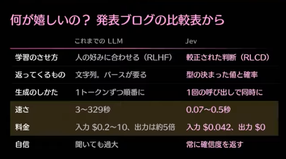
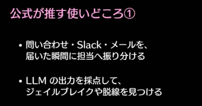
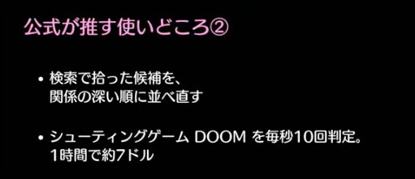



判断特化型  
文字は、一文字も書かない？  
「ファスト＆スロー」！！！！！  
まだ、上巻1/3しか読めてない  
システム１：早くて直感的・人間はこっちで動きがち  
システム２：遅くて論理的・こっちはかなりカロリー使うのであんまり使わない

<figure><figcaption>Jevとの比較</figcaption></figure>

Jevは、安くて早い！  
inputを1回して、Outputも1回する

Outputは重みなのか！

0~1.0での重みで出力する

確信度？振り分けで使う？

<strong>使い所</strong> はい・いいえで答えられるものが中心かと思ったけど、ガードレール的な使い方もできる・リランキング(AI・検索エンジンで情報を並び替える技術)ができる！

<figure><figcaption>1</figcaption></figure>

<figure><figcaption>2</figcaption></figure>

特徴は速さ！

コードのdiffをJevに見せて、変更の危険度をみる

判断の部分のみ・文字通りに読む・文章生成はLLMにやってもらう。

みのるんさん 　→判断モデル



画像分析のAWSのRecognitionの出力値が似てる

ハーネス適用



grill-meで聞かれる問いを<strong>grill-Jev</strong>で判断させる。

ちょっと賢いIF文

\-----
