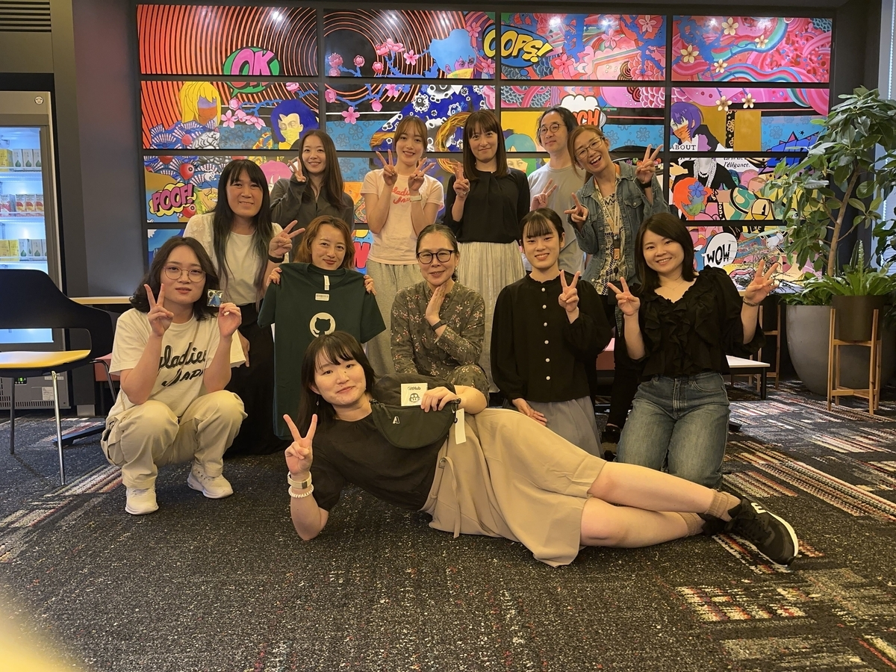
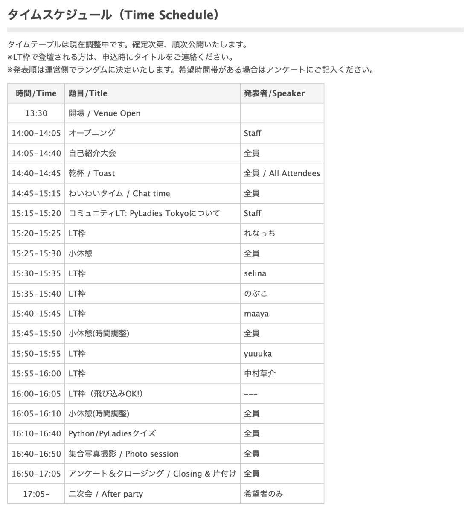
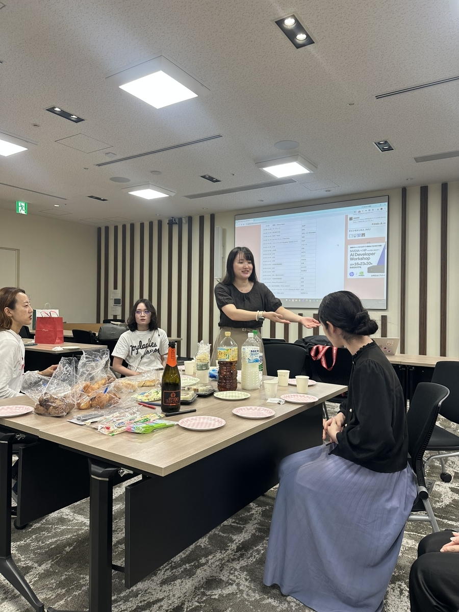
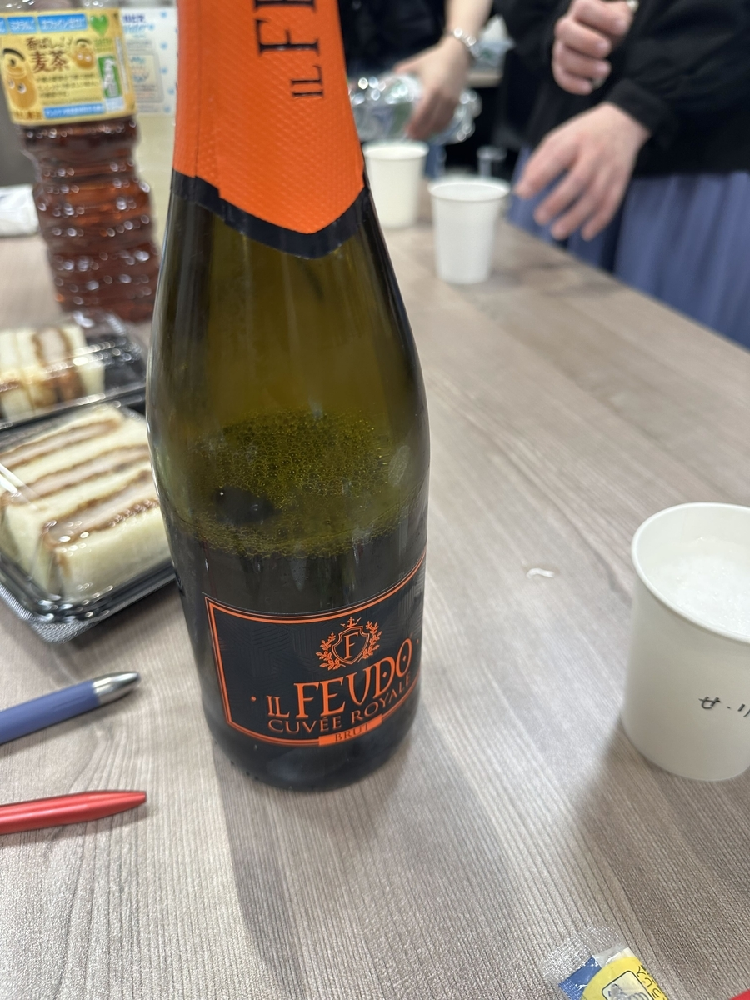

PyLadiesのスタッフをやらせていただいています。れなっちです。  
PyLadiesは12周年を迎えました！  
このコミュニティは12年間、月に一度のMeetUpを続けています。  
本当にすごいですし、お祝いできて嬉しいです！  
おめでとうございます！

<figure><figcaption>集合写真</figcaption></figure>



## イベントの内容

<figure><figcaption>タイムスケジュール</figcaption></figure>

まずは乾杯！

> PyLadies Tokyo12周年記念パーティ/12th Anniversary Party  
> かんぱーい！  
> 始まりました✨  
> お菓子もたくさん！[#pyladiestokyo](https://x.com/hashtag/pyladiestokyo?src=hash&ref_src=twsrc%5Etfw) [pic.twitter.com/XsLJfRyfVc](https://t.co/XsLJfRyfVc)

— PyLadiesTokyo (@PyLadiesTokyo) [2026年10月18日](https://x.com/PyLadiesTokyo/status/2111691029351137327)

自己紹介をして、わいわいおしゃべりタイム！

<figure><figcaption>自己紹介</figcaption></figure>

お酒も飲みつつ、Pythonやエンジニアリング、近況などをざっくばらんにお話ししていました。

<figure><figcaption>スパークリングワイン</figcaption></figure>

お祝いといえばケーキです！  
今回は、Findyさんの「コミュニティ応援企画」からいただきました！

> みんなに支えられて祝🎊12周年記念✨  
> ケーキ🎂を準備しましたー！[#pyladiestokyo](https://x.com/hashtag/pyladiestokyo?src=hash&ref_src=twsrc%5Etfw) [#pyladies](https://x.com/hashtag/pyladies?src=hash&ref_src=twsrc%5Etfw) [pic.twitter.com/FFQMUo3VrJ](https://t.co/FFQMUo3VrJ)

— PyLadiesTokyo (@PyLadiesTokyo) [2026年10月18日](https://x.com/PyLadiesTokyo/status/2111693816206098614)

PyLadiesスタッフの記事もぜひ見てください



コミュニティLT！  
日本国内のPyLadiseが増えています！コミュニティも2026年に2つ増えました！

> コミュニティLT始まりました！  
> 日本国内のPyLadiesも増えてきました！[#pyladiestokyo](https://x.com/hashtag/pyladiestokyo?src=hash&ref_src=twsrc%5Etfw) [pic.twitter.com/768mHrGHNH](https://t.co/768mHrGHNH)

— PyLadiesTokyo (@PyLadiesTokyo) [2026年10月18日](https://x.com/PyLadiesTokyo/status/2111700956425646443)

私のLT  
動的型付け言語を久々に触り戸惑いを感じて、型安全に実装を行う方法を探し始めた話をしました！

> LT始まりました✨  
> 「フロントエンドエンジニアがPythonやキャッチアップ時に戸惑ったこと」れなっちさん[@hfslca7439](https://x.com/hfslca7439?ref_src=twsrc%5Etfw) [pic.twitter.com/2fR8oXS8Vo](https://t.co/2fR8oXS8Vo)

— PyLadiesTokyo (@PyLadiesTokyo) [2026年10月18日](https://x.com/PyLadiesTokyo/status/2111701769776713732)

selinaさんのLT  
「PyCon JP 2026の参加体験と次のコミュニティ参加について！」PyCon参加の際の車旅行の話もお話ししてくださりました！

> LT2回目！  
> PyCon JP 2026の参加体験と次のコミュニティ参加について！[@selina787b](https://x.com/selina787b?ref_src=twsrc%5Etfw) [#PyLadiesTokyo](https://x.com/hashtag/PyLadiesTokyo?src=hash&ref_src=twsrc%5Etfw) [pic.twitter.com/bL9ycl0Nsx](https://t.co/bL9ycl0Nsx)

— PyLadiesTokyo (@PyLadiesTokyo) [2026年10月18日](https://x.com/PyLadiesTokyo/status/2111707307587612923)

のぶこさんのLT  
「AIどうやってつかってますか？」現在AIを使用した開発を行っているとのこと、その時の話をお話ししてくださりました！

> LT3回目！  
> 「AIどうやってつかってますか？」  
> のぶこさんの発表です♪[#PyLadiesTokyo](https://x.com/hashtag/PyLadiesTokyo?src=hash&ref_src=twsrc%5Etfw) [pic.twitter.com/wpaMZfvqfI](https://t.co/wpaMZfvqfI)

— PyLadiesTokyo (@PyLadiesTokyo) [2026年10月18日](https://x.com/PyLadiesTokyo/status/2111708079855378938)

まーやさんのLT  
「ダイブログを「使えるデータ」にする」ダイビングの際に水深や経度緯度をログとして残していおられるとのこと、それを見やすい形にされた時の話をしてくださりました。

> 次のLT✨  
> ダイブログを「使えるデータ」にする  
> です！[#PyLadiesTokyo](https://x.com/hashtag/PyLadiesTokyo?src=hash&ref_src=twsrc%5Etfw) [@maaya8585](https://x.com/maaya8585?ref_src=twsrc%5Etfw) [pic.twitter.com/fAfrYwVg8Z](https://t.co/fAfrYwVg8Z)

— PyLadiesTokyo (@PyLadiesTokyo) [2026年10月18日](https://x.com/PyLadiesTokyo/status/2111710084187435296)

yuuukaちゃんのLT  
「個人タスクアプリを作った話」個人タスクアプリを作って、使用した時の使用感や改善点・追加実装の話をお話ししてくださりました！

> 続いて、[@yuuun5124](https://x.com/yuuun5124?ref_src=twsrc%5Etfw) さん！  
> 個人タスクアプリを作った話  
> です♪[#PyLadiesTokyo](https://x.com/hashtag/PyLadiesTokyo?src=hash&ref_src=twsrc%5Etfw) [pic.twitter.com/m93EYv4uga](https://t.co/m93EYv4uga)

— PyLadiesTokyo (@PyLadiesTokyo) [2026年10月18日](https://x.com/PyLadiesTokyo/status/2111712188310458435)

中村さんのLT  
「MEMORY VIEWSについて」ライブラリやビックデータの操作の際に使用されているPythonに元々入っている機能のMEMORY VIEWSの話をお話ししてくださりました！

> 続いてのLT！  
> MEMORY VIEWSについて[@nakamurasousuke](https://x.com/nakamurasousuke?ref_src=twsrc%5Etfw) さん！  
> （年に一度、Anyversaryイベントでは男性の方も参加できます！）[#PyLadiesTokyo](https://x.com/hashtag/PyLadiesTokyo?src=hash&ref_src=twsrc%5Etfw) [pic.twitter.com/pNMs5SIdXv](https://t.co/pNMs5SIdXv)

— PyLadiesTokyo (@PyLadiesTokyo) [2026年10月18日](https://x.com/PyLadiesTokyo/status/2111714213391745493)

追加でまーやさんがSREのお話をしてくださりました！  
SREについて記事↓

{% linkcard "https://hotchpotchj37.wordpress.com/2026/09/25/azure-sre-agent-%e3%81%8b%e3%82%89-azure-sre-agent-%e3%82%92%e5%91%bc%e3%81%b6%e3%81%a8%e3%81%8d%e3%81%ab%e8%aa%8d%e8%a8%bc%e3%82%a8%e3%83%a9%e3%83%bc%e3%81%ab%e3%81%aa%e3%82%8b%e4%bb%b6/" %}

クイズ大会

> クイズ大会始まります！  
> 豪華景品もありますよー。[#PyLadiesTokyo](https://x.com/hashtag/PyLadiesTokyo?src=hash&ref_src=twsrc%5Etfw) [pic.twitter.com/Rh32FlTO29](https://t.co/Rh32FlTO29)

— PyLadiesTokyo (@PyLadiesTokyo) [2026年10月18日](https://x.com/PyLadiesTokyo/status/2111719049466147289)

PyLadise・Python3.15・まーやさんクイズが出ました！

LT会やクイズ大会ででたライブラリや考え方を参考に今困っていること話したり、今行っている研究をよりよくするための参考になるものの話を聞いたりしていました。為になる話が多く参考にさせていただきます！

> 皆さん、参加ありがとうございました！  
> 記念の集合写真📸とクイズ大会の授賞者です！  
> 会場スポンサー、Microsoftさんありがとうございます♪[#pyladiestokyo](https://x.com/hashtag/pyladiestokyo?src=hash&ref_src=twsrc%5Etfw) [pic.twitter.com/7A2wSKtgEB](https://t.co/7A2wSKtgEB)

— PyLadiesTokyo (@PyLadiesTokyo) [2026年10月18日](https://x.com/PyLadiesTokyo/status/2111727735123169638)

## 宣伝

次回は、2026/11/28 Python3.15研究会を行うます！  
connpassを近日中に公開いたします。ご興味が出た方はぜひご参加ください。

\-----
